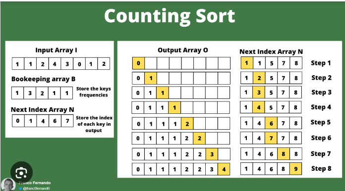

# [From Counting Sort To Optimization 100% + Tutorial] Sort Colors

**Author:** never_get_piped
**Votes:** 27
**Link:** [https://leetcode.com/problems/sort-colors/solutions/5298439/](https://leetcode.com/problems/sort-colors/solutions/5298439/)

---

**Topic** :  Sort

This problem involves sorting an input array directly, a task that can be solved using any traditional sorting algorithm. 

I'll introduce **Counting Sort** additionaly, a highly efficient sorting algorithm, which was featured in a recent daily challenge. Please check : 
* [Height Checker](https://leetcode.com/problems/height-checker/discuss/5287146/built-sort-vs-counting-sort-height-checker)
* [Relative Sort Array](https://leetcode.com/problems/relative-sort-array/discuss/5292311/built-sort-vs-counting-sort-relative-sort-array)

Due to input constraints, we'll explore optimizing from **Counting Sort** to a **Two Pointer Swap** approach.
___

## Language Built Sort
As the problem requires sorting the array, any sorting algorithm found online can be used. Here, I may opt for the language's built-in sorting function. 

**If your boss ask you to : "You must solve this problem without using the library's sort function", ask him/she to pip you and get the pip package.**

<iframe src="https://leetcode.com/playground/RL39GWkm/shared" frameBorder="0" width="600" height="300"></iframe>

**Complexity**:
* Time Complexity : `O(nlogn)`
* Space Complexity : `O(1)`
___
## Counting Sort
Counting sort is an integer sorting algorithm used in computer science to collect objects according to keys that are small positive integers. It works by determining the positions of each key value in the output sequence by counting the number of objects with distinct key values and applying prefix sum to those counts. (Google Search

We first use an array with size 3 to count the frequence of each element. For `0 <= i <= 2`, we put `i` `count[i]` tims in order.

<iframe src="https://leetcode.com/playground/LNcmWFGn/shared" frameBorder="0" width="600" height="300"></iframe>

**Complexity**:
* Time Complexity : `O(max(n, 3))`
* Space Complexity : `O(max(arr1[i]))`

## Optimization 
Given that we have only three distinct elements at most, it's evident that the smallest element will invariably occupy the first index, while the largest element will inevitably be positioned at the last index. 

Dividing our final array into three segments, we distinguish them as the smallest segment, the middle segment, and the largest segment. Employing swaps, we relocate the smallest elements to the first segment and the largest elements to the last segment, ensuring the middle segment remains unchanged. **This holds true when the number of distinct elements is less than 3**.

This swapping approach may reduce the need for additional counting variables, thereby improving the space complexity to **O(1)**. We can use while loop to achieve 1-pass.

<iframe src="https://leetcode.com/playground/YgBLMbFm/shared" frameBorder="0" width="600" height="300"></iframe>

**Complexity**:
* Time Complexity : `O(n)`
* Space Complexity : `O(1)`

**Feel free to leave a comment if something is confusing, or if you have any suggestions on how I can improve the post.**