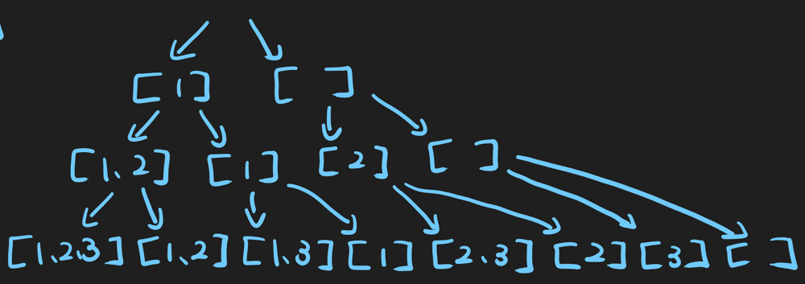

# 【Video】We have two choices for each number

**Author:** niits
**Votes:** 200
**Link:** [https://leetcode.com/problems/subsets/solutions/5525998/](https://leetcode.com/problems/subsets/solutions/5525998/)

---

# Intuition
We have two choices for each number.

---

# Solution Video

https://youtu.be/3JWtSMlq0Sw

### \u2B50\uFE0F\u2B50\uFE0F Don't forget to subscribe to my channel! \u2B50\uFE0F\u2B50\uFE0F

**\u25A0 Subscribe URL**
http://www.youtube.com/channel/UC9RMNwYTL3SXCP6ShLWVFww?sub_confirmation=1

Subscribers: 4,657
Thank you for your support!

---

# Approach

To create subsets, point is that we have two choices for each number.

---
\u2B50\uFE0F Points

- Include current number
- Not include current number

---

This picture is an example with input array `[1,2,3]`




First of all, we have two choices for `1`. We can create two subsets.
```
[1] or []
```
Next, we have two choices for `2`. We need to think about each pattern (= `[1] or []`).

For `[1]` case, we can create subsets

```
[1,2] or [1]

[1,2] is including 2 
[1] is not including 2 
```
For `[]` case, we can create subsets
```
[2] or []

[2] is including 2 
[] is not including 2 
```
We have 4 subsets so far.

```
[1,2], [1], [2], []
```
We do the same thing about `3` with all the 4 patterns above. In the end, we can create and return

```
For [1,2],
[1,2,3]
[1,2]

For [1],
[1,3]
[1]

For [2],
[2,3]
[2]

For [],
[3]
[]
```


---

https://youtu.be/bU_dXCOWHls

---

# Complexity
- Time complexity: $$O(2^n)$$
`n` is number of elements in the input array. We have two choices for each number. For examples, length of input array is `3(= n)`, output should be `2 * 2 * 2 = 8 subsets`.

- Space complexity: $$O(2^n)$$
<!-- Add your space complexity here, e.g. $$O(n)$$ -->

```python []
class Solution:
    def subsets(self, nums: List[int]) -> List[List[int]]:
        res = []
        subset = []

        def create_subset(i):
            if i == len(nums):
                res.append(subset[:])
                return
            
            subset.append(nums[i])
            create_subset(i+1)

            subset.pop()
            create_subset(i+1)

        create_subset(0)
        return res
```
```javascript []
var subsets = function(nums) {
    const res = [];
    const subset = [];

    const createSubset = function(i) {
        if (i === nums.length) {
            res.push([...subset]);
            return;
        }

        subset.push(nums[i]);
        createSubset(i + 1);

        subset.pop();
        createSubset(i + 1);
    };

    createSubset(0);
    return res;    
};
```
```java []
class Solution {
    public List<List<Integer>> subsets(int[] nums) {
        List<List<Integer>> res = new ArrayList<>();
        List<Integer> subset = new ArrayList<>();

        createSubset(nums, 0, res, subset);
        return res;        
    }

    private void createSubset(int[] nums, int index, List<List<Integer>> res, List<Integer> subset) {
        if (index == nums.length) {
            res.add(new ArrayList<>(subset));
            return;
        }

        subset.add(nums[index]);
        createSubset(nums, index + 1, res, subset);

        subset.remove(subset.size() - 1);
        createSubset(nums, index + 1, res, subset);
    }    
}
```
```C++ []
class Solution {
public:
    vector<vector<int>> subsets(vector<int>& nums) {
        vector<vector<int>> res;
        vector<int> subset;

        createSubset(nums, 0, res, subset);
        return res;        
    }

    void createSubset(vector<int>& nums, int index, vector<vector<int>>& res, vector<int>& subset) {
        if (index == nums.size()) {
            res.push_back(subset);
            return;
        }

        subset.push_back(nums[index]);
        createSubset(nums, index + 1, res, subset);

        subset.pop_back();
        createSubset(nums, index + 1, res, subset);
    }    
};
```

## Step by Step Algorithm

1. **Initialization**:
   - Initialize an empty list `res` to store the subsets.
   - Initialize an empty list `subset` to temporarily store subsets during recursion.
   ```python
   res = []
   subset = []
   ```

2. **Define Recursive Function**:
   - Define a recursive function `create_subset` that takes an index `i` as its parameter.
   - If the index `i` reaches the length of the input list `nums`, add the current `subset` to the result `res`.
   - Otherwise, for each element in `nums`, include it in the `subset` and recursively call `create_subset` with the next index (`i+1`).
   - After the recursive call, remove the last element from the `subset` to backtrack, and recursively call `create_subset` with the same index (`i+1`).
   ```python
   def create_subset(i):
       if i == len(nums):
           res.append(subset[:])
           return
       
       subset.append(nums[i])
       create_subset(i+1)

       subset.pop()
       create_subset(i+1)
   ```

3. **Initial Function Call**:
   - Call the `create_subset` function with the initial index `0`.
   ```python
   create_subset(0)
   ```

4. **Return Result**:
   - Return the list `res` containing all subsets.
   ```python
   return res
   ```

In summary, this algorithm recursively generates all possible subsets of the input list `nums`, using backtracking to explore all combinations. The subsets are stored in the `res` list and returned as the final result.

---

Thank you for reading my post.


## \u2B50\uFE0F Subscribe URL
http://www.youtube.com/channel/UC9RMNwYTL3SXCP6ShLWVFww?sub_confirmation=1

## \u2B50\uFE0F Twitter
https://twitter.com/CodingNinjaAZ

## My previous video - Reverse Linked List #206

video
https://youtu.be/9TsQmdRAxT8
