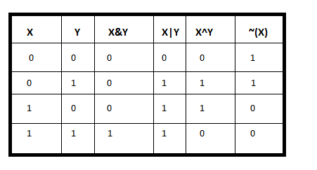

# [Bitmask Tutorial] Subsets

**Author:** never_get_piped
**Votes:** 11
**Link:** [https://leetcode.com/problems/subsets/solutions/5379767/](https://leetcode.com/problems/subsets/solutions/5379767/)

---

**Topic** :  Bitmask
___

### Bitmask:
A bitwise operation is a fundamental operation performed on binary numbers or binary representations of data. It operates on individual bits of the operands, typically integers or binary values, in parallel.. The four critical Bitwise Operations are: **AND**, **OR**, **XOR**, and **NOT**. 
Let\u2019s look at the truth table of the above operations : 

<br/>
Let's also delve into learning a few commonly used bit manipulation techniques. (The following pseudocode is based on Java.)
```
Consider an integer `x` that we are working with.

* Checking if the i-th bit is set:
	if((x & (1 << i)) > 0)
* Flipping the i-th bit:
   x ^= (1 << i)
```

## Solution
The power set is a set which includes **all the subsets** including the empty set and the original set itself. It is usually denoted by **P**. A subset of **S** is any collection of elements that are contained within **S**.

**Example**:
```
Suppose S = {1, 2, 3}, the power set P of S is
[[],[1],[2],[1,2],[3],[1,3],[2,3],[1,2,3]]
```

For any subset, it can be represented as either selecting or not selecting each element from the original set 
**S**. For example, the subset [1, 3] can be represented as [select 1, do not select 2, select 3]. 

Since there are only two states\u2014selecting and not selecting\u2014an efficient way to represent subsets is using **Bit**. Each bit, where the number of bits is equal to the number of elements in `S`, represents a single subset. Setting the `i-th` bit indicates that we select the `i-th` element from `S` and include it in the subset.
For example, The subset `[1, 3]` can be represented as `101`.

We can iterate through all possible bit values from `0` to `2^n - 1` to generate each corresponding subset of the set `S`.

<br/>

```c++ []
class Solution {
public:
    vector<vector<int>> subsets(vector<int>& nums) {
        vector<vector<int>> ans;
        for(int st = 0; st < (1 << nums.size()); st++) {
            ans.push_back({});
            for(int i = 0; i < nums.size(); i++) {
                if(st & (1 << i)) {
                    ans.back().push_back(nums[i]);
                }
            }
        }
        return ans;
    }
};
```
```java []
class Solution {
    public List<List<Integer>> subsets(int[] nums) {
        List<List<Integer>> ans = new ArrayList<>();
        int n = nums.length;
        for (int st = 0; st < (1 << n); st++) {
            List<Integer> subset = new ArrayList<>();
            for (int i = 0; i < n; i++) {
                if ((st & (1 << i)) != 0) {
                    subset.add(nums[i]);
                }
            }
            ans.add(subset);
        }
        return ans;
    }
}
```
```python []
class Solution:
    def subsets(self, nums: List[int]) -> List[List[int]]:
        ans = []
        n = len(nums)
        for st in range(1 << n):
            subset = []
            for i in range(n):
                if st & (1 << i):
                    subset.append(nums[i])
            ans.append(subset)
        return ans
```
```Go []
func subsets(nums []int) [][]int {
    var ans [][]int
	n := len(nums)
	for st := 0; st < (1 << n); st++ {
		subset := []int{}
		for i := 0; i < n; i++ {
			if st&(1<<i) != 0 {
				subset = append(subset, nums[i])
			}
		}
		ans = append(ans, subset)
	}
	return ans
}
```
```PHP []
class Solution {

    /**
     * @param Integer[] $nums
     * @return Integer[][]
     */
    function subsets($nums) {
        $ans = [];
        $n = count($nums);
        for ($st = 0; $st < (1 << $n); $st++) {
            $subset = [];
            for ($i = 0; $i < $n; $i++) {
                if (($st & (1 << $i)) != 0) {
                    array_push($subset, $nums[$i]);
                }
            }
            array_push($ans, $subset);
        }
        return $ans;
    }
}
```
```javascript []
/**
 * @param {number[]} nums
 * @return {number[][]}
 */
var subsets = function(nums) {
    let ans = [];
    let n = nums.length;
    for (let st = 0; st < (1 << n); st++) {
        let subset = [];
        for (let i = 0; i < n; i++) {
            if ((st & (1 << i)) !== 0) {
                subset.push(nums[i]);
            }
        }
        ans.push(subset);
    }
    return ans;
};
```

**Complexity**:
* Time Complexity : `O(2 ^ n)`
* Space Complexity : `O(2 ^ n)`
<br/>

**Homework**
* [Letter Case Permutation](https://leetcode.com/problems/letter-case-permutation/?envType=problem-list-v2&envId=m83b1i05)
* [Minimum Number of Flips to Convert Binary Matrix to Zero Matrix](https://leetcode.com/problems/minimum-number-of-flips-to-convert-binary-matrix-to-zero-matrix/?envType=problem-list-v2&envId=m83b1i05)
* [Maximum Number of Achievable Transfer Requests](https://leetcode.com/problems/maximum-number-of-achievable-transfer-requests/?envType=problem-list-v2&envId=m83b1i05)

**Feel free to leave a comment if something is confusing, or if you have any suggestions on how I can improve the post.**