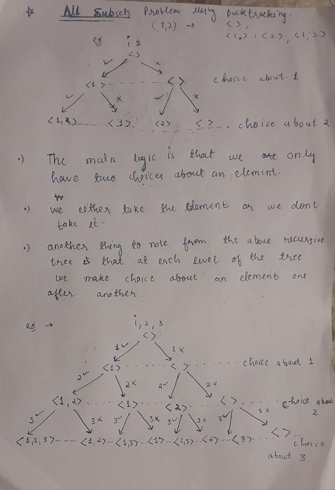

# Beats 100% ✅ | Comprehensive explanation of recursive calls (with Notes) | Backtracking Solution

**Author:** quagmire8
**Votes:** 48
**Link:** [https://leetcode.com/problems/subsets/solutions/4914949/](https://leetcode.com/problems/subsets/solutions/4914949/)

---

# Beats 100%
- This link is proof that this solution beats 100% users with C++
- [Link to LeetCode Submission](https://leetcode.com/problems/subsets/submissions/1211693616)

---


---

# Intuition
## To generate all possible subsets, we can follow a recursive approach:
- For each element, we have two choices: either pick the element or don't pick it.
- At each level of the recursive tree, we make a choice for each subsequent element as we traverse down the tree.
- The recursive tree illustration provided below helps visualize this concept.

## Notes with Recursive Tree (example for {1,2,3})

- The leaf nodes of the recursive tree represent all possible subsets.

---

# Approach
We use a recursive approach to generate all possible subsets:
- Initialize an empty result vector `Ans`.
- Define a helper function `Helper` that takes parameters for the current subset (`op`), the input array (`nums`), and the current index (`startIndex`).
- In the base case, when `startIndex` equals the size of the input array, add the current subset `op` to the result vector `Ans`.
- In the recursive case:
  - Make a choice to include the current element at `startIndex` in the subset and recursively call `Helper` with the updated subset and index.
  - Backtrack by removing the last added element from the subset.
  - Make a choice to exclude the current element at `startIndex` from the subset and recursively call `Helper` with the updated index.

---

# Complexity
- Time complexity: $$O(2^n)$$, where `n` is the number of elements in the input set. Since each element can be either included or excluded, there are `2^n` subsets in total. We are getting all the subsets at leaf nodes of the recursive tree, the total number of leaf nodes are `2^n`
- Space complexity: $$O(2^n)$$, where `n` is the number of elements in the input set. Since we're making recursive calls for each element in the input array, the space complexity mainly depends on the depth of the recursion tree. At each level of recursion, we're maintaining a subset of elements, and at the leaf nodes, we have all possible subsets of the input array.

---

# Code

```cpp []
class Solution {
public:

    vector<vector<int>> Ans;
    int n;
    void Helper(vector<int> &op,vector<int> &nums,int startIndex){

        // base case(s)
        if(startIndex == n){
            Ans.push_back(op);
            return;
        }

        // recurisve case(s)

        // choice 1: you take the current element
        op.push_back(nums[startIndex]);
        Helper(op,nums,startIndex + 1);

        // backtracking step
        op.pop_back();

        // choice 2: you neglect the current element;
        Helper(op,nums,startIndex + 1);
    }

    vector<vector<int>> subsets(vector<int>& nums){
        
        vector<int> op;
        n = nums.size();

        // call the helper function
        Helper(op,nums,0);

        return Ans;
    }
};
```

```java []
class Solution {
    List<List<Integer>> Ans = new ArrayList<>();
    int n;

    public List<List<Integer>> subsets(int[] nums) {
        List<Integer> op = new ArrayList<>();
        n = nums.length;

        // call the helper function
        Helper(op, nums, 0);

        return Ans;
    }

    public void Helper(List<Integer> op, int[] nums, int startIndex) {
        // base case
        if (startIndex == n) {
            Ans.add(new ArrayList<>(op));
            return;
        }

        // recursive case
        // choice 1: include the current element
        op.add(nums[startIndex]);
        Helper(op, nums, startIndex + 1);

        // backtracking step
        op.remove(op.size() - 1);

        // choice 2: exclude the current element
        Helper(op, nums, startIndex + 1);
    }
}

```

```python []
class Solution:
    def subsets(self, nums: List[int]) -> List[List[int]]:
        Ans = []
        n = len(nums)

        # Helper function
        def Helper(op, start_index):
            # base case
            if start_index == n:
                Ans.append(list(op))
                return
            
            # recursive case
            # choice 1: include the current element
            op.append(nums[start_index])
            Helper(op, start_index + 1)
            
            # backtracking step
            op.pop()
            
            # choice 2: exclude the current element
            Helper(op, start_index + 1)
        
        Helper([], 0)
        return Ans
```

```javascript []
/**
 * @param {number[]} nums
 * @return {number[][]}
 */

var subsets = function(nums) {
    const Ans = [];
    const n = nums.length;

    // Helper function
    const Helper = (op, startIdx) => {
        // base case
        if (startIdx === n) {
            Ans.push(op.slice()); // add a copy of op to Ans
            return;
        }

        // recursive case
        // choice 1: include the current element
        op.push(nums[startIdx]);
        Helper(op, startIdx + 1);
        
        // backtracking step
        op.pop();
        
        // choice 2: exclude the current element
        Helper(op, startIdx + 1);
    }

    Helper([], 0);
    return Ans;
};
```


```ruby []
class Solution
    attr_accessor :ans, :n

    def initialize
        @ans = []
    end

    def subsets(nums)
        @n = nums.length
        helper([], nums, 0)
        @ans
    end

    def helper(op, nums, start_index)
        # base case
        if start_index == n
            ans << op.clone
            return
        end

        # recursive case
        # choice 1: include the current element
        op << nums[start_index]
        helper(op, nums, start_index + 1)

        # backtracking step
        op.pop

        # choice 2: exclude the current element
        helper(op, nums, start_index + 1)
    end
end
```


# Dont forget to upvote if you liked the solution, Happy LeetCoding!
---
