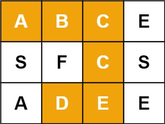

# [79. Word Search](https://leetcode.com/problems/word-search/)

| Category | Difficulty | Likes | Dislikes |
| :------: | :--------: | :---: | :------: |
| Algorithms | Medium | 17352 | 742 |

**Tags:** [`array`](https://leetcode.com/tag/array), [`string`](https://leetcode.com/tag/string), [`backtracking`](https://leetcode.com/tag/backtracking), [`depth-first-search`](https://leetcode.com/tag/depth-first-search), [`matrix`](https://leetcode.com/tag/matrix)

**Companies:** `amazon`, `bloomberg`, `google`, `uber`, `facebook`, `tiktok`, `microsoft`, `faire`, `atlassian`, `oracle`, `cisco`, `epic-systems`, `ibm`, `karat`, `netflix`, `goldman-sachs`, `paypal`, `snapchat`, `apple`, `zoho`, `salesforce`, `grammarly`, `walmart-labs`, `capital-one`, `samsung`, `servicenow`, `citadel`, `visa`, `wix`, `freshworks`

## Description

Given an `m x n` grid of characters `board` and a string `word`, return `true` *if* `word` *exists in the grid*.

The word can be constructed from letters of sequentially adjacent cells, where adjacent cells are horizontally or vertically neighboring. The same letter cell may not be used more than once.

 

**Example 1:**


```

Input: board = [[&quot;A&quot;,&quot;B&quot;,&quot;C&quot;,&quot;E&quot;],[&quot;S&quot;,&quot;F&quot;,&quot;C&quot;,&quot;S&quot;],[&quot;A&quot;,&quot;D&quot;,&quot;E&quot;,&quot;E&quot;]], word = &quot;ABCCED&quot;
Output: true

```

**Example 2:**


```

Input: board = [[&quot;A&quot;,&quot;B&quot;,&quot;C&quot;,&quot;E&quot;],[&quot;S&quot;,&quot;F&quot;,&quot;C&quot;,&quot;S&quot;],[&quot;A&quot;,&quot;D&quot;,&quot;E&quot;,&quot;E&quot;]], word = &quot;SEE&quot;
Output: true

```

**Example 3:**


```

Input: board = [[&quot;A&quot;,&quot;B&quot;,&quot;C&quot;,&quot;E&quot;],[&quot;S&quot;,&quot;F&quot;,&quot;C&quot;,&quot;S&quot;],[&quot;A&quot;,&quot;D&quot;,&quot;E&quot;,&quot;E&quot;]], word = &quot;ABCB&quot;
Output: false

```

 

**Constraints:**

	- `m == board.length`

	- `n = board[i].length`

	- `1 <= m, n <= 6`

	- `1 <= word.length <= 15`

	- `board` and `word` consists of only lowercase and uppercase English letters.

 

**Follow up:** Could you use search pruning to make your solution faster with a larger `board`?

---

**Links:** [Submissions](https://leetcode.com/problems/word-search/) | [Solutions](https://leetcode.com/problems/word-search/)
