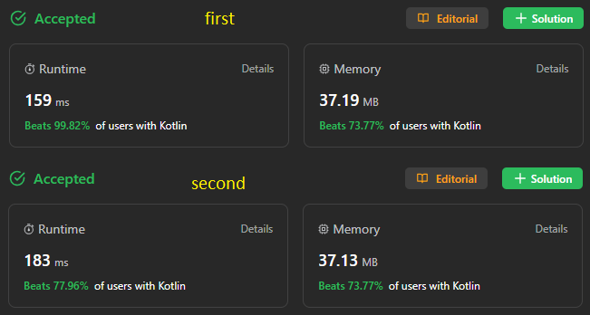

# ✅ 99% 🐕 2 solution || no extra space || fast & clear

**Author:** sunnoca
**Votes:** 9
**Link:** [https://leetcode.com/problems/remove-duplicates-from-sorted-array-ii/solutions/4246936/](https://leetcode.com/problems/remove-duplicates-from-sorted-array-ii/solutions/4246936/)

---

# Please Upvote \uD83D\uDD1D Appreciations!



In this approach, we traverse the array once. We keep track of an index variable indicating where the next distinct element should be positioned. If the current element differs from the element at index - 2, it signifies that we haven't come across this element for the second time, allowing us to add it to the resulting array.
# Code
``` Kotlin []
class Solution {  // first
    fun removeDuplicates(nums: IntArray): Int {
        if (nums.size <= 2) return nums.size

        var slow = 2
        for (fast in 2 until nums.size) {
            if (nums[slow - 2] != nums[fast]) nums[slow++] = nums[fast]
        }

        return slow
    }
}
```
``` Kotlin []
class Solution {  // second
    fun removeDuplicates(nums: IntArray): Int {
        var j = 0
        var num = nums[0]  // nums.length >= 1
        var count = 0

        for (i in nums.indices) {
            if (num == nums[i]) { // repeated number
                count++
                if (count <= 2) nums[j++] = num
            } else { // new number
                num = nums[i]
                nums[j++] = num
                count = 1
            }
        }

        return j
    }
}
```
# Complexity
- Time complexity: **O(n)**
- Space complexity: **O(1)**

