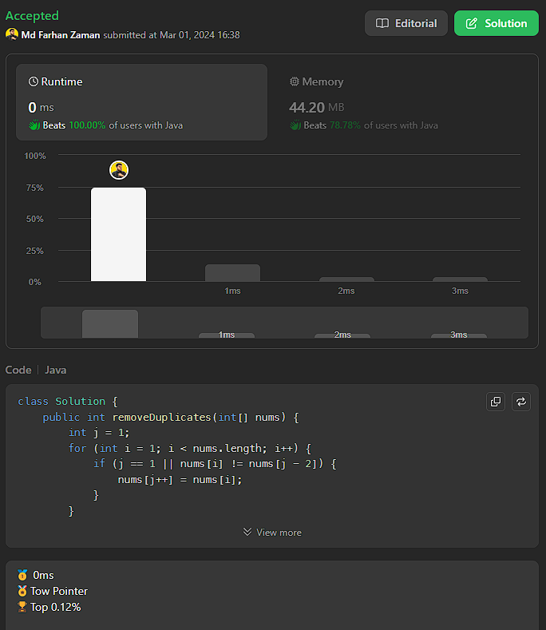

# ✅ Beats 100 %|| 0ms ||🌟Advanced Two-Pointer Approach || Java || C++ || Python || Rust

**Author:** farhanzamanarnob
**Votes:** 235
**Link:** [https://leetcode.com/problems/remove-duplicates-from-sorted-array-ii/solutions/4804983/](https://leetcode.com/problems/remove-duplicates-from-sorted-array-ii/solutions/4804983/)

---

# Intuition
The problem seems to involve removing duplicates from a sorted array, but with a constraint that allows at most two occurrences of each element. The use of a two-pointer approach is hinted by the iteration variable `j` in the code.



# Approach
The approach employs a two-pointer strategy. The variable `j` is used to keep track of the current position in the modified array where elements are being stored without violating the constraint. The loop iterates through the array, and for each element, it checks whether it is the same as the element two positions behind the current `j`. If it is, it means there are already two occurrences of this element in the modified array, and we should skip adding another one to adhere to the constraint. Otherwise, the element is added to the modified array at position `j`, and `j` is incremented.

# Complexity
- Time complexity: $$O(n)$$, where $$n$$ is the length of the input array. The algorithm iterates through the array once.
- Space complexity: $$O(1)$$, as the modification is done in-place without using any additional data structures.

# Explanation of Two-Pointer Approach
The two-pointer approach in this scenario involves using two pointers, `i` and `j`, where `i` iterates through the array, and `j` keeps track of the position where elements satisfying the constraint are being stored.

- **Initialization:** Initialize `j` to 1 since the first element (at index 0) is always considered part of the modified array.
- **Iteration:** Loop through the array starting from index 1 (i.e., `i = 1`). Compare the current element at index `i` with the element two positions behind at index `j - 2`. If they are the same, it means there are already two occurrences of this element in the modified array, so skip adding another. If they are different, add the current element to the modified array at position `j` and increment `j`.
- **Final Result:** The final length of the modified array is equal to `j`, and the modified array contains elements adhering to the constraint.
# Code
```Java []
class Solution {
    public int removeDuplicates(int[] nums) {
        int j = 1;
        for (int i = 1; i < nums.length; i++) {
            if (j == 1 || nums[i] != nums[j - 2]) {
                nums[j++] = nums[i];
            }
        }
        return j;
    }
}
```
```C++ []
class Solution {
public:
    int removeDuplicates(std::vector<int>& nums) {
        int j = 1;
        for (int i = 1; i < nums.size(); i++) {
            if (j == 1 || nums[i] != nums[j - 2]) {
                nums[j++] = nums[i];
            }
        }
        return j;
    }
};
```
```Python []
class Solution:
    def removeDuplicates(self, nums: List[int]) -> int:
        j = 1
        for i in range(1, len(nums)):
            if j == 1 or nums[i] != nums[j - 2]:
                nums[j] = nums[i]
                j += 1
        return j
```
```Rust []
impl Solution {
    pub fn remove_duplicates(nums: &mut Vec<i32>) -> i32 {
        let mut j = 1;
        for i in 1..nums.len() {
            if j == 1 || nums[i] != nums[j - 2] {
                nums[j] = nums[i];
                j += 1;
            }
        }
        j as i32
    }
}

```

