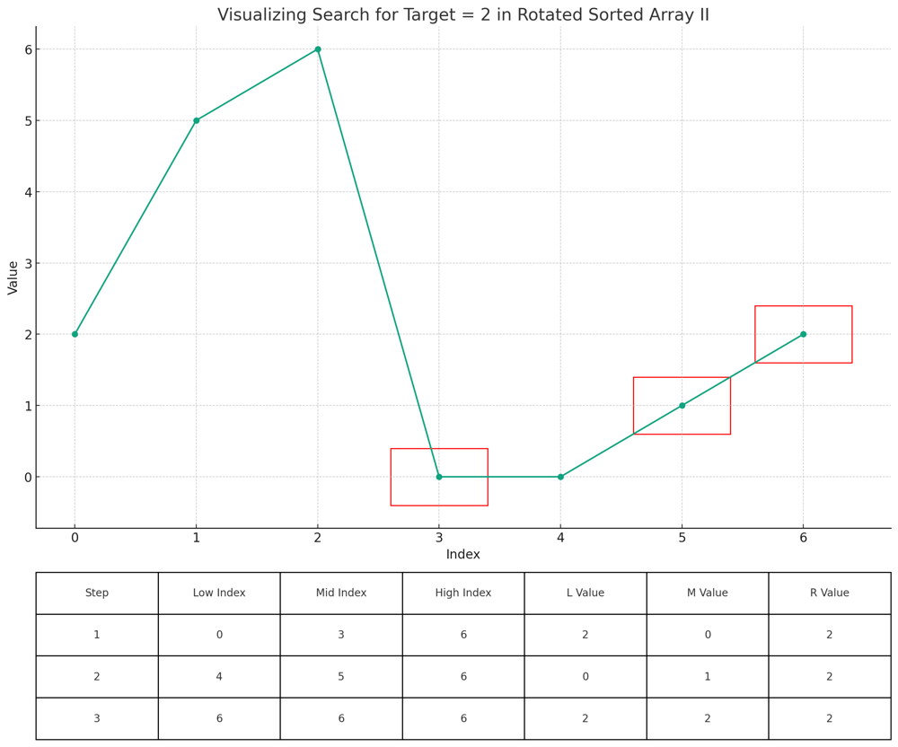
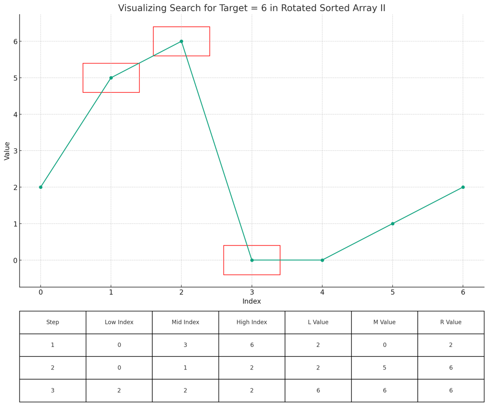
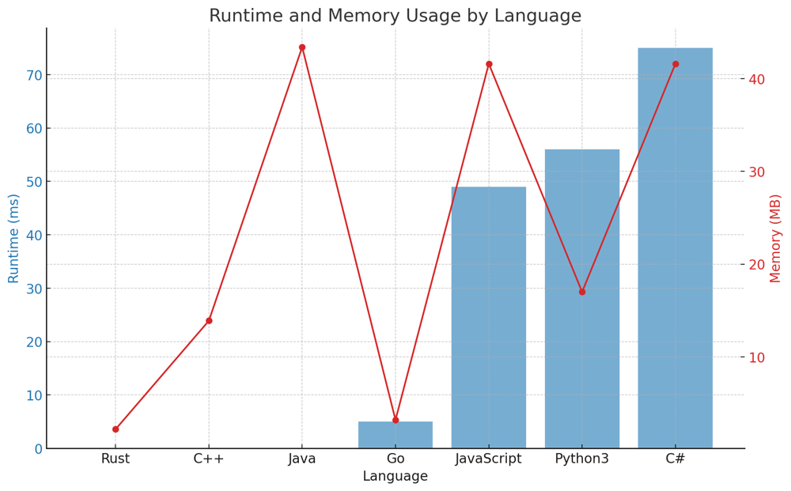

# ✅ 100% Binary Search [VIDEO] with Rotation Handling - Optimal

**Author:** vanAmsen
**Votes:** 93
**Link:** [https://leetcode.com/problems/search-in-rotated-sorted-array-ii/solutions/3888242/](https://leetcode.com/problems/search-in-rotated-sorted-array-ii/solutions/3888242/)

---

# Problem Understanding

The problem presents us with a modified search challenge where we're provided an array that has been rotated at an undetermined pivot. Unlike a standard sorted array, this comes with the added complexity of having been altered. Imagine a scenario where you take a sorted array, make a cut at a specific point, and then attach the detached segment to the front. The aim here is to ascertain whether a specific target value is present in this rearranged sorted array. Adding to the intricacy, this array might have duplicate values.

For instance, considering the array $$[2,5,6,0,0,1,2]$$, it becomes evident that a rotation occurred after the number 6. If our target is 2, it is indeed present within the array. Similarly, for a target of 6, it is also found in the array. However, should the target be a number like 3, it is absent from the array.

Below are the visualizations for the "Search in Rotated Sorted Array II" problem for targets 2 and 6:

- The top chart visualizes the search process in the rotated sorted array. Each step highlights the current mid value being considered with a red rectangle.

- The table below provides a step-by-step breakdown of the search algorithm, detailing the indices (low, mid, high) and their corresponding values at each step of the search.

For each target:

- The top chart shows the search process in the rotated sorted array. Each step of the search process is highlighted by a red rectangle.

- The table below provides a step-by-step breakdown of the search algorithm, detailing the indices (low, mid, high) and their corresponding values at each search step.

**Target = 2**



**Target = 6**



---

# Live Coding & Explanation

https://youtu.be/Py75aDQqrJw

# Approach

To tackle this challenge, we employ a binary search strategy, taking into account the rotation and potential duplicates. The primary goal is to identify the sorted part of the array in each step and narrow down our search based on the target.

## Binary Search with Rotation Handling

Our approach doesn't involve searching for the rotation point. Instead, we modify the binary search to work directly with the rotated array:

- We calculate the middle index, `mid`, of our current search interval.
- If the value at `mid` is our target, we've found it.
- If the value at `low` is the same as the value at `mid`, we might be dealing with duplicates. In this case, we increment `low` to skip potential duplicates.
- If the left part of our interval (from `low` to `mid`) is sorted (i.e., `nums[low] <= nums[mid]`), we check if our target lies within this sorted interval. If it does, we search in the left half; otherwise, we search in the right half.
- If the left part isn't sorted, then the right part must be. We apply a similar logic to decide which half to search in next.

## Code Breakdown

1. Initialize pointers `low` and `high` at the start and end of `nums`, respectively.
2. While `low` is less than or equal to `high`, compute `mid`.
3. Check if `nums[mid]` is the target. If yes, return `True`.
4. If `nums[low]` is equal to `nums[mid]`, increment `low`.
5. If the left half is sorted, check if target lies within it. If yes, update `high`; otherwise, update `low`.
6. If the right half is sorted, use a similar logic to update `low` or `high`.
7. If the loop completes without finding the target, return `False`.

## Rationale

The beauty of this solution lies in its adaptability. While binary search is a straightforward algorithm on sorted arrays, this problem added the twist of a rotated array and duplicates. By understanding the structure of the rotated array and handling duplicates wisely, we can still achieve efficient search performance.

# Complexity

**Time Complexity:** $$O(\\log n)$$ for the best case (unique elements). However, in the worst-case scenario (many duplicates), the complexity can degrade to $$O(n)$$.

**Space Complexity:** $$O(1)$$ as we only use a constant amount of space.

# Performance

| Language    | Runtime (ms) | Runtime Beat (%) | Memory (MB) | Memory Beat (%) |
|-------------|--------------|------------------|-------------|-----------------|
| Rust        | 0 ms         | 100%             | 2.2 MB      | 48%             |
| C++         | 0 ms         | 100%             | 13.9 MB     | 50.5%           |
| Java        | 0 ms         | 100%             | 43.4 MB     | 15.46%          |
| Go          | 5 ms         | 56.57%           | 3.2 MB      | 98.86%          |
| JavaScript  | 49 ms        | 92.77%           | 41.6 MB     | 97.20%          |
| Python3     | 56 ms        | 92.26%           | 17 MB       | 47.39%          |
| C#          | 75 ms        | 98.86%           | 41.6 MB     | 80.11%          |




# Code
``` Python []
class Solution:
    def search(self, nums: List[int], target: int) -> bool:
        low, high = 0, len(nums) - 1

        while low <= high:
            mid = (low + high) // 2
            if nums[mid] == target:
                return True
         
            if nums[low] == nums[mid]:
                low += 1
                continue
            
            if nums[low] <= nums[mid]:
                if nums[low] <= target <= nums[mid]:
                    high = mid - 1
                else:
                    low = mid + 1
            else:
                if nums[mid] <= target <= nums[high]:
                    low = mid + 1
                else:
                    high = mid - 1
        
        return False
```
``` C++ []
class Solution {
public:
    bool search(std::vector<int>& nums, int target) {
        int low = 0, high = nums.size() - 1;

        while (low <= high) {
            int mid = (low + high) / 2;
            if (nums[mid] == target) return true;

            if (nums[low] == nums[mid]) {
                low++;
                continue;
            }

            if (nums[low] <= nums[mid]) {
                if (nums[low] <= target && target <= nums[mid]) high = mid - 1;
                else low = mid + 1;
            } else {
                if (nums[mid] <= target && target <= nums[high]) low = mid + 1;
                else high = mid - 1;
            }
        }
        return false;
    }
};
```
``` Rust []
impl Solution {
    pub fn search(nums: Vec<i32>, target: i32) -> bool {
        let mut low = 0;
        let mut high = nums.len() as i32 - 1;

        while low <= high {
            let mid = (low + high) / 2;
            if nums[mid as usize] == target {
                return true;
            }

            if nums[low as usize] == nums[mid as usize] {
                low += 1;
                continue;
            }

            if nums[low as usize] <= nums[mid as usize] {
                if nums[low as usize] <= target && target <= nums[mid as usize] {
                    high = mid - 1;
                } else {
                    low = mid + 1;
                }
            } else {
                if nums[mid as usize] <= target && target <= nums[high as usize] {
                    low = mid + 1;
                } else {
                    high = mid - 1;
                }
            }
        }
        false
    }
}
```
``` Go []
func search(nums []int, target int) bool {
    low, high := 0, len(nums) - 1

    for low <= high {
        mid := (low + high) / 2
        if nums[mid] == target {
            return true
        }

        if nums[low] == nums[mid] {
            low++
            continue
        }

        if nums[low] <= nums[mid] {
            if nums[low] <= target && target <= nums[mid] {
                high = mid - 1
            } else {
                low = mid + 1
            }
        } else {
            if nums[mid] <= target && target <= nums[high] {
                low = mid + 1
            } else {
                high = mid - 1
            }
        }
    }
    return false
}
```
``` Java []
public class Solution {
    public boolean search(int[] nums, int target) {
        int low = 0, high = nums.length - 1;

        while (low <= high) {
            int mid = (low + high) / 2;
            if (nums[mid] == target) return true;

            if (nums[low] == nums[mid]) {
                low++;
                continue;
            }

            if (nums[low] <= nums[mid]) {
                if (nums[low] <= target && target <= nums[mid]) high = mid - 1;
                else low = mid + 1;
            } else {
                if (nums[mid] <= target && target <= nums[high]) low = mid + 1;
                else high = mid - 1;
            }
        }
        return false;
    }
}
```
``` JavaScript []
/**
 * @param {number[]} nums
 * @param {number} target
 * @return {boolean}
 */
var search = function(nums, target) {
    let low = 0, high = nums.length - 1;

    while (low <= high) {
        let mid = Math.floor((low + high) / 2);
        if (nums[mid] === target) return true;

        if (nums[low] === nums[mid]) {
            low++;
            continue;
        }

        if (nums[low] <= nums[mid]) {
            if (nums[low] <= target && target <= nums[mid]) high = mid - 1;
            else low = mid + 1;
        } else {
            if (nums[mid] <= target && target <= nums[high]) low = mid + 1;
            else high = mid - 1;
        }
    }
    return false;
}
```
``` C# []
public class Solution {
    public bool Search(int[] nums, int target) {
        int low = 0, high = nums.Length - 1;

        while (low <= high) {
            int mid = (low + high) / 2;
            if (nums[mid] == target) return true;

            if (nums[low] == nums[mid]) {
                low++;
                continue;
            }

            if (nums[low] <= nums[mid]) {
                if (nums[low] <= target && target <= nums[mid]) high = mid - 1;
                else low = mid + 1;
            } else {
                if (nums[mid] <= target && target <= nums[high]) low = mid + 1;
                else high = mid - 1;
            }
        }
        return false;
    }
}
```
