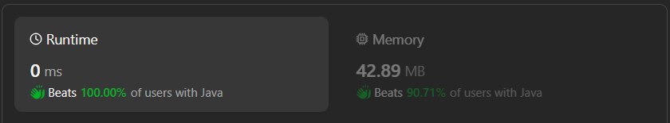

# Easy & Beginner & dry run|| Brute force & Binary Search || Time - O(Log n) & Space - O(1) || Gits✅✅

**Author:** GiteshSK_12
**Votes:** 6
**Link:** [https://leetcode.com/problems/search-in-rotated-sorted-array-ii/solutions/4660766/](https://leetcode.com/problems/search-in-rotated-sorted-array-ii/solutions/4660766/)

---

# Guys if you like the solution and explanation then upvote me \uD83D\uDC48


# Intuition \uD83D\uDC48
In question given a rotated sorted array. To solve this question there are two approach brute force and optimised which include binary search.

# **Brute force approach -** \uD83D\uDC48
- In one traversal we will find the element in the array but the time complexity will be O(n) but the condition is to solve in O(log n) complexity.
```C []
bool search(int* nums, int numsSize, int target) {
    for (int i = 0; i < numsSize; i++) {
        if (nums[i] == target) {
            return true;
        }
    }
    return false;
}
```
```C++ []
class Solution {
public:
    bool search(vector<int>& nums, int target) {
        for (int num : nums) {
            if (num == target) {
                return true;
            }
        }
        return false;
    }
};
```
```Java []
class Solution {
    public boolean search(int[] nums, int target) {
        for (int num : nums) {
            if (num == target) {
                return true;
            }
        }
        return false;
    }
}
```
```javascript []
/**
 * @param {number[]} nums
 * @param {number} target
 * @return {number}
 */
function search(nums: number[], target: number): boolean {
    for (let num of nums) {
        if (num === target) {
                return true;
        }
    }
    return false;
};
```
```python []
class Solution(object):
    def search(self, nums, target):
        """
        :type nums: List[int]
        :type target: int
        :rtype: int
        """
        for num in nums:
            if num == target:
                return True
        return False
```
```ruby []
# @param {Integer[]} nums
# @param {Integer} target
# @return {Integer}
def search(nums, target)
    nums.each_with_index do |num, index|
        return true if num == target
    end
    false 
end
```
# **Optimised Approach (Binary Search) -** \uD83D\uDC48
- To solve this question using binary search we should know what is binary search.
- Binary Search is defined as a searching algorithm used in a sorted array by repeatedly dividing the search interval in half. The idea of binary search is to use the information that the array is sorted and reduce the time complexity to O(log N).
- Conditions for when to apply Binary Search in a Data Structure:
# To apply Binary Search algorithm: \uD83D\uDC48
    1. The data structure must be sorted.
    2. Access to any element of the data structure takes constant time. 
    
# **Binary Search Algorithm:** \uD83D\uDC48
In this algorithm, 
1. Divide the search space into two halves by finding the middle index \u201Cmid\u201D.


2. Compare the middle element of the search space with the key. 
3. If the key is found at middle element, the process is terminated.
4. If the key is not found at middle element, choose which half will be used as the next search space.
    - If the key is smaller than the middle element, then the left side is used for next search.
    - If the key is larger than the middle element, then the right side is used for next search.
5. This process is continued until the key is found or the total search space is exhausted.

# Code Explanation \uD83D\uDC48
 
**Step 1. Binary Search Loop:**

- `while (start <= end) {
    ...
}`
- The loop continues as long as start is less than or equal to end.

**Step 2. Calculate Midpoint:**

- int mid = (start + end) / 2;
- The midpoint of the current search range is calculated.

**Step 3. Check if Target is Found:**

- `if (target == nums[mid]) return true;`
- If the target value is found at the midpoint, return true.

**Step 4. Adjust Search Range:**

- Handle duplicates:

- `if (nums[start] == nums[mid]) {
    start++;
    continue;
}`
- If the start and midpoint elements are equal, the search range is moved forward to skip the duplicate.

**Step 5. Determine which part of the array to search:**

`else if (nums[mid] <= nums[end]) {
    ...
} else {
    ...
}`
- This part checks whether the midpoint divides the array into a sorted or unsorted part. Depending on the target's position relative to nums[mid] and either nums[start] or nums[end], the search range is adjusted by moving start or end.

****Step 6. Return False:**
- `return false;`

- If the loop exits without finding the target, false is returned.

- # Complexity \uD83D\uDC48
    - **Time complexity:** Time complexity of optimised approach is O(log n)

    - **Space complexity:** O(1)

# Binary Search Code \uD83D\uDC48
```C []
bool search(int* nums, int numsSize, int target) {
    int start = 0, end = numsSize - 1;

    while (start <= end) {
        int mid = start + (end - start) / 2;
        if (target == nums[mid]) return true;

        if (nums[start] == nums[mid]) {
            start++;
            continue;
        } else if (nums[mid] <= nums[end]) {
            if (target >= nums[mid] && target <= nums[end]) start = mid + 1;
            else end = mid - 1;
        } else {
            if (target >= nums[start] && target <= nums[mid]) end = mid - 1;
            else start = mid + 1;
        }
    }
    return false;
}
```
```C++ []
class Solution {
public:
    bool search(vector<int>& nums, int target) {
        int start = 0, end = nums.size() - 1;

        while (start <= end) {
            int mid = start + (end - start) / 2;
            if (target == nums[mid]) return true;

            if (nums[start] == nums[mid]) {
                start++;
                continue;
            } else if (nums[mid] <= nums[end]) {
                if (target >= nums[mid] && target <= nums[end]) start = mid + 1;
                else end = mid - 1;
            } else {
                if (target >= nums[start] && target <= nums[mid]) end = mid - 1;
                else start = mid + 1;
            }
        }
        return false;
    }
};

```
```Java []
class Solution {
    public boolean search(int[] nums, int target) {
        int len = nums.length - 1,start = 0, end = len;

        while(start <= end){

            int mid = (start+end)/2;
            if(target == nums[mid])return true;
            if (nums[start] == nums[mid]) {
                start++;
                continue;
            }
            else if(nums[mid] <= nums[end]){
                if(target >= nums[mid] && target <= nums[end])start = mid+1;
                else end = mid -1;
            }
            else{
                if(target >= nums[start] && target<=nums[mid])end = mid -1;
                else start = mid +1;
            }
        }
        return false;
    }
}
```
```javascript []
/**
 * @param {number[]} nums
 * @param {number} target
 * @return {boolean}
 */
var search = function(nums, target) {
    let start = 0, end = nums.length - 1;

    while (start <= end) {
        let mid = Math.floor((start + end) / 2);
        if (target === nums[mid]) return true;

        if (nums[start] === nums[mid]) {
            start++;
            continue;
        } else if (nums[mid] <= nums[end]) {
                if (target >= nums[mid] && target <= nums[end]) start = mid + 1;
                else end = mid - 1;
        } else {
            if (target >= nums[start] && target <= nums[mid]) end = mid - 1;
            else start = mid + 1;
        }
    }
    return false;
    
};
```
```python []
class Solution(object):
    def search(self, nums, target):
        """
        :type nums: List[int]
        :type target: int
        :rtype: bool
        """
        start, end = 0, len(nums) - 1

        while start <= end:
            mid = (start + end) // 2
            if target == nums[mid]:
                return True

            if nums[start] == nums[mid]:
                start += 1
                continue
            elif nums[mid] <= nums[end]:
                if target >= nums[mid] and target <= nums[end]:
                    start = mid + 1
                else:
                    end = mid - 1
            else:
                if target >= nums[start] and target <= nums[mid]:
                    end = mid - 1
                else:
                    start = mid + 1

        return False
```
```python3 []
class Solution:
    def search(self, nums: List[int], target: int) -> bool:
        start, end = 0, len(nums) - 1

        while start <= end:
            mid = (start + end) // 2
            if target == nums[mid]:
                return True

            if nums[start] == nums[mid]:
                start += 1
                continue
            elif nums[mid] <= nums[end]:
                if target >= nums[mid] and target <= nums[end]:
                    start = mid + 1
                else:
                    end = mid - 1
            else:
                if target >= nums[start] and target <= nums[mid]:
                    end = mid - 1
                else:
                    start = mid + 1

        return False

```
```ruby []
# @param {Integer[]} nums
# @param {Integer} target
# @return {Boolean}
def search(nums, target)
    start, _end = 0, nums.length - 1
        while start <= _end
            mid = (start + _end) / 2
            return true if target == nums[mid]

            if nums[start] == nums[mid]
                start += 1
                next
            elsif nums[mid] <= nums[_end]
                if target >= nums[mid] && target <= nums[_end]
                    start = mid + 1
                else
                    _end = mid - 1
                end
            else
                if target >= nums[start] && target <= nums[mid]
                    _end = mid - 1
                else
                    start = mid + 1
                end
            end
        end
    false
end

```
# **Dry Run -** \uD83D\uDC48
The algorithm is quite complex so here is a dry run for this code.

**Step 0. Initial Setup**
- nums = [2, 5, 6, 0, 0, 1, 2]
- target = 0
- start = 0
- end = nums.length - 1 = 6

**Step 1. Iteration 1**
- start = 0, end = 6
- mid = (start + end) / 2 = (0 + 6) / 2 = 3
- nums[mid] = nums[3] = 0
- Since nums[mid] is equal to target, the method returns true.
- The target is found in the first iteration. The method successfully identifies that the target 0 is present at the midpoint of the array (mid = 3) and returns true immediately.

# If the explanation is helpful then upvote me guys.

