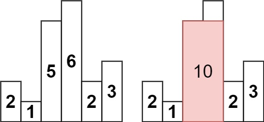
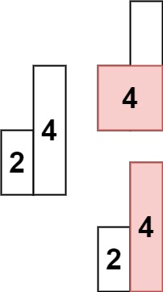

# [84. Largest Rectangle in Histogram](https://leetcode.com/problems/largest-rectangle-in-histogram/)

| Category | Difficulty | Likes | Dislikes |
| :------: | :--------: | :---: | :------: |
| Algorithms | Hard | 19067 | 366 |

**Tags:** [`array`](https://leetcode.com/tag/array), [`stack`](https://leetcode.com/tag/stack), [`monotonic-stack`](https://leetcode.com/tag/monotonic-stack)

**Companies:** `google`, `amazon`, `facebook`, `microsoft`, `visa`, `capital-one`, `bloomberg`, `uber`, `walmart-labs`, `flipkart`, `doordash`, `oracle`, `waymo`, `bitgo`, `apple`, `de-shaw`, `roblox`, `tcs`, `tiktok`, `myntra`, `zoho`

## Description

Given an array of integers `heights` representing the histogram's bar height where the width of each bar is `1`, return *the area of the largest rectangle in the histogram*.

 

**Example 1:**


```

Input: heights = [2,1,5,6,2,3]
Output: 10
Explanation: The above is a histogram where width of each bar is 1.
The largest rectangle is shown in the red area, which has an area = 10 units.

```

**Example 2:**


```

Input: heights = [2,4]
Output: 4

```

 

**Constraints:**

	- `1 <= heights.length <= 10^5`

	- `0 <= heights[i] <= 10^4`

---

**Links:** [Submissions](https://leetcode.com/problems/largest-rectangle-in-histogram/) | [Solutions](https://leetcode.com/problems/largest-rectangle-in-histogram/)
