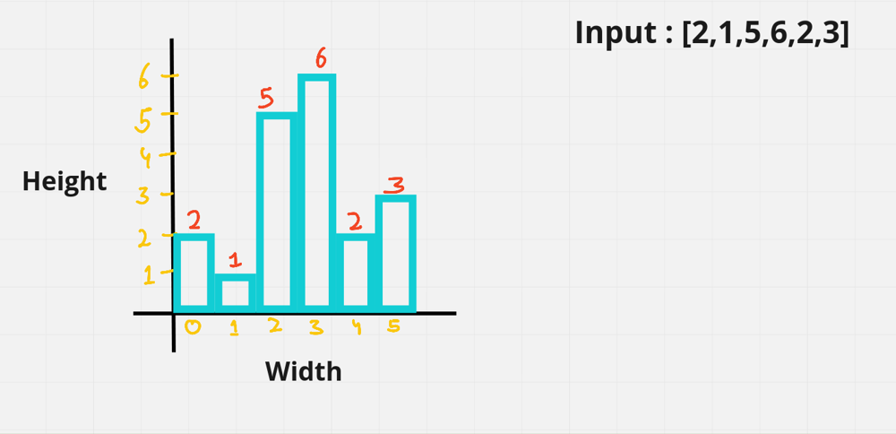
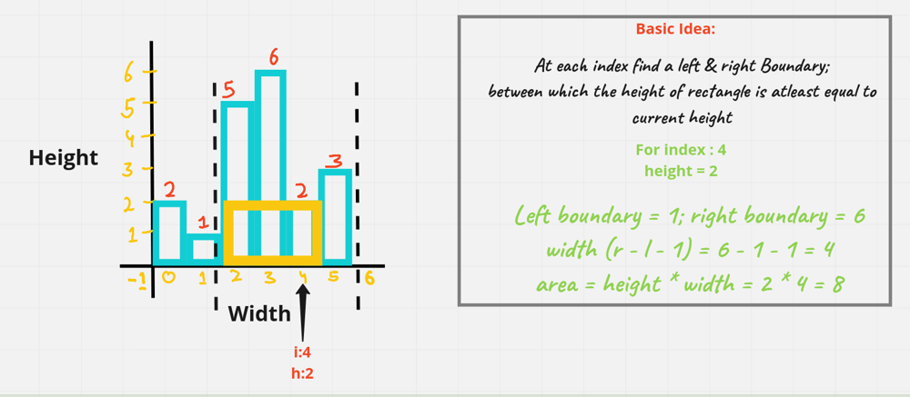
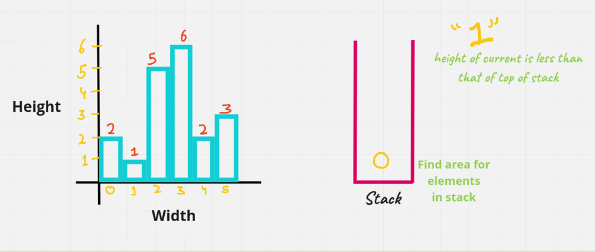
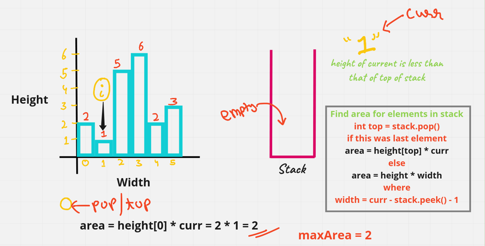

# [Java/C++] Explanation going from Brute to Optimal Approach

**Author:** hi-malik
**Votes:** 202
**Link:** [https://leetcode.com/problems/largest-rectangle-in-histogram/solutions/1727776/](https://leetcode.com/problems/largest-rectangle-in-histogram/solutions/1727776/)

---

```
What the Question is saying, 
Given an array of integers heights representing the histogram's bar height where the width of each bar is 1, 
return the area of the largest rectangle in the histogram.
```

Understand this problem with an example;
**Input:** `heights = [2,1,5,6,2,3]`


Let's understand how we calculate this, let's took on index 4 height is 2. If we go to the left and see where the height is less then 2 and i.e. at index 1. So, that becomes the left Boundary. Similarly if we go to right and see where the height is less then 2 & i.e. at index 6 [which is end of the array].

Now we have left & right boundary the area could be find out by height * width. And width will get by (right - left - 1) in case of 4 that will be 6 - 1 - 1 = 4. And we know the height already i.e. 2.

The Area we get is 2 * 4 i.e. 8



The main idea here would be how to find **left boundary & right boundary** for every index. The **brute way** is using an **ARRAY**
`For left boundary array:`
* Start with index 1, (left[0] = -1)
* For each index -> go to left & find the nearest index where height [index] < height[curr]
* Start with index 1,
* Eg : Index 1 : left[1] = -1

`For right boundary array:`
* Start with index n - 2 right[n - 1] = n
* For each index -> go to right & find the nearest index where height[index] < height[curr]
* Start with index n - 2
* Eg : Index 2 : right[2] = 4

I hope you got the point and let's code this brute force Approach then we move to optimal Approach:
**Java**
```
class Solution {
    public int largestRectangleArea(int[] heights) {
        int n = heights.length;
        if(n == 0) return 0; // Base Condition
        int maxArea = 0;
        int left[] = new int[n]; //fill left boundary
        int right[] = new int[n]; // fill right boundary
        
        left[0] = -1;
        right[n - 1] = n;
        
        for(int i = 1; i < n; i++){
            int prev = i - 1; // previous for comparing the heights
            while(prev >= 0 && heights[prev] >= heights[i]){
                prev = left[prev]; // we have done this to minimise the jumps we make to the left
            }
            left[i] = prev;
        }
        // Similarly we do for right
        for(int i = n - 2; i >= 0; i--){
            int prev = i + 1; 
            while(prev < n && heights[prev] >= heights[i]){
                prev = right[prev]; 
            }
            right[i] = prev;
        }
        // once we have these two arrays fill we need width & area
        for(int i = 0; i < n; i++){
            int width = right[i] - left[i] - 1;
            maxArea = Math.max(maxArea, heights[i] * width);
        }
        return maxArea;
        
    }
}
```
**C++**
```
class Solution {
public:
    int largestRectangleArea(vector<int>& heights) {
        int n = heights.size();
        if(n == 0) return 0; // Base Condition
        int maxArea = 0;
        vector<int> left(n); //fill left boundary
        vector<int> right(n); // fill right boundary
        
        left[0] = -1;
        right[n - 1] = n;
        
        for(int i = 1; i < n; i++){
            int prev = i - 1; // previous for comparing the heights
            while(prev >= 0 && heights[prev] >= heights[i]){
                prev = left[prev]; // we have done this to minimise the jumps we make to the left
            }
            left[i] = prev;
        }
        // Similarly we do for right
        for(int i = n - 2; i >= 0; i--){
            int prev = i + 1; 
            while(prev < n && heights[prev] >= heights[i]){
                prev = right[prev]; 
            }
            right[i] = prev;
        }
        // once we have these two arrays fill we need width & area
        for(int i = 0; i < n; i++){
            int width = right[i] - left[i] - 1;
            maxArea = max(maxArea, heights[i] * width);
        }
        return maxArea;
    }
};
```
ANALYSIS :
* **Time Complexity :-** BigO(N^2)

* **Space Complexity :-** BigO(N)

Now, let's see our Optimize Approach i.e. **Using Stack**
So, what we do is we take a stack & keep on adding the indexes in the stack till we get a increasing sequence. Once the sequence becomes decreasing we need to pop the element and find the area `[That's the basic idea behind the stack]`

So, let's take the stack and we are at index 1. The height of current is less than that of top of stack which is the 0th index. As the height is decreasing. So, what we do here is find the area for elements in stack


Now, to find the area we pop the element from stack & then for that element the area becomes **height[top] * curr i.e. 1**
If the stack becomes empty i.e. if this is the only element present for that we find the width and multiply with the height of top element `[width would be curr - stack.peek - 1]` where curr is right & stack.peek() is left

For this case we **pop "0"** and stack becomes **empty**, so the area becomes **height[0] * curr = 2 * 1 = 2.** So, till now maxArea we have found is 2



We will do this procedure for all the element's and we will get the **maxArea i.e. 10**

*I hope you got the idea,* **So, let's code it up:**
**Java**
```
class Solution {
    public int largestRectangleArea(int[] heights) {
        int n = heights.length;
        int maxArea = 0;
        Stack<Integer> st = new Stack<>();
        
        for(int i = 0; i <= n; i++){
            int currHeight = i == n ? 0 : heights[i];
            // check if currHeight becomes greater then height[top] element of stack. we do a push because it's an increasing sequence
            // otherwise we do pop and find area, so for that we write a while loop
            while(!st.isEmpty() && currHeight < heights[st.peek()]){
                int top = st.pop(); // current element on which we are working
                // now we need width & area
                int width = st.isEmpty() ? i : i - st.peek() - 1; // width differ, if stack is empty or not empty after we pop the element
                int area = heights[top] * width; // current height * width
                maxArea = Math.max(area, maxArea);
            }
            // if it doesn't enter in while loop, it means it's an increasing sequence & we need to push index
            st.push(i);
        }
        return maxArea;
    }
}
```
**C++**
```
class Solution {
public:
    int largestRectangleArea(vector<int>& heights) {
        int n = heights.size();
        int maxArea = 0;
        stack<int> st;
        
        for(int i = 0; i <= n; i++){
            int currHeight = i == n ? 0 : heights[i];
            // check if currHeight becomes greater then height[top] element of stack. we do a push because it's an increasing sequence
            // otherwise we do pop and find area, so for that we write a while loop
            while(!st.empty() && currHeight < heights[st.top()]){
                int top = st.top(); st.pop(); // current element on which we are working
                // now we need width & area
                int width = st.empty() ? i : i - st.top() - 1; // width differ if we stack is empty or not empty after we pop the element
                int area = heights[top] * width; // current height * width
                maxArea = max(area, maxArea);
            }
            // if it doesn't enter in while loop, it means it's an increasing sequence & we need to push index
            st.push(i);
        }
        return maxArea;
    }
};
```
ANALYSIS :
* **Time Complexity :-** BigO(N)

* **Space Complexity :-** BigO(N)