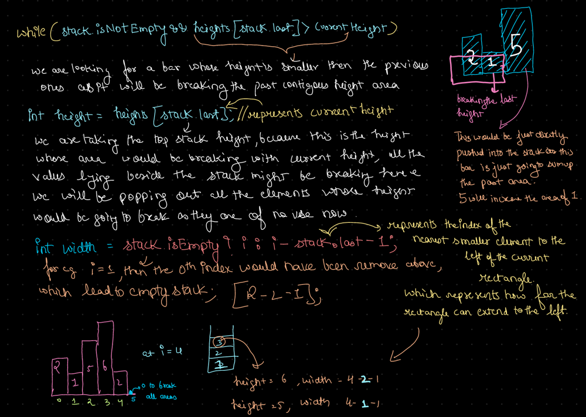

# 🔥BEATS 💯 % 🎯 |✨SUPER EASY BEGINNERS 👏

**Author:** CodeWithSparsh
**Votes:** 4
**Link:** [https://leetcode.com/problems/largest-rectangle-in-histogram/solutions/6126363/](https://leetcode.com/problems/largest-rectangle-in-histogram/solutions/6126363/)

---


---


---
# Intuition
The problem can be visualized as calculating the largest rectangle that can be formed in a histogram. The intuition is to use a **stack** to keep track of indices of histogram bars that are not yet resolved. By ensuring that the heights in the stack are in increasing order, we can calculate the largest rectangle for each bar as soon as we encounter a bar of smaller height.

---

# Approach
1. **Use a stack** to store indices of bars in increasing order of height.
2. When a bar of smaller height is encountered, **calculate the maximum area** for all indices in the stack that are greater than the current bar's height.
3. Use a **sentinel value** of `0` height at the end to ensure all bars are processed.
4. For each resolved height, calculate the area using the width determined by the current index and the index of the previous smaller height.

---

# Complexity
- **Time Complexity**:  
  $$O(n)$$ because each bar is pushed and popped from the stack at most once.

- **Space Complexity**:  
  $$O(n)$$ for the stack.

---


```python []
class Solution:
    def largestRectangleArea(self, heights):
        stack = []
        max_area = 0
        n = len(heights)

        for i in range(n + 1):
            current_height = heights[i] if i < n else 0

            while stack and heights[stack[-1]] > current_height:
                height = heights[stack.pop()]
                width = i if not stack else i - stack[-1] - 1
                max_area = max(max_area, height * width)
            
            stack.append(i)
        
        return max_area
```


```cpp []
#include <vector>
#include <stack>
#include <algorithm>
using namespace std;

class Solution {
public:
    int largestRectangleArea(vector<int>& heights) {
        stack<int> st;
        int maxArea = 0;
        int n = heights.size();

        for (int i = 0; i <= n; ++i) {
            int currentHeight = (i == n) ? 0 : heights[i];

            while (!st.empty() && heights[st.top()] > currentHeight) {
                int height = heights[st.top()];
                st.pop();
                int width = st.empty() ? i : i - st.top() - 1;
                maxArea = max(maxArea, height * width);
            }

            st.push(i);
        }

        return maxArea;
    }
};
```


```java []
import java.util.Stack;

class Solution {
    public int largestRectangleArea(int[] heights) {
        Stack<Integer> stack = new Stack<>();
        int maxArea = 0;
        int n = heights.length;

        for (int i = 0; i <= n; i++) {
            int currentHeight = (i == n) ? 0 : heights[i];

            while (!stack.isEmpty() && heights[stack.peek()] > currentHeight) {
                int height = heights[stack.pop()];
                int width = stack.isEmpty() ? i : i - stack.peek() - 1;
                maxArea = Math.max(maxArea, height * width);
            }

            stack.push(i);
        }

        return maxArea;
    }
}
```


```go []
func largestRectangleArea(heights []int) int {
    stack := []int{}
    maxArea := 0
    n := len(heights)

    for i := 0; i <= n; i++ {
        currentHeight := 0
        if i < n {
            currentHeight = heights[i]
        }

        for len(stack) > 0 && heights[stack[len(stack)-1]] > currentHeight {
            height := heights[stack[len(stack)-1]]
            stack = stack[:len(stack)-1]
            width := i
            if len(stack) > 0 {
                width = i - stack[len(stack)-1] - 1
            }
            maxArea = max(maxArea, height*width)
        }

        stack = append(stack, i)
    }

    return maxArea
}

func max(a, b int) int {
    if a > b {
        return a
    }
    return b
}
```


```javascript []
var largestRectangleArea = function(heights) {
    let stack = [];
    let maxArea = 0;
    let n = heights.length;

    for (let i = 0; i <= n; i++) {
        let currentHeight = (i === n) ? 0 : heights[i];

        while (stack.length && heights[stack[stack.length - 1]] > currentHeight) {
            let height = heights[stack.pop()];
            let width = stack.length === 0 ? i : i - stack[stack.length - 1] - 1;
            maxArea = Math.max(maxArea, height * width);
        }

        stack.push(i);
    }

    return maxArea;
};
```


```dart []
class Solution {
  int largestRectangleArea(List<int> heights) {
    int n = heights.length;
    List<int> stack = [];
    int maxArea = 0;

    for (int i = 0; i <= n; i++) {
      int currentHeight = (i == n) ? 0 : heights[i];

      while (stack.isNotEmpty && heights[stack.last] > currentHeight) {
        int height = heights[stack.removeLast()];
        int width = stack.isEmpty ? i : i - stack.last - 1;
        maxArea = max(maxArea, height * width);
      }

      stack.add(i);
    }

    return maxArea;
  }
}
```

---

 {:style='width:250px'}