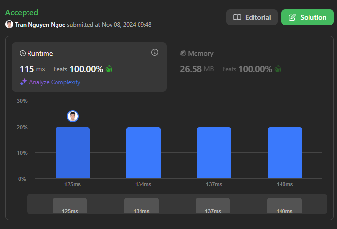
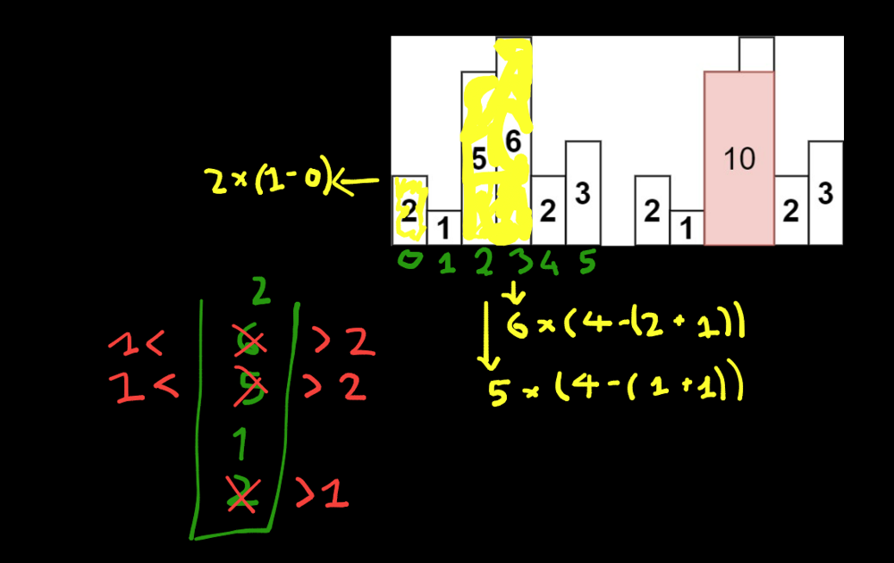

# Beat 100%(Runtime & Memory) - PHP!!! Optimized Stack Solution for Largest Rectangle in Histogram 💥

**Author:** nguyenngoc02082000
**Votes:** 0
**Link:** [https://leetcode.com/problems/largest-rectangle-in-histogram/solutions/6021348/](https://leetcode.com/problems/largest-rectangle-in-histogram/solutions/6021348/)

---




# Intuition
<!-- Describe your first thoughts on how to solve this problem. -->
I realized that for each bar, I should find the largest possible rectangle with that bar as the smallest height. To do this, I needed to determine the range (width) of bars that were at least as tall as the current bar. This led me to the idea of using a stack to store the indices of the bars in increasing order. By keeping track of increasing heights in a stack, I could quickly determine when I hit a "boundary" (a bar shorter than the one on top of the stack).

When encountering a shorter bar, I could "pop" from the stack, calculate the area for the popped bar, and update the maximum area. This way, I only calculated areas when necessary and avoided recalculating for previously processed bars. This stack-based approach seemed optimal because it allowed me to keep track of relevant bars without backtracking or redundant calculations.
# Approach
<!-- Describe your approach to solving the problem. -->
To solve this problem, we utilize a stack to store the indices of histogram bars. This stack helps efficiently manage and find the smallest bar height in a series of bars as needed.

The reason for using a stack is that it allows us to:

1. Maintain the bars in increasing order of height.
2. Easily retrieve the height of the smallest bar in the sequence to calculate the rectangle area.
3. Avoid recalculating areas for the same set of bars multiple times, optimizing the solution\u2019s performance.
# Explanation of Logic
The core idea is to iterate through each bar, and whenever a bar\u2019s height is less than the height of the bar at the top of the stack, it signifies a \u201Cboundary\u201D that limits the height of the previous bars. Therefore, we can calculate the rectangle area using this bar's height and extend it to the limits of the bars processed earlier.





**Specifically:**

- When the current bar height is less than the height of the top bar in the stack:
    1. Pop the top bar from the stack, treating it as the height of the rectangle.
    2. Calculate the width of this rectangle (from the index of the new top of the stack to the current bar\u2019s index).
Update the maximum area if this area is larger than the previous max area.
    3. When there\u2019s no bar in the stack that\u2019s taller than the current height, we push the current bar\u2019s index onto the stack.
- Finally, if there are any remaining bars in the stack, we repeat the above process until the stack is empty, as this handles the remaining unprocessed bars.
# Code Walkthrough
Let's go through the code step by step.
```
        if(count($heights) === 1) return $heights[0];
        $stack = []; // Initialize an empty stack to hold indices of the bars.
        $res = 0; // Initialize the result variable to keep track of the maximum area.
        $count = count($heights); // Store the number of bars in the histogram.
```
1. **Checking for a Single Bar:** if heights has only one bar, return its height directly because it's the largest possible rectangle.

2. **Initializing Variables:**
    *stack*: An empty stack to hold the indices of bars as we process them.

    *res*: A variable to store the maximum rectangle area found.

    *count*: The number of bars in the histogram, which will be used later to calculate the width for remaining bars.

  ### **1. Main Loop - Iterating Through Bars**
---
```
        foreach($heights as $i => $height) {
            while (!empty($stack) && end($stack) >= $height) {
                // Pop the stack when the current height is smaller than the height at stack's top
                $pop = array_pop($stack); // Pop the index of the last bar in the stack
                $key = key($stack) || key($stack) === 0 ? key($stack) + 1 : 0; 
                $res = max($res, $pop * ($i - $key));
            }
            $stack[$i] = $height;
        }
```
1. **Loop through Each Bar:**
    - We loop through each bar in heights, where $i is the index and $height is the height of the current bar.

2. **While the Current Bar is Shorter than the Stack's Top Bar:**

    - If the current bar (*height*) is shorter than the bar at the index stored on top of the stack, we need to calculate the maximum rectangle area using the top bar.
    - **Pop the Stack**: Remove the index of the top bar from the stack and store it in *pop*. This represents the height of the rectangle we\u2019re about to calculate.
3. **Calculate Width:**
    - If the stack is not empty after popping, the width of the rectangle is the difference between the current index (*i*) and the new top index of the stack (*key*(*stack*) + 1), giving us the width up to the popped bar.
    - If the stack is empty, it means the popped bar can extend all the way back to the start, so the width is simply *i*.

4. **Update the Maximum Area:**
    - Calculate the area as (*pop* * (*i* - *key*)) and update *res* if this area is larger than the previous maximum.

5. **Push Current Bar into the Stack:**
    - After processing, push the current index and height into the stack. This maintains the stack in increasing order of bar heights.


  ### **2. Final Loop - Processing Remaining Bars in Stack**
---
```
        while(!empty($stack)) {
            $a = array_pop($stack); // Pop the last index from the stack
            $key = key($stack) || key($stack) === 0 ? key($stack) + 1 : 0;
            $res = max($res, $a * ($count - $key));
        }
        
        return $res;
    }
}

```
1. **Process Remaining Bars:**
    - After iterating through all bars, there may still be bars left in the stack. Each remaining bar could potentially form the largest rectangle, so we need to calculate areas for them.

2. **Pop and Calculate Area for Remaining Bars:**

    - For each bar left in the stack, pop it and calculate its area.
    - If the stack is not empty after popping, use the index of the new top of the stack to calculate the width.
    - If the stack is empty, the popped bar extends all the way to the end, so the width becomes *(count - 0)*.

4. **Update Maximum Area:**
    - Calculate the area as (*pop* * (*i* - *key*)) and update *res* if this area is larger than the previous maximum.

5. **Return the Result:**
    - After processing all bars, *res* holds the maximum rectangle area for the histogram, which is then returned.
# Complexity
- **Time complexity: O(n)** - We only iterate through the heights array once, and each push and pop operation on the stack is done at most once per bar. Hence, the time complexity is linear in the number of bars.


- **Space complexity: O(n)** - In the worst case, every bar could be added to the stack, requiring O(n) space.

# Code
```php []
class Solution {

    /**
     * @param Integer[] $heights
     * @return Integer
     */
    function largestRectangleArea($heights) {
        if(count($heights) === 1) return $heights[0];
        $stack = [];
        $res = 0;
        $count = count($heights);
        foreach($heights as $i => $height) {
            while (!empty($stack) && end($stack) >= $height) {
                $pop = array_pop($stack);
                $end = end($stack);
                $key = key($stack) || key($stack) === 0 ? key($stack) + 1 : 0;
                $res = max($res, $pop * ($i - $key));
            }
            $stack[$i] = $height;
        }

        while(!empty($stack)) {
            $a = array_pop($stack);
            $end = end($stack);
            $key = key($stack) || key($stack) === 0 ? key($stack) + 1 : 0;
            $res = max($res, $a * ($count - $key));
        }
        
        return $res;
    }
}
```