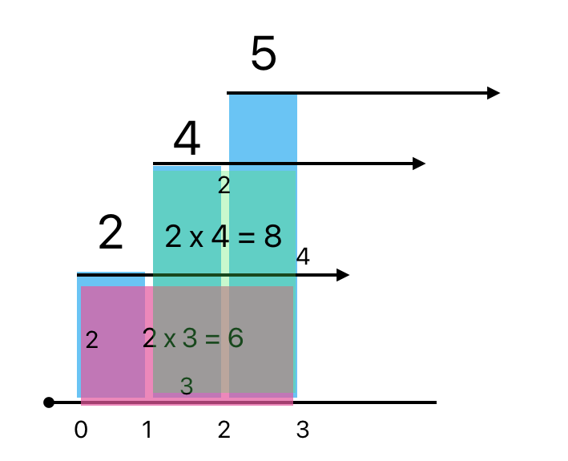
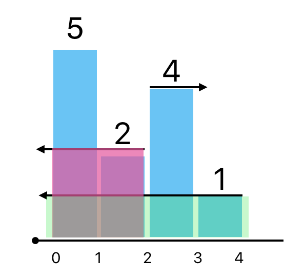

# C++ | RUST | Stack 💯 | Explanation with illustrations 🔥

**Author:** kunaldutta
**Votes:** 3
**Link:** [https://leetcode.com/problems/largest-rectangle-in-histogram/solutions/4530741/](https://leetcode.com/problems/largest-rectangle-in-histogram/solutions/4530741/)

---

# Intuition
To solve this problem, we will use a monotonic stack. This problem will basically have two types of cases. Let's discuss them in detail.

## 1. Next bar >= Current Bar


From the image we can se that, if a larger bar than the current one appears consequently, it can be extended by width to the next bar. Obviously the height of the current bar will be the limiting factor for the next. We can keep having these bars put into our stack and until we find a smaller bar than the current one, we can simply take the height of the current bar and the index of it till the just previous bar where a smaller than the current bar was found.

Let's understand the above graph. 
1. PINK SHADE: Here at index 0, we have bar with height 2. Next bar has height of 4, and the last bar is of height 5. This means we can have the bar of height 2 extended to index (0, 1, 2) that is a width of 3. And the area would be $2 * 3 = 6$.
2. GREEN SHADE: Here the bar at index 1 has height 4, and the next bar is height 5, which means I can have a minimum rectangle of height 4 overlapping our next index so a widhth of 2. And area $4*2=8$.

## 2. Next bar < Current bar.


This one is quite tricky, and the real head scractcher, but I'll make it easier for you. As soon as a smaller bar comes along, we can't anymore stretch by widhth, as the next bar can't accomodate a rectangle overlapping the height of current one. So we simply remove the bar from the consideration any further, even if a larger bar comes along, it's of no benefit as the smaller bar in between won't allow to make a rectangle. And now what we do is all the bars in the stack, probably getting smaller by depth of stack as we only push larger and larger bar, we check, how many bars are smaller than the current small one, and comparitvely calculating the area till there and popping them off the stack. Let's look at the examples real quick.

1. PINK SHADE: As the bar of height 5 can't be extended til bar 2, will calculate the max area till bar 5 and pop it. But notice how the bar 2 can be extended backwards. For now we don't care about the forward situation (as that is covered in the first case). Observe that the two could've been formed from the start, as we said we will keep poping until we find a smaller bar than the 2, it makes sense that the two will have a more extended width. And how much? It's till exacly where the last bar of height greater than equal the current bar. So here, 2.<br>Therefore, the starting index of bar 2 wouldn't be its original index `[1]` but instead till where it was able to extend itself backwards, i.e, `[0]`.
2. GREEN SHADE: Similarly, The green was able to pull itself as back as the first index `[0]`. As no smaller bar was found than 1, we can say, it had a width of the last bar it can pop, Notice How we have already poped the last bar of height 5, but because even 2 can't extend till 1 (it extends for the bar of height 4). The bar of height 2 was already extending from index `[0]` and that means the last element that even smaller element of height 1 will pop is element of height 2 so following the rules, it will borrow its index `[0]` and stretch all the way.
> Observation: The first condition takes care of extending the area forward, while the second condition checks for bars (area) backwards.

# Approach
1. Initialize `maxArea = 0` and a vector of pairs to store starting index and height. `vector<pair<int: starting index, int: height>> st`. It acts as our ***MONOTONIC STACK*** (Elements are always increasing, or equal).
2. Intially push the first element in our stack.
3. Iterate through every other element. 
4. Check condition 2: Intialize a `temp_index` that will store the index of last element we pop, because it will be just big enough (or might be equal) so that the smaller bar that caused all the poppings can be stretch till that elements index. <br>**WHILE** the stack is not empty, keep comparing with the current maximum area. It is given by the formula<br> $\	ext{bar.height * (current loop index - bar.starting index)}$.
5. Else condition 1: Simply keep on pushing larger and larger or of same height bars into our monotonically not decreasing stack `st`.
6. Lastly if there are bars remaining, i.e, the last element wasn't the smallest one to pop all previous bars. This suggest that according to our first condition, only bars in monotonically non decreasing order are present. This suggest that all bars till last haven't found a smaller bar, so all of their widths can be extended till the end of the histogram. So we one by one deal with the rest, by caculating the max area and popping them. We can also decide not to pop any of them and simply itterate over our stack as enumeration. The formula is given by<br>$\	ext{bar.height * (total length of original histogram/last index - bar.starting index)}$

Example: Input: heights = [2,1,5,6,2,3]
1. [c1] Push (0,2)
2. [c2] Pop (`0`, 2) --Index borrow--> Push (`0`, 1) $[maxArea=2*1=2]$ Accept
3. [c1] Push (2,5)
4. [c1] Push (3,6)
5. [c2] Pop(3,6) $[maxArea=6*1=6]$ Accept<br> Pop(`2`,5) $[maxArea=5*2=10]$ Accept<br> Push(`2`, 2)
6. [c1] Push (5,3)

Stack: `[(0,1), (2,2), (5,3)]`. Enter Last loop

7. Pop (0,1) $[maxArea=1*(6-0)=6]$ Reject
8. Pop (2,2) $[maxArea=2*(6-2)=8]$ Reject
9. Pop (5,3) $[maxArea=3*(6-5)=3]$ Reject


# Complexity

- Time complexity: $O(N)$
We traverse the array once.

- Space complexity: $O(N)
Worst case, all elements are in non decreasing order and all are pushed into the stack 

# Code
```cpp []
class Solution {
public:
    int largestRectangleArea(vector<int>& heights) {
        int maxArea = 0;
        int n = heights.size();
        vector<pair<int, int> >st;

        st.emplace_back(0, heights[0]);

        for(int i=1; i<n; i++){
            if(heights[i] < st.back().second){
                int temp_index = 0;
                while(!st.empty() and heights[i] < st.back().second){
                    maxArea = max(maxArea, st.back().second * (i - st.back().first));
                    temp_index = st.back().first;
                    st.pop_back();
                }
                st.emplace_back(temp_index, heights[i]);
            }
            else {
                st.emplace_back(i, heights[i]);
            }
        }

        if(!st.empty()){
            while(!st.empty()){
                maxArea = max(maxArea, st.back().second * (n - st.back().first));
                st.pop_back();
            }
        }

        return maxArea;
    }
};
```
```Rust []
impl Solution {
    pub fn largest_rectangle_area(heights: Vec<i32>) -> i32 {
        let mut max_area:i32 = 0;
        let n = heights.len();
        let mut st: Vec<(usize, i32)> = Vec::new();

        st.push((0, heights[0]));

        for i in 1..n {
            if heights[i] < st.last().unwrap().1 {
                let mut temp_index = 0;
                while !st.is_empty() && heights[i] < st.last().unwrap().1 {
                    let top = st.pop().unwrap();
                    max_area = max_area.max(top.1 as i32 * (i - top.0) as i32);
                    temp_index = top.0;
                }
                st.push((temp_index, heights[i]));
            }
            else {
                st.push((i, heights[i]));
            }
        }

        while !st.is_empty() {
            let top = st.pop().unwrap();
            max_area = max_area.max(top.1 as i32 * (n - top.0) as i32);
        }

        max_area
    }
}
```
---
# Rust
Above there is the rust code if you are interested.

basically we use a Vec<(usize, i32) with starting index as `usize` because indexes in loop use `usize`. This is a vector of a tuple of two elements.
To get last or top element we use `stack.last()`. To get the <Result> that it returns as tuple, we method chain `.unwrap()`. Lastly we use `.0` for first element or index and `.1` for second element or the actual height.
`max_area = max_area.max(top.1 as i32 * (n - top.0) as i32);`
 We also type convert all operations to `as i32` to avoid overflow. Notice that max function is using the method instance and not normal function and argument like others, i.e, instead of `max(a, b)` we are using `a.max(b);` Rest is same.


