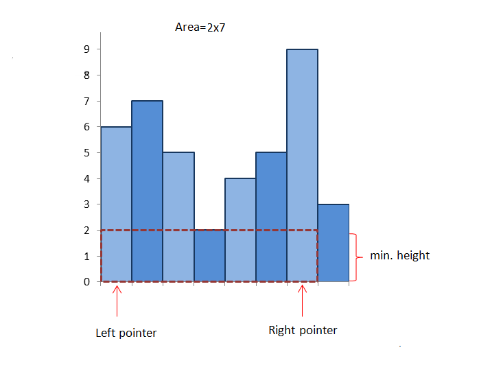
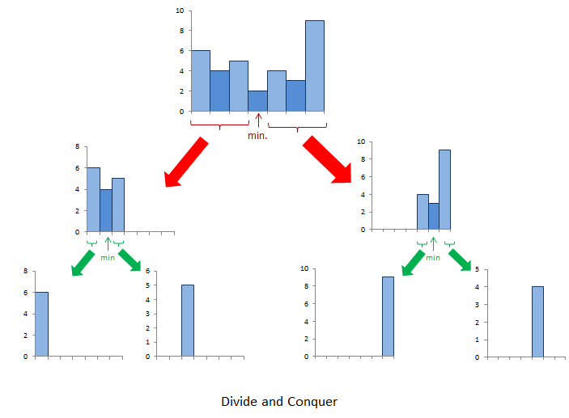

# Official Solution

**Link:** [https://leetcode.com/problems/largest-rectangle-in-histogram/solution/](https://leetcode.com/problems/largest-rectangle-in-histogram/solution/)

---

[TOC]

## Video Solution

---

<div>
    <div class="video-container">
        <iframe src="https://player.vimeo.com/video/495920363" width="640" height="360" frameborder="0" allow="autoplay; fullscreen" allowfullscreen></iframe>
    </div>
</div>

<div>&nbsp;
</div>

## Solution Article

We need to find the rectangle of largest area that can be formed by using the given bars of histogram.


---
### Approach 1: Brute Force

Firstly, we need to take into account the fact that the height of the rectangle formed between any two bars will always be limited by the height of the shortest bar lying between them which can be understood by looking at the figure below:



Thus, we can simply start off by considering every possible pair of bars and finding the area of the rectangle formed between them using the height of the shortest bar lying between them as the height and the spacing between them as the width of the rectangle. We can thus, find the required rectangle with the maximum area.


<iframe src="https://leetcode.com/playground/GXhbEnvC/shared" frameBorder="0" width="100%" height="361" name="GXhbEnvC"></iframe>


**Complexity Analysis**

* Time complexity: $$O(n^3)$$. We have to find the minimum height bar $$O(n)$$ lying
between every pair $$O(n^2)$$.

* Space complexity: $$O(1)$$. Constant space is used.

---

### Approach 2: Better Brute Force

**Algorithm**

We can do one slight modification in the previous approach to optimize it to some extent.

Instead of taking every possible pair and then finding the bar of minimum height lying between them everytime, we can find the bar of minimum height for current pair by using the minimum height bar of the previous pair.

In mathematical terms, $$minheight=\min(minheight, heights(j))$$, where $$heights(j)$$ refers to the height of the $$j$$th bar.


<iframe src="https://leetcode.com/playground/GsMJ26j7/shared" frameBorder="0" width="100%" height="344" name="GsMJ26j7"></iframe>

**Complexity Analysis**

* Time complexity: $$O(n^2)$$. Every possible pair is considered

* Space complexity: $$O(1)$$. No extra space is used.

---

### Approach 3: Divide and Conquer Approach

**Algorithm**

This approach relies on the observation that the rectangle with maximum area will be the maximum of:

1. The widest possible rectangle with height equal to the height of the shortest bar.

2. The largest rectangle confined to the left of the shortest bar(subproblem).

3. The largest rectangle confined to the right of the shortest bar(subproblem).

Let's take an example:
```
[6, 4, 5, 2, 4, 3, 9]
```

Here, the shortest bar is of height 2. The area of the widest rectangle using this bar as height is 2x7=14. Now, we need to look for cases 2 and 3 mentioned above.

Thus, we repeat the same process to the left and right of 2. In the left of 2, 4 is the minimum, forming an area of rectangle 4x3=12. Further, rectangles of area 6x1=6 and 5x1=5 exist in its left and right respectively. Similarly we find an area of 3x3=9, 4x1=4 and 9x1=9 to the left of 2. Thus, we get 14 as the correct maximum area. See the figure below for further clarification:




<iframe src="https://leetcode.com/playground/hrYRqH2d/shared" frameBorder="0" width="100%" height="480" name="hrYRqH2d"></iframe>

**Complexity Analysis**

* Time complexity:

    Average Case: $$O\big(n \log n\big)$$.

    Worst Case: $$O(n^2)$$. If the numbers in the array are sorted, we don't gain the advantage of divide and conquer.

* Space complexity: $$O(n)$$. Recursion with worst case depth $$n$$.

---

### Approach 4: Better Divide and Conquer

**Algorithm**

You can observe that in the Divide and Conquer Approach, we gain the advantage, since the large problem is divided into substantially smaller subproblems. But, we won't gain much advantage with that approach if the array happens to be sorted in either ascending or descending order, since every time we need to find the minimum number in a large subarray $$O(n)$$. Thus, the overall complexity becomes $$O(n^2)$$ in the worst case.

We can reduce the time complexity by using a Segment Tree to find the minimum every time which can be done in $$O\big(\log n\big)$$ time.

For implementation, click [here](https://leetcode.com/problems/largest-rectangle-in-histogram/discuss/28941/segment-tree-solution-just-another-idea-onlogn-solution).

**Complexity Analysis**

* Time complexity: $$O\big(n\log n\big)$$. Segment tree takes $$\log n$$ for a total of $$n$$ times.

* Space complexity: $$O(n)$$. Space required for Segment Tree.

---

### Approach 5: Using Stack

**Algorithm**

In this approach, we maintain a stack. Initially, we push a -1 onto the stack to mark the end.

We start with the leftmost bar and keep pushing the current bar's index onto the stack until we get two successive numbers in descending order, i.e. until we get $$heights[i] < heights[i-1]$$. Now, we start popping the numbers from the stack until we hit a number $$stack[j]$$ on the stack such that $$heights\big[stack[j]\big] \leq heights[i]$$.

Every time we pop, we find out the area of rectangle formed using the current element as the height of the rectangle and the difference between the the current element's index pointed to in the original array and the element $$stack[top-1] - 1$$ as the width

i.e. if we pop an element $$stack[top]$$ and i is the current index to which we are pointing in the original array, the current area of the rectangle will be considered as:

$$
(i-stack[top-1]-1) \times heights\big[stack[top]\big].
$$

Further, if we reach the end of the array, we pop all the elements of the stack and at every pop, this time we use the following equation to find the area:
  $$(heights.length - stack[top-1] - 1) \times heights\big[stack[top]\big]$$, where $$stack[top]$$ refers to the element just popped. Thus, we can get the area of the of the largest rectangle by comparing the new area found everytime.

The following example will clarify the process further:

$$\text{[6, 7, 5, 2, 4, 5, 9, 3]}$$

!?!../Documents/84_Largest_Rectangle.json:1000,563!?!

<iframe src="https://leetcode.com/playground/n68KemoZ/shared" frameBorder="0" width="100%" height="480" name="n68KemoZ"></iframe>

**Complexity Analysis**

* Time complexity: $$O(n)$$. $$n$$ numbers are pushed and popped.

* Space complexity: $$O(n)$$. Stack is used.