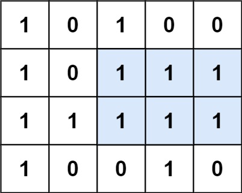

# [85. Maximal Rectangle](https://leetcode.com/problems/maximal-rectangle/)

| Category | Difficulty | Likes | Dislikes |
| :------: | :--------: | :---: | :------: |
| Algorithms | Hard | 11538 | 213 |

**Tags:** [`array`](https://leetcode.com/tag/array), [`dynamic-programming`](https://leetcode.com/tag/dynamic-programming), [`stack`](https://leetcode.com/tag/stack), [`matrix`](https://leetcode.com/tag/matrix), [`monotonic-stack`](https://leetcode.com/tag/monotonic-stack)

**Companies:** `google`, `amazon`, `facebook`, `goldman-sachs`, `sprinklr`, `microsoft`, `bloomberg`, `salesforce`, `apple`, `tcs`, `tiktok`, `zoho`

## Description

Given a `rows x cols` binary `matrix` filled with `0`'s and `1`'s, find the largest rectangle containing only `1`'s and return *its area*.

 

**Example 1:**


```

Input: matrix = [[&quot;1&quot;,&quot;0&quot;,&quot;1&quot;,&quot;0&quot;,&quot;0&quot;],[&quot;1&quot;,&quot;0&quot;,&quot;1&quot;,&quot;1&quot;,&quot;1&quot;],[&quot;1&quot;,&quot;1&quot;,&quot;1&quot;,&quot;1&quot;,&quot;1&quot;],[&quot;1&quot;,&quot;0&quot;,&quot;0&quot;,&quot;1&quot;,&quot;0&quot;]]
Output: 6
Explanation: The maximal rectangle is shown in the above picture.

```

**Example 2:**

```

Input: matrix = [[&quot;0&quot;]]
Output: 0

```

**Example 3:**

```

Input: matrix = [[&quot;1&quot;]]
Output: 1

```

 

**Constraints:**

	- `rows == matrix.length`

	- `cols == matrix[i].length`

	- `1 <= rows, cols <= 200`

	- `matrix[i][j]` is `'0'` or `'1'`.

---

**Links:** [Submissions](https://leetcode.com/problems/maximal-rectangle/) | [Solutions](https://leetcode.com/problems/maximal-rectangle/)
