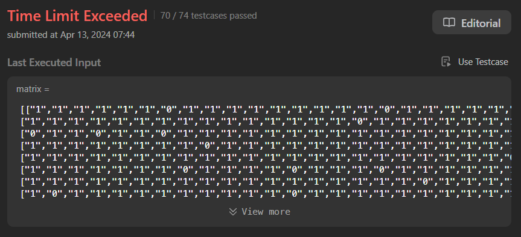

# 💯Faster✅💯Lesser✅Detailed Explaination🎯Stack🔥Height🧠Step-by-Step Explaination✅Python🐍Java🍵

**Author:** Mohammed_Raziullah_Ansari
**Votes:** 147
**Link:** [https://leetcode.com/problems/maximal-rectangle/solutions/5014890/](https://leetcode.com/problems/maximal-rectangle/solutions/5014890/)

---

# \uD83D\uDE80 Hi, I'm [Mohammed Raziullah Ansari](https://leetcode.com/Mohammed_Raziullah_Ansari/), and I'm excited to share solution to this question with detailed explanation:

# \uD83C\uDFAFProblem Explaination: 
- We have a 2D array `matrix` filled with `0's` and `1's`.
- We need to find the largest rectangle containing only 1's and return its `area`.
# \uD83E\uDDE0Thinking Behind the Solution:

Let's break down the solution process into two distinct sub-processes: **Processing Height Array** and **Max Area Calculation**.

### 1\uFE0F\u20E3Processing Height Array\u2705:
1. **Initialization**:
   - Create an array `height` initialized with zeros, with length equal to the number of columns in the matrix. This array will represent the heights of bars in a histogram.

2. **Processing Each Row**:
   - For each row `currRow` in the 2D matrix:
     - Traverse through each element of `currRow`.
     - If the element is `1`, increment the corresponding index in the `height` array.
     - If the element is `0`, reset the corresponding index in the `height` array to `0`.

### 2\uFE0F\u20E3Max Area Calculation (Naive Approach)\uD83E\uDD13:
- Now that we got `height` array assume that you are solving `Leetcode Problem 84. Largest Rectangle in Histogram` where we are given an array of integers `heights` representing the histogram's bar height where the width of each bar is 1.
- We want to find and return the area of the largest rectangle in the histogram.

**Approach**:
   - Iterate over all possible pairs of bars (i, j) where i < j.
   - For each pair (i, j), determine the minimum height `h` between the bars from index `i` to `j`.
   - Calculate the area of the rectangle formed by this pair of bars, which is `area = h * (j - i + 1)`.
   - Keep track of the maximum area found during these iterations.

#### Code\uD83D\uDC69\uD83C\uDFFB\u200D\uD83D\uDCBB(TLE\u274C):


```python []
class Solution:
    def maximalRectangle(self, matrix: List[List[str]]) -> int:
        if not matrix:
            return 0
        
        rows, cols = len(matrix), len(matrix[0])
        heights = [0] * (cols + 1)  # Include an extra element for easier calculation
        max_area = 0
        
        for row in matrix:
            for i in range(cols):
                heights[i] = heights[i] + 1 if row[i] == '1' else 0
            
            # Calculate max area using histogram method
            n = len(heights)  # Number of bars in the histogram

            for i in range(n):
                for j in range(i, n):
                    # Determine the minimum height between bar i and bar j
                    min_height = min(heights[k] for k in range(i, j + 1))
                    # Calculate the area of the rectangle
                    area = min_height * (j - i + 1)
                    # Update maximum area if the current rectangle's area is larger
                    if area > max_area:
                        max_area = area

        return max_area
        
```
     
```Java []
class Solution {
    public int maximalRectangle(char[][] matrix) {
        if (matrix == null || matrix.length == 0 || matrix[0].length == 0)
            return 0;
        
        int rows = matrix.length;
        int cols = matrix[0].length;
        int[] heights = new int[cols + 1]; // Include an extra element for easier calculation
        int maxArea = 0;
        
        for (char[] row : matrix) {
            for (int i = 0; i < cols; i++) {
                heights[i] = (row[i] == '1') ? heights[i] + 1 : 0;
            }
            
            // Calculate max area using histogram method
            int n = heights.length; // Number of bars in the histogram
            
            for (int i = 0; i < n; i++) {
                for (int j = i, minHeight = Integer.MAX_VALUE; j < n; j++) {
                    minHeight = Math.min(minHeight, heights[j]);
                    int area = minHeight * (j - i + 1);
                    maxArea = Math.max(maxArea, area);
                }
            }
        }
        
        return maxArea;
    }
}

```
     
```C++ []
class Solution {
public:
    int maximalRectangle(vector<vector<char>>& matrix) {
        if (matrix.empty() || matrix[0].empty())
            return 0;
        
        int rows = matrix.size();
        int cols = matrix[0].size();
        vector<int> heights(cols + 1, 0); // Include an extra element for easier calculation
        int maxArea = 0;
        
        for (const auto& row : matrix) {
            for (int i = 0; i < cols; i++) {
                heights[i] = (row[i] == '1') ? heights[i] + 1 : 0;
            }
            
            // Calculate max area using histogram method
            int n = heights.size(); // Number of bars in the histogram
            
            for (int i = 0; i < n; i++) {
                for (int j = i, minHeight = INT_MAX; j < n; j++) {
                    minHeight = min(minHeight, heights[j]);
                    int area = minHeight * (j - i + 1);
                    maxArea = max(maxArea, area);
                }
            }
        }
        
        return maxArea;
    }
};
```

**Complexity**:
The naive approach examines all possible rectangles by iterating through each pair of bars in the histogram, resulting in a time complexity of O(n^3), where n is the number of bars. 



**Optimization**:
To optimize, identify and address inefficiencies in the brute-force method. This involves recognizing repetitive calculations, such as repeatedly finding the minimum height between pairs of bars. We can use techniques like dynamic programming (DP) or stack-based methods to streamline the process and reduce unnecessary recalculations, ultimately improving efficiency and scalability for larger datasets.

### 2\uFE0F\u20E3Max Area Calculation (Using Stack-Based Approach)\uD83D\uDE0E:
1. **Initialization**:
   - Initialize a stack `stack` to keep track of indices of bars in the histogram.
   - Initialize `max_area` to store the maximum rectangle area found.

2. **Iterate Through Each Bar**:
   - Traverse each bar's height in the `height` array from left to right.

3. **Stack Operations**:
   - For each bar at index `i`:
     - While the stack is not empty and the current bar's height (`height[i]`) is less than the height of the bar represented by the index on top of the stack (`height[stack[-1]]`):
       - Pop the top index `j` from the stack.
       - Calculate the area with the popped bar's height:
         - `h = height[j]`
         - `w = i - stack[-1] - 1` (if stack is not empty), otherwise `w = i`
         - `area = h * w`
       - Update `max_area` with the maximum of `max_area` and `area`.

4. **Final Maximum Area**:
   - After processing all bars in the `height` array:
     - Check if the stack is not empty:
       - Pop each remaining index `j` from the stack and calculate the area similarly to step 3.

5. **Return Result**:
   - `max_area` will hold the value of the largest rectangle that can be formed within the histogram.


# Let's walkthrough\uD83D\uDEB6\uD83C\uDFFB\u200D\u2642\uFE0F the implementation process with an example for better understanding\uD83C\uDFAF:
Let's walk through the code step by step with the input `matrix = [["1","0","1","0","0"],["1","0","1","1","1"],["1","1","1","1","1"],["1","0","0","1","0"]]`.
- Iteration 1:
```
Current Row Array: ['1', '0', '1', '0', '0']
Height Array: [1, 0, 1, 0, 0]
Current Histogram:
# #  
Max Area: 1
```
- Iteration 2:
```
Current Row Array: ['1', '0', '1', '1', '1']
Height Array: [2, 0, 2, 1, 1]
Current Histogram:
# #  
# ###
Max Area: 3
```
- Iteration 3:
```
Current Row Array: ['1', '1', '1', '1', '1']
Height Array: [3, 1, 3, 2, 2]
Current Histogram:
# #  
# ###
#####
Max Area: 6
```
- Iteration 4:
```
Current Row Array: ['1', '0', '0', '1', '0']
Height Array: [4, 0, 0, 3, 0]
Current Histogram:
#    
#  # 
#  # 
#  # 
Max Area: 6
```

# Code\uD83D\uDC68\uD83C\uDFFB\u200D\uD83D\uDCBB:
```Python []
class Solution:
    def maximalRectangle(self, matrix: List[List[str]]) -> int:
        if not matrix:
            return 0
        
        rows, cols = len(matrix), len(matrix[0])
        heights = [0] * (cols + 1)  # Include an extra element for easier calculation
        max_area = 0
        
        for row in matrix:
            for i in range(cols):
                heights[i] = heights[i] + 1 if row[i] == '1' else 0
            
            # Calculate max area using histogram method
            stack = []
            for i in range(len(heights)):
                while stack and heights[i] < heights[stack[-1]]:
                    h = heights[stack.pop()]
                    w = i if not stack else i - stack[-1] - 1
                    max_area = max(max_area, h * w)
                stack.append(i)
        
        return max_area               
```
```Java []
class Solution {
    public int maximalRectangle(char[][] matrix) {
        if (matrix == null || matrix.length == 0 || matrix[0].length == 0)
            return 0;

        int rows = matrix.length;
        int cols = matrix[0].length;
        int[] heights = new int[cols + 1]; // Include an extra element for easier calculation
        int maxArea = 0;

        for (char[] row : matrix) {
            for (int i = 0; i < cols; i++) {
                heights[i] = (row[i] == '1') ? heights[i] + 1 : 0;
            }

            // Calculate max area using stack-based method
            Stack<Integer> stack = new Stack<>();
            for (int i = 0; i < heights.length; i++) {
                while (!stack.isEmpty() && heights[i] < heights[stack.peek()]) {
                    int h = heights[stack.pop()];
                    int w = stack.isEmpty() ? i : i - stack.peek() - 1;
                    maxArea = Math.max(maxArea, h * w);
                }
                stack.push(i);
            }
        }

        return maxArea;
    }
}

```
```C++ []
class Solution {
public:
    int maximalRectangle(vector<vector<char>>& matrix) {
        if (matrix.empty() || matrix[0].empty())
            return 0;

        int rows = matrix.size();
        int cols = matrix[0].size();
        vector<int> heights(cols + 1, 0); // Include an extra element for easier calculation
        int maxArea = 0;

        for (const auto& row : matrix) {
            for (int i = 0; i < cols; i++) {
                heights[i] = (row[i] == '1') ? heights[i] + 1 : 0;
            }

            // Calculate max area using stack-based method
            stack<int> stk;
            for (int i = 0; i < heights.size(); i++) {
                while (!stk.empty() && heights[i] < heights[stk.top()]) {
                    int h = heights[stk.top()];
                    stk.pop();
                    int w = stk.empty() ? i : i - stk.top() - 1;
                    maxArea = max(maxArea, h * w);
                }
                stk.push(i);
            }
        }

        return maxArea;
    }
};

```
