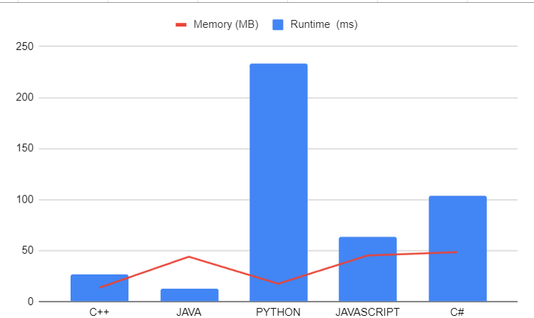

# 📢Stack and DP: Unveiling the Secrets to Count Maximal Rectangles || Full Explanation || Mr. Robot

**Author:** LakshayBrejwal_1_0
**Votes:** 23
**Link:** [https://leetcode.com/problems/maximal-rectangle/solutions/4172980/](https://leetcode.com/problems/maximal-rectangle/solutions/4172980/)

---

# Unlocking the Power of Algorithms: Solving the Maximal Rectangle Problem

If you're a coding enthusiast or a budding programmer, you've probably heard about the Maximal Rectangle Problem. This fascinating problem is a classic in the world of computer science and is often used to demonstrate the power of dynamic programming and efficient algorithm design.

In this blog post, we'll dive deep into the problem and explore a solution using a clever algorithm. We'll provide code examples in multiple programming languages to ensure that you can follow along regardless of your coding preferences. So, whether you're a C++ aficionado, a Java enthusiast, a Python pro, or a JavaScript wizard, you're in the right place!

## Understanding the Maximal Rectangle Problem

The Maximal Rectangle Problem can be defined as follows: Given a binary matrix, find the largest rectangle containing only ones and return its area. This might sound a bit complex at first, but with the right algorithm, it becomes a manageable challenge.

## The Algorithm: Dynamic Programming to the Rescue

The key to solving the Maximal Rectangle Problem lies in dynamic programming. Dynamic programming is a powerful technique that involves breaking down a complex problem into smaller subproblems and reusing solutions to subproblems to avoid redundant computations. 

### Step 1: The `largestRectangleArea` Function

First, let's take a look at the `largestRectangleArea` function. This function, written in C++, Java, Python, and JavaScript, calculates the largest rectangle area in a histogram. The idea is to use a stack to efficiently find the maximum area.

Here's a simplified overview of the algorithm:

1. Create an empty stack to store indices.
2. Iterate through the histogram from left to right.
3. While the stack is not empty and the current histogram value is less than the value at the index stored in the stack's top element, pop elements from the stack and calculate the maximum area for each popped element.
4. Keep track of the maximum area as you iterate through the histogram.

This algorithm efficiently finds the largest rectangle area in the histogram, which we'll use in the next step.

### Step 2: The `maximalAreaOfSubMatrixOfAll1` Function

In this step, we adapt the `largestRectangleArea` function to solve the Maximal Rectangle Problem for a binary matrix. We create a vector to store the height of each column and use dynamic programming to find the maximum rectangle area for each row.

### Step 3: Bringing It All Together

In the final step, we create the `maximalRectangle` function, which takes a binary matrix as input and returns the maximum rectangle area containing only ones.


## Dry Run of `maximalRectangle` Function

We'll perform a dry run of the `maximalRectangle` function using the following matrix:

```python
matrix = [
    ['1', '0', '1', '0', '0'],
    ['1', '0', '1', '1', '1'],
    ['1', '1', '1', '1', '1'],
    ['1', '0', '0', '1', '0']
]
```

### Step 1: Initializing Variables

We start with the given matrix:

```
1 0 1 0 0
1 0 1 1 1
1 1 1 1 1
1 0 0 1 0
```

We have two helper functions, `largestRectangleArea` and `maximalAreaOfSubMatrixOfAll1`, which are used within the `maximalRectangle` function.

### Step 2: `maximalAreaOfSubMatrixOfAll1`

We enter the `maximalAreaOfSubMatrixOfAll1` function, which computes the maximal area of submatrices containing only '1's. 

**Matrix and `height` after each row iteration:**

1. Process Row 1:
   - Matrix:
     ```
     1 0 1 0 0
     ```
   - Height: `[1, 0, 1, 0, 0]`

2. Process Row 2:
   - Matrix:
     ```
     1 0 1 1 1
     ```
   - Height: `[2, 0, 2, 1, 1]`

3. Process Row 3:
   - Matrix:
     ```
     1 1 1 1 1
     ```
   - Height: `[3, 1, 3, 2, 2]`

4. Process Row 4:
   - Matrix:
     ```
     1 0 0 1 0
     ```
   - Height: `[4, 1, 1, 3, 1]`

**Maximal Area of Histogram (`largestRectangleArea`):**

For each `height`, we calculate the maximal area of the histogram using the `largestRectangleArea` function.

- For the height `[1, 0, 1, 0, 0]`, the maximal area is `1`.
- For the height `[2, 0, 2, 1, 1]`, the maximal area is `4`.
- For the height `[3, 1, 3, 2, 2]`, the maximal area is `6`.
- For the height `[4, 1, 1, 3, 1]`, the maximal area is `4`.

The maximal area of submatrices for each row is `[1, 4, 6, 4]`.

### Step 3: `maximalRectangle`

Finally, we return the maximum value from the array `[1, 4, 6, 4]`, which is `6`.

The maximal area of a submatrix containing only '1's in the given matrix is `6`.

This concludes the dry run of the `maximalRectangle` function with the provided matrix.

###  **Code C++ Java Python JS C#**
```cpp []
class Solution {
public:
int largestRectangleArea(vector < int > & histo) {
    stack < int > st;
    int maxA = 0;
    int n = histo.size();
    for (int i = 0; i <= n; i++) {
        while (!st.empty() && (i == n || histo[st.top()] >= histo[i])) {
            int height = histo[st.top()];
            st.pop();
            int width;
            if (st.empty())
                width = i;
            else
                width = i - st.top() - 1;
            maxA = max(maxA, width * height);
        }
        st.push(i);
    }
    return maxA;
}
int maximalAreaOfSubMatrixOfAll1(vector<vector<char>> &mat, int n, int m) {
   
    int maxArea = 0;
    vector<int> height(m, 0);
    for (int i = 0; i < n; i++) {
        for (int j = 0; j < m; j++) {
            if (mat[i][j] == '1') height[j]++;
            else height[j] = 0;
        }
        int area = largestRectangleArea(height);
        maxArea = max(maxArea, area);
    }
    return maxArea;
}

    int maximalRectangle(vector<vector<char>>& matrix) {
        return maximalAreaOfSubMatrixOfAll1(matrix,matrix.size(),matrix[0].size());
    }
};
```

**Java:**
```java []
import java.util.Stack;

public class Solution {

    public int largestRectangleArea(int[] heights) {
        Stack<Integer> stack = new Stack<>();
        int maxArea = 0;
        int n = heights.length;
        for (int i = 0; i <= n; i++) {
            while (!stack.isEmpty() && (i == n || heights[stack.peek()] >= heights[i])) {
                int height = heights[stack.pop()];
                int width = stack.isEmpty() ? i : i - stack.peek() - 1;
                maxArea = Math.max(maxArea, width * height);
            }
            stack.push(i);
        }
        return maxArea;
    }

    public int maximalAreaOfSubMatrixOfAll1(char[][] matrix, int n, int m) {
        int maxArea = 0;
        int[] height = new int[m];
        for (int i = 0; i < n; i++) {
            for (int j = 0; j < m; j++) {
                if (matrix[i][j] == '1') {
                    height[j]++;
                } else {
                    height[j] = 0;
                }
            }
            int area = largestRectangleArea(height);
            maxArea = Math.max(maxArea, area);
        }
        return maxArea;
    }

    public int maximalRectangle(char[][] matrix) {
        return maximalAreaOfSubMatrixOfAll1(matrix, matrix.length, matrix[0].length);
    }
}
```

**Python:**
```python []
class Solution:
    def largestRectangleArea(self, heights):
        stack = []
        max_area = 0
        n = len(heights)
        
        for i in range(n + 1):
            while stack and (i == n or heights[stack[-1]] >= heights[i]):
                height = heights[stack.pop()]
                width = i if not stack else i - stack[-1] - 1
                max_area = max(max_area, height * width)
            
            stack.append(i)
        
        return max_area

    def maximalAreaOfSubMatrixOfAll1(self, mat, n, m):
        max_area = 0
        height = [0] * m

        for i in range(n):
            for j in range(m):
                if mat[i][j] == '1':
                    height[j] += 1
                else:
                    height[j] = 0

            area = self.largestRectangleArea(height)
            max_area = max(max_area, area)
        
        return max_area

    def maximalRectangle(self, matrix):
        if not matrix:
            return 0
        n, m = len(matrix), len(matrix[0])
        return self.maximalAreaOfSubMatrixOfAll1(matrix, n, m)

```

**JavaScript:**
```javascript []
function largestRectangleArea(heights) {
    const stack = [];
    let maxArea = 0;
    const n = heights.length;
    for (let i = 0; i <= n; i++) {
        while (stack.length > 0 && (i === n || heights[stack[stack.length - 1]] >= heights[i])) {
            const height = heights[stack.pop()];
            const width = stack.length === 0 ? i : i - stack[stack.length - 1] - 1;
            maxArea = Math.max(maxArea, width * height);
        }
        stack.push(i);
    }
    return maxArea;
}

function maximalAreaOfSubMatrixOfAll1(matrix, n, m) {
    let maxArea = 0;
    const height = new Array(m).fill(0);
    for (let i = 0; i < n; i++) {
        for (let j = 0; j < m; j++) {
            if (matrix[i][j] === '1') {
                height[j]++;
            } else {
                height[j] = 0;
            }
        }
        const area = largestRectangleArea(height);
        maxArea = Math.max(maxArea, area);
    }
    return maxArea;
}

function maximalRectangle(matrix) {
    return maximalAreaOfSubMatrixOfAll1(matrix, matrix.length, matrix[0].

length);
}
``` 
**C#**

``` csharp []
using System;
using System.Collections.Generic;

class Solution
{
    public int MaximalRectangle(char[][] matrix)
    {
        if (matrix == null || matrix.Length == 0 || matrix[0].Length == 0)
        {
            return 0;
        }

        int numRows = matrix.Length;
        int numCols = matrix[0].Length;

        int maxArea = 0;
        int[] height = new int[numCols];

        for (int row = 0; row < numRows; row++)
        {
            for (int col = 0; col < numCols; col++)
            {
                if (matrix[row][col] == '1')
                {
                    height[col]++;
                }
                else
                {
                    height[col] = 0;
                }
            }

            int area = LargestRectangleArea(height);
            maxArea = Math.Max(maxArea, area);
        }

        return maxArea;
    }

    private int LargestRectangleArea(int[] heights)
    {
        Stack<int> stack = new Stack<int>();
        int maxArea = 0;
        int n = heights.Length;

        for (int i = 0; i <= n; i++)
        {
            while (stack.Count > 0 && (i == n || heights[stack.Peek()] >= heights[i]))
            {
                int h = heights[stack.Pop()];
                int w = stack.Count == 0 ? i : i - stack.Peek() - 1;
                maxArea = Math.Max(maxArea, h * w);
            }

            stack.Push(i);
        }

        return maxArea;
    }
}
```
---
## Analysis


---
| Language   | Runtime (ms) | Memory (MB) |
|------------|--------------|-------------|
| C++        | 27           | 13.6        |
| Java       | 13           | 44          |
| Python     | 233          | 17.5        |
| JavaScript | 63           | 45.2        |
| C#         | 104          | 48.5        |

---
# Consider UPVOTING\u2B06\uFE0F


# DROP YOUR SUGGESTIONS IN THE COMMENT

## Keep Coding\uD83E\uDDD1\u200D\uD83D\uDCBB

 -- *MR.ROBOT SIGNING OFF*
