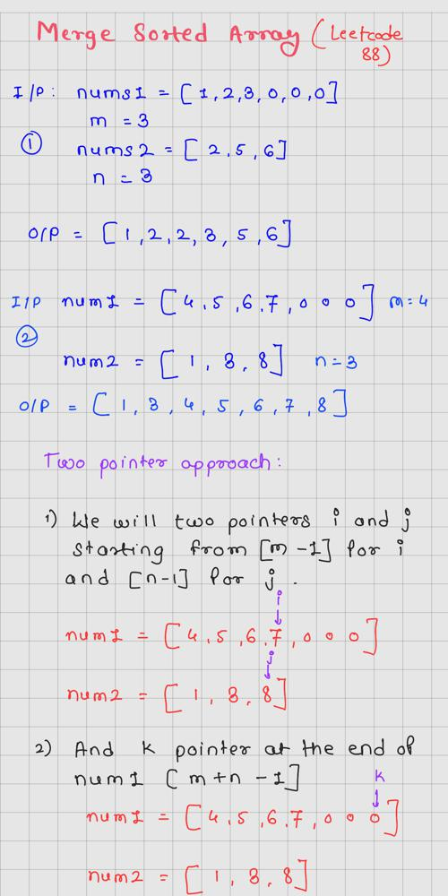
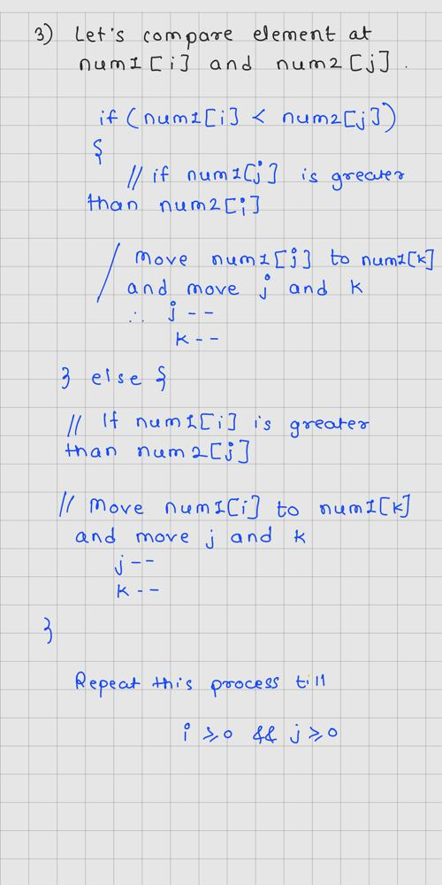
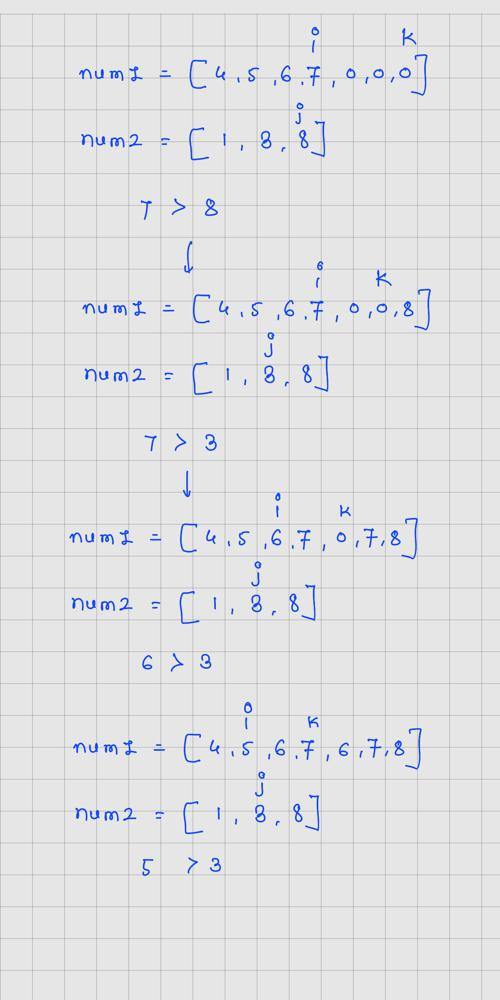
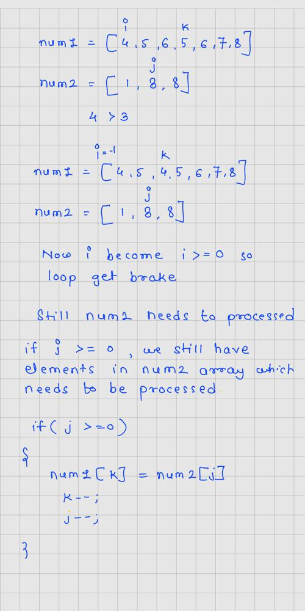
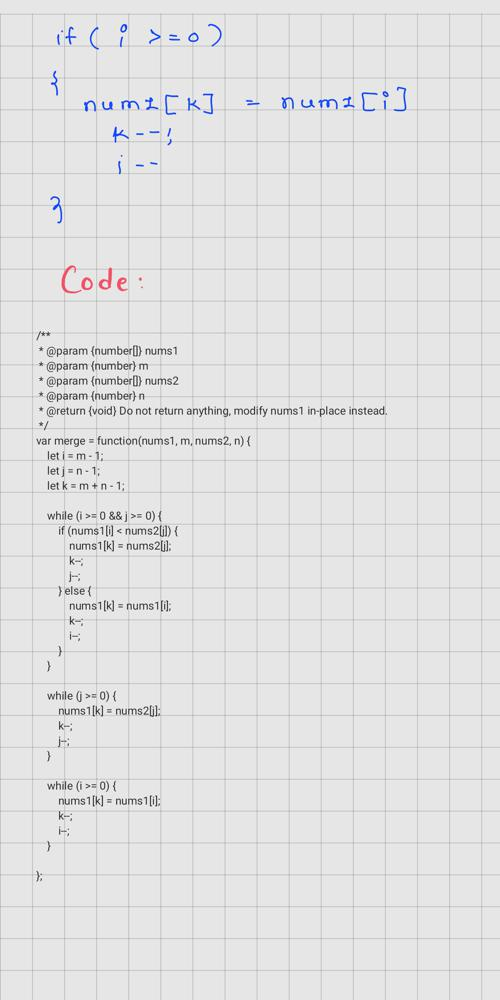

# JavaScript | Two Pointer | Explanation

**Author:** deadsec
**Votes:** 70
**Link:** [https://leetcode.com/problems/merge-sorted-array/solutions/2643064/](https://leetcode.com/problems/merge-sorted-array/solutions/2643064/)

---







```
/**
 * @param {number[]} nums1
 * @param {number} m
 * @param {number[]} nums2
 * @param {number} n
 * @return {void} Do not return anything, modify nums1 in-place instead.
 */
var merge = function(nums1, m, nums2, n) {
    let i = m - 1;
    let j = n - 1;
    let k = m + n - 1;
    
    while (i >= 0 && j >= 0) {
        if (nums1[i] < nums2[j]) {
            nums1[k] = nums2[j];
            k--;
            j--;
        } else {
            nums1[k] = nums1[i];
            k--;
            i--;
        }
    }
    
    while (j >= 0) {
        nums1[k] = nums2[j];
        k--;
        j--;
    }
    
    while (i >= 0) {
        nums1[k] = nums1[i];
        k--;
        i--;
    }
    
};
```