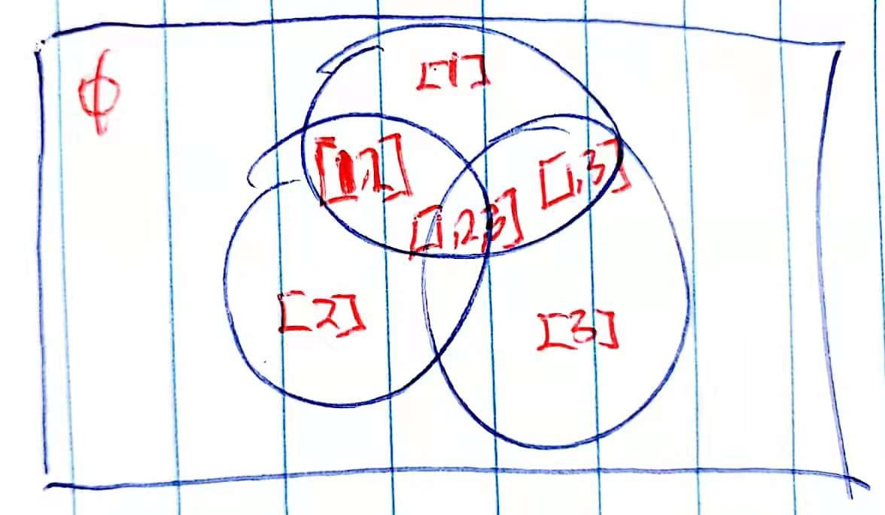
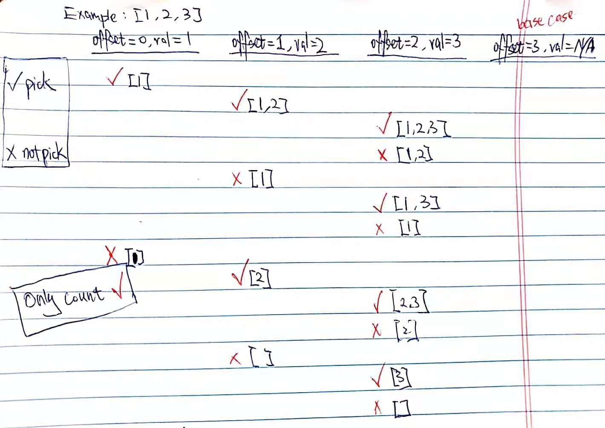
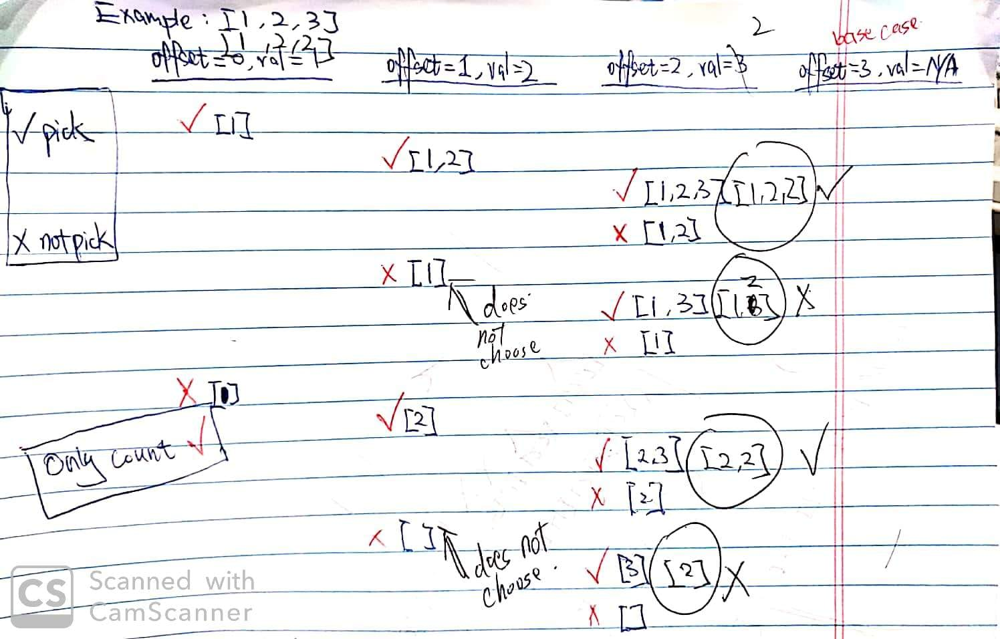
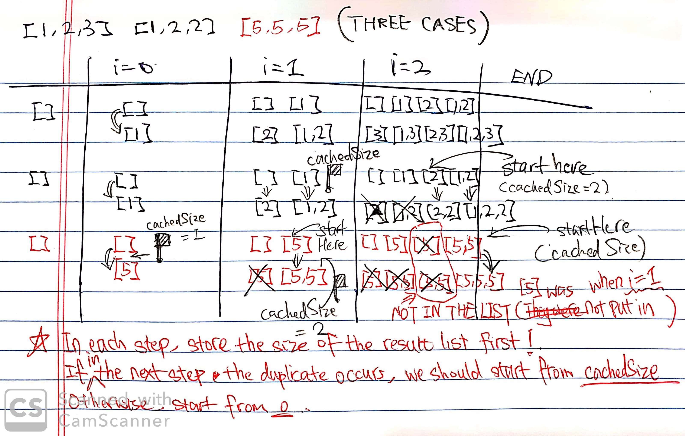

# Subsets I & II, Java Solution with Detailed Explanation and Comments (Recursion & Iteration)

**Author:** junhaowanggg
**Votes:** 414
**Link:** [https://leetcode.com/problems/subsets-ii/solutions/388566/](https://leetcode.com/problems/subsets-ii/solutions/388566/)

---

Reference: [Subsets I](https://leetcode.com/problems/subsets/) & [Subsets II](https://leetcode.com/problems/subsets-ii/) <span class="gray">EPI 15.5</span>
Difficulty: <span class="orange">Medium</span> (I think Subsets II should be hard)


## Problem

> Given a set of `distinct` integers, `nums`, return all possible subsets (the power set).

**Note:** The solution set must not contain duplicate subsets.

**Example:** 

```java
Input: nums = [1,2,3]
Output: [
  [3],
  [1],
  [2],
  [1,2,3],
  [1,3],
  [2,3],
  [1,2],
  []
]
```

**Follow up:** Check out the [Subsets II](#subsets_ii) section below.


## Analysis

The power set of a set `S` is the set of all subsets of `S`, including both the empty set `emptyset` and `S` itself. The power set of `{1, 2, 3}` is graphically illustrated as follows.




### Backtracking

The idea is that we loop over the number list. For each number, we have two choices: pick it, or not. For example, in `[1, 2, 3]`, we pick `1` and then do the same thing for the subproblem `[2, 3]`; and we don't pick `1` and then do the same thing for the subproblem `[2, 3]`.

The size of subproblems is decreasing. When picking `2`, the subproblem becomes `[3]` instead of `[1, 3]`.

Consider the following questions:

- What is the base case?
- When do we add the list to the result?

Here is an illustration of recursive process on `[1, 2, 3]`.




**Note:** Remember to add empty set manually.


```java
public List<List<Integer>> subsets(int[] nums) {
  List<List<Integer>> result = new ArrayList<>();
  List<Integer> numList = new ArrayList<>();
  
  result.add(new ArrayList<>()); // empty set
  subsets(0, nums, numList, result);
  return result;
}

private void subsets(int offset, int[] nums, List<Integer> numList, List<List<Integer>> result) {
  if (offset >= nums.length) {
    return;
  }
  int val = nums[offset];
  // pick
  numList.add(val);
  subsets(offset + 1, nums, numList, result);
  // add to result
  result.add(new ArrayList<>(numList));
  // not pick
  numList.remove(numList.size() - 1);
  subsets(offset + 1, nums, numList, result);
}
```

**Time:** `O(N * 2^N)` since the recurrence is `T(N) = 2T(N - 1)` and we also spend at most `O(N)` time within a call.
**Space:** `O(N * 2^N)` since there are `2^N` subsets. If we only print the result, we just need `O(N)` space.


### Iteration

The idea is simple. We go through the elements in the `nums` list. For each element, we loop over the current `result` list we have constructed so far. For each list in the `result`, we make a copy of this list and append the current element to it (it means picking the element). It is based on the same idea in backtracking (in each step you have choices: `pick` or `not pick`).

The result list initially contains an empty list `[]`. We loop over each element of `nums`, e.g. `[1, 2, 3]`.

- After the first round, we have `[[], [1]]`.
- After the second round, we have `[[], [1], [2], [1,2]]`.
- After the third round, we have `[[], [1], [2], [1,2], [3], [1,3], [2,3], [1,2,3]]`.

First, let's go over an incorrect version. There are two errors:

1. We add a new element to `L`, but it changes the existed `L`. Thus, we should make a new copy of it.
2. While looping over `result`, we are modifying its size. In Java, the compiler would yell.

**Incorrect version:**

```java
public List<List<Integer>> subsets(int[] nums) {
  List<List<Integer>> result = new ArrayList<>();
  result.add(new ArrayList<>());  // empty set
  for (int i = 0; i < nums.length; ++i) {
    for (List<Integer> L : result) {
      L.add(nums[i]);
      result.add(L);
    }
  }
  return result;
}
```

**Correct version:**

```java
public List<List<Integer>> subsets(int[] nums) {
  List<List<Integer>> result = new ArrayList<>();
  result.add(new ArrayList<>());  // empty set
  for (int i = 0; i < nums.length; ++i) {
    List<List<Integer>> newResult = new ArrayList<>(); // used for new lists
    for (List<Integer> L : result) {
      L = new ArrayList<>(L); // copy
      L.add(nums[i]);
      newResult.add(L);
    }
    result.addAll(newResult);  // concatenate
  }
  return result;
}
```

**Time:** `O(N * 2^N)`
- The outer loop takes `O(N)` time.
- The inner loop takes `2, 4, 8, ..., 2^N` time respectively.
- In inner loop, making a new copy of `L` takes at most `O(N)` time.
- Total runtime `T(N) = N * (2 + 4 + 8 + ... + 2^N) ~= N * 2^N`

**Space:** `O(N * 2^N)`


### K-Size Subsets

Actually, we can use the code in [77. Combinations](https://www.junhaow.com/lc/problems/backtracking/77_combinations.html) to solve this problem.


```java
public List<List<Integer>> subsets(int[] nums) {
  List<List<Integer>> result = new ArrayList<>();
  List<Integer> numList = new ArrayList<>();
  
  int n = nums.length;
  for (int k = 0; k <= n; ++k) { // compatible with empty set
    combine(n, k, 1, nums, numList, result);
  }
  return result;
}

private void combine(int n, int k, int d, int[] nums, List<Integer> numList, List<List<Integer>> result) {
  // base case (in order to handle empty set, ordering of two IFs matters)
  if (numList.size() == k) { // get a result
    result.add(new ArrayList<>(numList));
    return;
  }
  if (n - d + 1 < k - numList.size()) { // remaining elements are not enough
    return;
  }

  for (int i = d; i <= n; ++i) {
    int val = nums[i - 1];
    numList.add(val);
    combine(n, k, i + 1, nums, numList, result);
    numList.remove(numList.size() - 1); // remove the last
  }
}
```

**Time:** `O(N * 2^N)`
- `C(0, N) + C(1, N) + C(2, N) + C(3, N) + ... + C(N, N) = 2^N`

**Space:** `O(N * 2^N)`


## Subsets II

Reference:

- [[Java] Two Way of Recursive thinking](https://leetcode.com/problems/subsets-ii/discuss/169226/Java-Two-Way-of-Recursive-thinking)
- [Simple iterative solution](https://leetcode.com/problems/subsets-ii/discuss/30137/Simple-iterative-solution)

> Given a collection of integers that might **contain duplicates**, `nums`, return all possible subsets (the power set).

**Note:** The solution set must not contain duplicate subsets.

```java
Input: [1,2,2]
Output: [
  [2],
  [1],
  [1,2,2],
  [2,2],
  [1,2],
  []
]
```

### Backtracking

We need to know when we **should not** add a list to the result list.



By observation, a duplicate list occurs when `offset >= 1` (when `offset = 0`, duplicate cannot occur) and `nums[offset - 1] == nums[offset]` and in the previous step we did not pick `nums[offset - 1]`. The information of whether it picks or not could be passed down by a **boolean parameter** `isPicked`.
 
If the above condition is satisfied:
- Do not add the list to the result list.
- Do not do the subproblem after picking the current element.
- Only do the subproblem after not picking the current element.

**Note:** Be careful where we should put the `numList.add(val)` and `numList.remove(numList.size() - 1)`.

```java
public List<List<Integer>> subsetsWithDup(int[] nums) {
  // sorting
  Arrays.sort(nums);
  
  List<List<Integer>> result = new ArrayList<>();
  List<Integer> numList = new ArrayList<>();
  result.add(new ArrayList<>());
  subsets(0, nums, numList, result, true);
  return result;
}

private void subsets(int offset, int[] nums, List<Integer> numList, List<List<Integer>> result, boolean isPicked) {
  // base case
  if (offset >= nums.length) {
    return;
  }
  int val = nums[offset];
  // duplicate checking (convert && to ||)
  if (offset == 0 || nums[offset - 1] != nums[offset] || isPicked == true) {
    // pick
    numList.add(val);
    subsets(offset + 1, nums, numList, result, true);
    result.add(new ArrayList<>(numList));  // add to the result list
    numList.remove(numList.size() - 1);
  }
  // not pick
  subsets(offset + 1, nums, numList, result, false);
}
```

Another version (similar): 

```java
private void subsets(int offset, int[] nums, List<Integer> numList, List<List<Integer>> result, boolean isPicked) {
  // base case
  if (offset >= nums.length) {
    return;
  }
  int val = nums[offset];
  // not pick
  subsets(offset + 1, nums, numList, result, false);
  // duplicate check
  if (offset >= 1 && nums[offset - 1] == nums[offset] && isPicked == false) {
    return;
  }
  // pick
  numList.add(val);
  subsets(offset + 1, nums, numList, result, true);
  result.add(new ArrayList<>(numList));  // add to the result list
  numList.remove(numList.size() - 1); 
}
```

**Time:** `O(N * 2^N)`
**Space:** `O(N * 2^N)`


### Iteration

Using the same idea in backtracking, we need to figure out when we should add a list to the result list. Check out three examples below (`[1,2,3]`, `[1,2,2]`, `[5,5,5]`).



By observation, we learn that we should start from, if duplicate is detected, a specific location in the result list. In Subsets I, we always start from $0$.

Interestingly, the specific location corresponds to the initial size of the result list in the previous round. Since we change the result list in each round, we should cache the size of the result list as `cachedSize`.

Then we denote the starting index as `startIdx`. In each round, similar to what we've done in Subsets I, we set `startIdx` as:

- `0` (no duplicate or `i == 0`)
- `cachedSize` (duplicate occurs)

After setting `startIdx`, remember to do the caching job for the current size of the result list. Notice a fact that this cached size may not be used in the next round.


```java
public List<List<Integer>> subsetsWithDup(int[] nums) {
  // sort
  Arrays.sort(nums);
  
  List<List<Integer>> result = new ArrayList<>();
  result.add(new ArrayList<>());  // empty set
  
  int cachedSize = 0, startIdx = 0;
  for (int i = 0; i < nums.length; ++i) {
    List<List<Integer>> newResult = new ArrayList<>();  // used for new lists
    // set startIdx first before we update cachedSize
    startIdx = (i > 0 && nums[i - 1] == nums[i]) ? cachedSize : 0; // if duplicate occurs
    cachedSize = result.size(); // cache the size for startIdx in the next round
    for (int j = startIdx; j < result.size(); ++j) {
      List<Integer> L = result.get(j);
      L = new ArrayList<>(L);  // copy
      L.add(nums[i]);
      newResult.add(L);
    }
    result.addAll(newResult);  // concatenate
  }
  return result;
}
```

**Time:** `O(N * 2^N)`
**Space:** `O(N * 2^N)`


