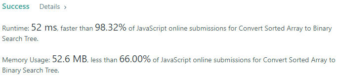
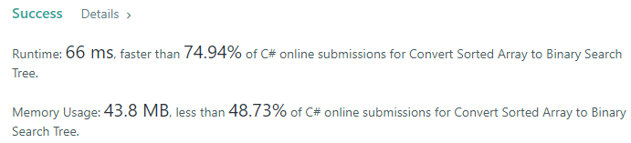
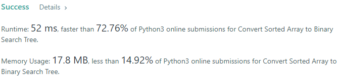
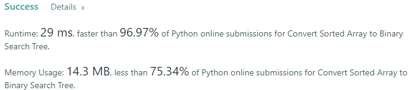
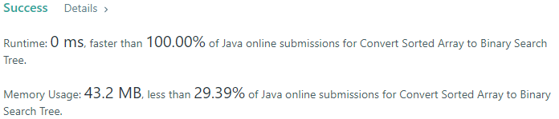
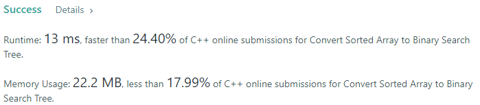

# 💢☠💫Easiest👾Faster✅💯 Lesser🧠 🎯 C++✅Python3🐍✅Java✅C✅Python🐍✅C#✅💥🔥💫Explained☠💥🔥 Beats 💯

**Author:** Edwards310
**Votes:** 22
**Link:** [https://leetcode.com/problems/convert-sorted-array-to-binary-search-tree/solutions/5594193/](https://leetcode.com/problems/convert-sorted-array-to-binary-search-tree/solutions/5594193/)

---

# Intuition







```javascript []
//JavaScript COde
/**
 * Definition for a binary tree node.
 * function TreeNode(val, left, right) {
 *     this.val = (val===undefined ? 0 : val)
 *     this.left = (left===undefined ? null : left)
 *     this.right = (right===undefined ? null : right)
 * }
 */
/**
 * @param {number[]} nums
 * @return {TreeNode}
 */

var sortedArrayToBST = function(nums, left = 0, right = nums.length - 1) {
    if (left > right) 
        return null;
    
    const mid = Math.floor((left + right) / 2);
    const node = new TreeNode(nums[mid]);
    
    node.left = sortedArrayToBST(nums, left, mid - 1);
    node.right = sortedArrayToBST(nums, mid + 1, right);
    
    return node;
}
```
```C++ []
//C++ Code
/**
 * Definition for a binary tree node.
 * struct TreeNode {
 *     int val;
 *     TreeNode *left;
 *     TreeNode *right;
 *     TreeNode() : val(0), left(nullptr), right(nullptr) {}
 *     TreeNode(int x) : val(x), left(nullptr), right(nullptr) {}
 *     TreeNode(int x, TreeNode *left, TreeNode *right) : val(x), left(left),
 * right(right) {}
 * };
 */
class Solution {
    TreeNode* helper(vector<int>& arr, int s, int e) {
        if (s > e)
            return nullptr;
        int mid = s + (e - s) / 2 ;
        TreeNode* node = new TreeNode(arr[mid]);
        node->left = helper(arr, s, mid - 1);
        node->right = helper(arr, mid + 1, e);
        return node;
    }

public:
    TreeNode* sortedArrayToBST(vector<int>& arr) {
        int n = arr.size();
        if (n == 0)
            return nullptr;
        TreeNode* root = helper(arr, 0, n - 1);
        return root;
    }
};
```
```Python3 []
#Python3 Code
# Definition for a binary tree node.
# class TreeNode:
#     def __init__(self, val=0, left=None, right=None):
#         self.val = val
#         self.left = left
#         self.right = right
class Solution:
    def sortedArrayToBST(self, nums: List[int]) -> Optional[TreeNode]:
        def helper(arr, s, e):
            if s > e:
                return None
            mid = s + (e - s) // 2
            node = TreeNode(arr[mid])
            node.left = helper(arr, s, mid - 1)
            node.right = helper(arr, mid + 1, e)
            return node
        
        n = len(nums)
        if n == 0:
            return None
        return helper(nums, 0, n - 1)
```
```Java []
//Java Code
/**
 * Definition for a binary tree node.
 * public class TreeNode {
 *     int val;
 *     TreeNode left;
 *     TreeNode right;
 *     TreeNode() {}
 *     TreeNode(int val) { this.val = val; }
 *     TreeNode(int val, TreeNode left, TreeNode right) {
 *         this.val = val;
 *         this.left = left;
 *         this.right = right;
 *     }
 * }
 */
class Solution {

    private TreeNode helper(int[] nums, int s, int e){
        if(s > e)
            return null;
        int mid = s + (e - s) / 2;
        TreeNode node = new TreeNode(nums[mid]);
        node.left = helper(nums, s, mid - 1);
        node.right = helper(nums, mid + 1, e);
        return node;
    }
    public TreeNode sortedArrayToBST(int[] nums) {
        int n = nums.length;
        if(n == 0)
            return null;
        return helper(nums, 0, n - 1);
    }
}
```
```C []
//C Code
/**
 * Definition for a binary tree node.
 * struct TreeNode {
 *     int val;
 *     struct TreeNode *left;
 *     struct TreeNode *right;
 * };
 */
struct TreeNode* createNewNode(int val){
    struct TreeNode* newNode = (struct TreeNode*)malloc(sizeof(struct TreeNode));
    newNode->val = val;
    newNode->left = NULL;
    newNode->right = NULL;
    return newNode;
}
struct TreeNode* helper(int* nums, int s, int e){
    if(s > e)
        return NULL;
    int mid = s + (e - s) / 2;
    struct TreeNode* node = createNewNode(nums[mid]);
    node->left = helper(nums, s, mid - 1);
    node->right = helper(nums, mid + 1, e);
    return node;
}
struct TreeNode* sortedArrayToBST(int* nums, int numsSize) {
    return helper(nums, 0, numsSize - 1);
}
```
```Python []
#Python Code
# Definition for a binary tree node.
# class TreeNode(object):
#     def __init__(self, val=0, left=None, right=None):
#         self.val = val
#         self.left = left
#         self.right = right
class Solution(object):
    def sortedArrayToBST(self, nums):
        """
        :type nums: List[int]
        :rtype: TreeNode
        """
        def helper(arr, s, e):
            if s > e:
                return None
            mid = s + (e - s) // 2
            node = TreeNode(arr[mid])
            node.left = helper(arr, s, mid - 1)
            node.right = helper(arr, mid + 1, e)
            return node
        
        n = len(nums)
        if n == 0:
            return None
        return helper(nums, 0, n - 1)
```
```C# []
//C# Code
/**
 * Definition for a binary tree node.
 * public class TreeNode {
 *     public int val;
 *     public TreeNode left;
 *     public TreeNode right;
 *     public TreeNode(int val=0, TreeNode left=null, TreeNode right=null) {
 *         this.val = val;
 *         this.left = left;
 *         this.right = right;
 *     }
 * }
 */
public class Solution {
    private TreeNode helper(int[] nums, int s, int e){
        if(s > e)
            return null;
        int mid = s + (e - s) / 2;
        TreeNode node = new TreeNode(nums[mid]);
        node.left = helper(nums, s, mid - 1);
        node.right = helper(nums, mid + 1, e);
        return node;
    }
    
    public TreeNode SortedArrayToBST(int[] nums) {
        return helper(nums, 0, nums.Length - 1);
    }
}
```
<!-- Describe your first thoughts on how to solve this problem. -->

# Approach
<!-- Describe your approach to solving the problem. -->

# Complexity
- Time complexity:
<!-- Add your time complexity here, e.g. $$O(n)$$ -->

- Space complexity:
<!-- Add your space complexity here, e.g. $$O(n)$$ -->

# Code

