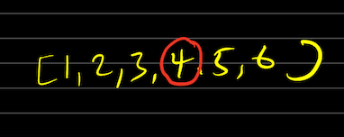
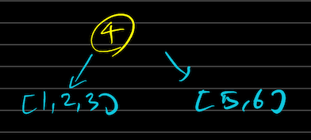
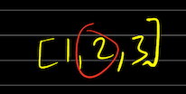
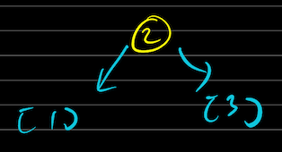
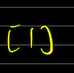
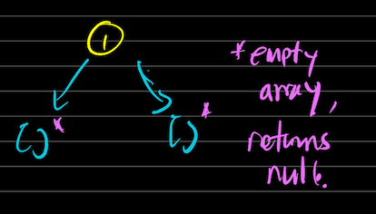

# ✅ Easiest TypeScript Solution Image&Explanation+ (Beautiful 4 BFS Liners)

**Author:** mlajkim
**Votes:** 6
**Link:** [https://leetcode.com/problems/convert-sorted-array-to-binary-search-tree/solutions/3309212/](https://leetcode.com/problems/convert-sorted-array-to-binary-search-tree/solutions/3309212/)

---


# Code (Beautiful 4 BFS Liners)
- Gets the number, and if it has the length of `0`, obviously should return `null`.
- Get the center index of given array. `n / 2` will be chosen when `n` is even number.
- Set the center index as a center of the node, and the array to the left will be sent to `sortedArrayToBST()` recursively, and vice versa for the right side.
    - This logic works, with the following diagram
    - Only the left-most logic was drawn, but the rest follow the same logic.







*end.*

```
function sortedArrayToBST(nums: number[]): TreeNode | null {
    if (nums.length === 0) return null

    const centerIndex = Math.floor(nums.length / 2)
    return new TreeNode(nums[centerIndex],
        sortedArrayToBST(nums.slice(0, centerIndex)),
        sortedArrayToBST(nums.slice(centerIndex + 1))
    )
};
```

## Tips
- If you face such a problem like this, its the best to reuse the given function most of the times.