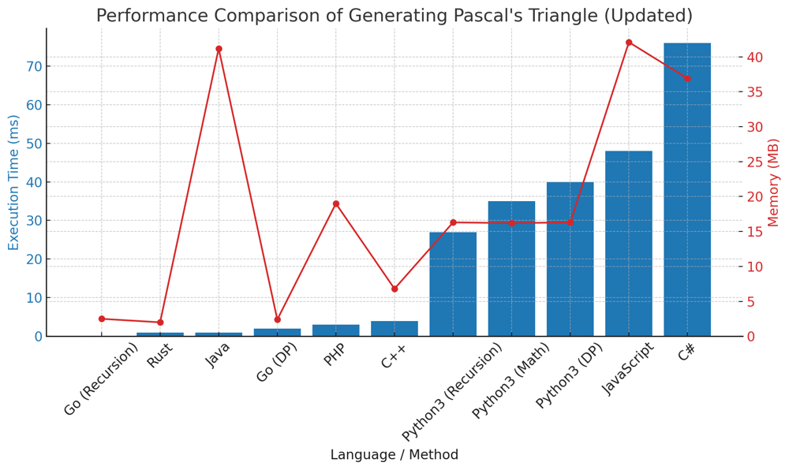

# ✅ 99.53% Recursion & Math & Dynamic Programming

**Author:** vanAmsen
**Votes:** 88
**Link:** [https://leetcode.com/problems/pascals-triangle/solutions/4016165/](https://leetcode.com/problems/pascals-triangle/solutions/4016165/)

---

# Comprehensive Guide to Generating Pascal's Triangle: A Three-Pronged Approach for Programmers

## Introduction & Problem Statement

Welcome to this in-depth guide on generating Pascal's Triangle up to a given number of rows. Pascal's Triangle is a mathematical concept that finds applications in various domains, including combinatorics, probability theory, and computer science. In this guide, we will explore three distinct methods to solve this problem: Dynamic Programming, Recursion, and Math (Combinatorics).

## Key Concepts and Constraints

1. **Row Anatomy**:  
   In Pascal's Triangle, each row starts and ends with 1. Each inner element is the sum of the two elements directly above it in the previous row.

2. **Row Generation**:  
   Our primary task is to generate the first `numRows` of Pascal's Triangle.

3. **Constraints**:  
   1 <= `numRows` <= 30. The constraint allows us to generate up to 30 rows of Pascal's Triangle.

---

# Strategies to Tackle the Problem: A Three-Pronged Approach

### Live Coding Dynamic Programming
https://youtu.be/g1QAZX8MLWo?si=eeIe-f-Hi4PJfipl

## Method 1. Dynamic Programming

### Intuition and Logic Behind the Solution

In Dynamic Programming, we use the concept of "building upon previous solutions" to solve the problem. We start with the first row and iteratively generate each subsequent row based on the row above it.

### Step-by-step Explanation

1. **Initialization**:  
   - Start with a list containing the first row `[1]`.

2. **Iterative Row Generation**:  
   - For each subsequent row, generate it based on the last row in the list. Start and end each row with 1 and fill the middle elements according to Pascal's rule.

3. **Return the Triangle**:  
   - After generating the required number of rows, return the triangle.

### Complexity Analysis

- **Time Complexity**: $$O(n^2)$$ \u2014 Each row takes $$O(n)$$ time to generate.
- **Space Complexity**: $$O(n^2)$$ \u2014 Storing the triangle takes $$O(n^2)$$ space.

## Code Dynamic Programming 
``` Python []
class Solution:
    def generate(self, numRows: int) -> List[List[int]]:
        if numRows == 0:
            return []
        
        triangle = [[1]]
        
        for i in range(1, numRows):
            prev_row = triangle[-1]
            new_row = [1]
            
            for j in range(1, len(prev_row)):
                new_row.append(prev_row[j-1] + prev_row[j])
            
            new_row.append(1)
            triangle.append(new_row)
        
        return triangle
```
``` Go []
func generate(numRows int) [][]int {
	var triangle [][]int
	if numRows == 0 {
		return triangle
	}

	triangle = append(triangle, []int{1})

	for i := 1; i < numRows; i++ {
		prevRow := triangle[i-1]
		var newRow []int
		newRow = append(newRow, 1)

		for j := 1; j < len(prevRow); j++ {
			newRow = append(newRow, prevRow[j-1]+prevRow[j])
		}

		newRow = append(newRow, 1)
		triangle = append(triangle, newRow)
	}

	return triangle
}
```
``` Rust []
impl Solution {
    pub fn generate(num_rows: i32) -> Vec<Vec<i32>> {
        let mut triangle = Vec::new();
        if num_rows == 0 {
            return triangle;
        }

        triangle.push(vec![1]);

        for _ in 1..num_rows {
            let prev_row = triangle.last().unwrap();
            let mut new_row = vec![1];

            for j in 1..prev_row.len() {
                new_row.push(prev_row[j-1] + prev_row[j]);
            }

            new_row.push(1);
            triangle.push(new_row);
        }

        triangle
    }
}
```
``` C++ []
class Solution {
public:
    vector<vector<int>> generate(int numRows) {
        vector<vector<int>> triangle;
        if (numRows == 0) return triangle;

        triangle.push_back({1});

        for (int i = 1; i < numRows; ++i) {
            vector<int> prev_row = triangle.back();
            vector<int> new_row = {1};

            for (int j = 1; j < prev_row.size(); ++j) {
                new_row.push_back(prev_row[j-1] + prev_row[j]);
            }

            new_row.push_back(1);
            triangle.push_back(new_row);
        }

        return triangle;
    }
};
```
``` Java []
public class Solution {
    public List<List<Integer>> generate(int numRows) {
        List<List<Integer>> triangle = new ArrayList<>();
        if (numRows == 0) return triangle;

        triangle.add(new ArrayList<>());
        triangle.get(0).add(1);

        for (int i = 1; i < numRows; i++) {
            List<Integer> prev_row = triangle.get(i - 1);
            List<Integer> new_row = new ArrayList<>();
            new_row.add(1);

            for (int j = 1; j < prev_row.size(); j++) {
                new_row.add(prev_row.get(j - 1) + prev_row.get(j));
            }

            new_row.add(1);
            triangle.add(new_row);
        }

        return triangle;
    }
}
```
``` C# []
class Solution {
    public IList<IList<int>> Generate(int numRows) {
        List<IList<int>> triangle = new List<IList<int>>();
        if (numRows == 0) return triangle;

        triangle.Add(new List<int>() { 1 });

        for (int i = 1; i < numRows; i++) {
            List<int> prevRow = (List<int>)triangle[i - 1];
            List<int> newRow = new List<int> { 1 };

            for (int j = 1; j < prevRow.Count; j++) {
                newRow.Add(prevRow[j - 1] + prevRow[j]);
            }

            newRow.Add(1);
            triangle.Add(newRow);
        }

        return triangle;
    }
}
```
``` JavaScript []
/**
 * @param {number} numRows
 * @return {number[][]}
 */
var generate = function(numRows) {
    let triangle = [];
    if (numRows === 0) return triangle;

    triangle.push([1]);

    for (let i = 1; i < numRows; i++) {
        let prevRow = triangle[i - 1];
        let newRow = [1];

        for (let j = 1; j < prevRow.length; j++) {
            newRow.push(prevRow[j - 1] + prevRow[j]);
        }

        newRow.push(1);
        triangle.push(newRow);
    }

    return triangle;
};
```
``` PHP []
class Solution {
    function generate($numRows) {
    $triangle = [];
    if ($numRows == 0) return $triangle;

    $triangle[] = [1];

    for ($i = 1; $i < $numRows; $i++) {
        $prevRow = end($triangle);
        $newRow = [1];

        for ($j = 1; $j < count($prevRow); $j++) {
            $newRow[] = $prevRow[$j - 1] + $prevRow[$j];
        }

        $newRow[] = 1;
        $triangle[] = $newRow;
    }

    return $triangle;
}
}
```

---

## Method 2. Recursion

### Intuition and Logic Behind the Solution

The Recursive approach generates Pascal's Triangle by making recursive calls to generate the previous rows and then building upon that to generate the current row.

### Step-by-step Explanation

1. **Base Case**:  
   - If `numRows` is 1, return `[[1]]`.

2. **Recursive Row Generation**:  
   - Make a recursive call to generate the first `numRows - 1` rows.
   - Generate the `numRows`-th row based on the last row in the list.

3. **Return the Triangle**:  
   - Return the triangle after adding the new row.

### Complexity Analysis

- **Time Complexity**: $$O(n^2)$$
- **Space Complexity**: $$O(n^2)$$

## Code Recursion
``` Python []
class Solution:
    def generate(self, numRows: int) -> List[List[int]]:
        if numRows == 1:
            return [[1]]
        
        triangle = self.generate(numRows - 1)
        
        prev_row = triangle[-1]
        new_row = [1]
        
        for i in range(1, len(prev_row)):
            new_row.append(prev_row[i-1] + prev_row[i])
        
        new_row.append(1)
        triangle.append(new_row)
        
        return triangle
```
``` Go []
func generate(numRows int) [][]int {
    if numRows == 1 {
        return [][]int{{1}}
    }

    triangle := generate(numRows - 1)
    prevRow := triangle[len(triangle) - 1]
    var newRow []int
    newRow = append(newRow, 1)

    for i := 1; i < len(prevRow); i++ {
        newRow = append(newRow, prevRow[i-1] + prevRow[i])
    }

    newRow = append(newRow, 1)
    triangle = append(triangle, newRow)

    return triangle
}

```

---

## Method 3. Math (Combinatorics)

### Intuition and Logic Behind the Solution

This method uses the mathematical formula for combinations to directly compute the elements of Pascal's Triangle without relying on previous rows. This formula is $$ \\binom{n}{k} $$.

### Step-by-step Explanation

1. **Define the Combination Function**:  
   - Use `math.comb()` or a custom function to calculate $$ \\binom{n}{k} $$.

2. **Direct Row Generation**:  
   - For each row $$ n $$ and each index $$ k $$ in that row, directly compute the element using $$ \\binom{n}{k} $$.

3. **Return the Triangle**:  
   - Return the generated triangle.

### Complexity Analysis

- **Time Complexity**: $$O(n^2)$$
- **Space Complexity**: $$O(n^2)$$

## Code Math
``` Python []
class Solution:
    def generate(self, numRows: int) -> List[List[int]]:
        import math

        triangle = []
        
        for n in range(numRows):
            row = []
            for k in range(n+1):
                row.append(math.comb(n, k))
            triangle.append(row)
        
        return triangle
```

## Performance

| Language     | Method      | Execution Time (ms) | Memory (MB) |
|--------------|-------------|---------------------|-------------|
| Go           | Recursion          | 0                   | 2.5         |
| Rust         | DP          | 1                   | 2.0         |
| Java         | DP          | 1                   | 41.2        |
| Go           | DP          | 2                   | 2.4         |
| PHP          | DP          | 3                   | 19          |
| C++          | DP          | 4                   | 6.8         |
| Python3      | Recursion   | 27                  | 16.3        |
| Python3      | Math        | 35                  | 16.2        |
| Python3      | DP          | 40                  | 16.3        |
| JavaScript   | DP          | 48                  | 42.1        |
| C#           | DP          | 76                  | 36.9        |




## Live Coding Recursion
https://youtu.be/DW5CiB4WBu0?si=Hg1oI3_R6BlA6_X5


## Code Highlights and Best Practices

- In the Dynamic Programming and Recursion approaches, we build upon previous solutions, making them more intuitive but dependent on previous rows.
- The Math approach directly computes each element, making it independent of previous rows but less intuitive.
- The Dynamic Programming approach is often the most straightforward and easy to implement.

By understanding these three approaches, you'll be well-equipped to tackle problems that involve generating Pascal's Triangle or similar combinatorial constructs.