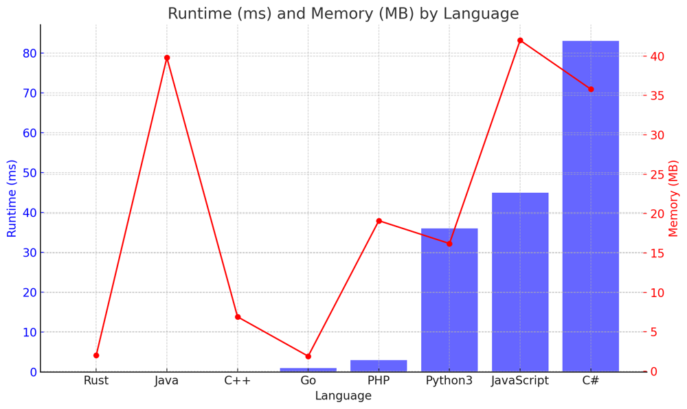

# ✅ 100% Easy Optimized

**Author:** vanAmsen
**Votes:** 114
**Link:** [https://leetcode.com/problems/pascals-triangle-ii/solutions/4173164/](https://leetcode.com/problems/pascals-triangle-ii/solutions/4173164/)

---

# Intuition
When faced with Pascal's Triangle, a fundamental pattern that stands out is the binomial coefficient. The elements of each row in Pascal's Triangle can be represented as combinations. Recognizing this mathematical property offers a direct route to the solution without the need to iterate through all the preceding rows.

## Live Coding + Explaining
https://youtu.be/BY95fxcrjag?si=d2BKTlF0FCIhLjoU

# Approach
Each row of Pascal's Triangle can be represented using the sequence of combinations:
$$ C(r, 0), C(r, 1), C(r, 2), \\ldots, C(r, r) $$
where $$ C(n, k) $$ is the binomial coefficient, defined as:
$$ C(n, k) = \\frac{n!}{k!(n-k)!} $$

The row's first element is always 1. Given the previous element in the row (`prev`), the next element can be calculated using:
$$ \	ext{next\\_val} = \	ext{prev} \	imes \\frac{\	ext{rowIndex} - k + 1}{k} $$
This formula is derived from the relationship between consecutive binomial coefficients in the same row.

Iterating from `k = 1` to `k = rowIndex`, we can directly generate the elements for the desired row without building the entire triangle.

# Complexity
- Time complexity: $$O(\	ext{rowIndex})$$
This is because we are directly computing the rowIndex-th row without iterating through all previous rows.

- Space complexity: $O(\	ext{rowIndex})$
The only significant space used is for the result list, which has a length of rowIndex + 1.

# Code
``` Python []
class Solution:
    def getRow(self, rowIndex: int) -> List[int]:
        res = [1]
        prev = 1
        for k in range(1, rowIndex + 1):
            next_val = prev * (rowIndex - k + 1) // k
            res.append(next_val)
            prev = next_val
        return res
```
``` C++ []
class Solution {
public:
    std::vector<int> getRow(int rowIndex) {
        std::vector<int> res(1, 1);
        long long prev = 1;
        for(int k = 1; k <= rowIndex; k++) {
            long long next_val = prev * (rowIndex - k + 1) / k;
            res.push_back(next_val);
            prev = next_val;
        }
        return res;
    }
};
```
``` Java []
public class Solution {
    public List<Integer> getRow(int rowIndex) {
        List<Integer> res = new ArrayList<>();
        res.add(1);
        long prev = 1;
        for (int k = 1; k <= rowIndex; k++) {
            long next_val = prev * (rowIndex - k + 1) / k;
            res.add((int) next_val);
            prev = next_val;
        }
        return res;
    }
}
```
``` Go []
func getRow(rowIndex int) []int {
    res := []int{1}
    prev := 1
    for k := 1; k <= rowIndex; k++ {
        next_val := prev * (rowIndex - k + 1) / k
        res = append(res, next_val)
        prev = next_val
    }
    return res
}
```
``` Rust []
impl Solution {
    pub fn get_row(row_index: i32) -> Vec<i32> {
        let mut res = vec![1];
        let mut prev: i64 = 1;  // use i64 for the calculations
        for k in 1..=row_index {
            let next_val = prev * (row_index - k + 1) as i64 / k as i64;
            res.push(next_val as i32);
            prev = next_val;
        }
        res
    }
}
```
``` PHP []
class Solution {
    function getRow($rowIndex) {
        $res = [1];
        $prev = 1;
        for($k = 1; $k <= $rowIndex; $k++) {
            $next_val = $prev * ($rowIndex - $k + 1) / $k;
            $res[] = $next_val;
            $prev = $next_val;
        }
        return $res;
    }
}
```
``` JavaScript []
var getRow = function(rowIndex) {
    let res = [1];
    let prev = 1;
    for(let k = 1; k <= rowIndex; k++) {
        let next_val = prev * (rowIndex - k + 1) / k;
        res.push(next_val);
        prev = next_val;
    }
    return res;
};
```
``` C# []
public class Solution {
    public IList<int> GetRow(int rowIndex) {
        List<int> res = new List<int> {1};
        long prev = 1;
        for (int k = 1; k <= rowIndex; k++) {
            long next_val = prev * (rowIndex - k + 1) / k;
            res.Add((int)next_val);
            prev = next_val;
        }
        return res;
    }
}
```


## Performance

| Language   | Runtime (ms) | Memory (MB) |
|------------|--------------|-------------|
| Rust       | 0 ms         | 2 MB        |
| Java       | 0 ms         | 39.8 MB     |
| C++        | 0 ms         | 6.9 MB      |
| Go         | 1 ms         | 1.9 MB      |
| PHP        | 3 ms         | 19.1 MB     |
| Python3    | 36 ms        | 16.2 MB     |
| JavaScript | 45 ms        | 42 MB       |
| C#         | 83 ms        | 35.8 MB     |




# What have we learned?
This problem teaches us the importance of recognizing patterns and mathematical properties in data. Rather than relying on a brute-force approach (i.e., building the entire Pascal's Triangle up to the desired row), we leveraged the properties of binomial coefficients to directly compute the required row. This understanding reduces both the time and space complexity of our solution. The logic behind this solution is the inherent mathematical relationship between consecutive binomial coefficients in Pascal's Triangle, which allows us to compute the next coefficient given the previous one. This is a testament to the power of mathematical insight in algorithm design.