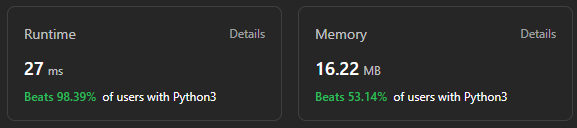

# ✅ Beats 98.39% 🔥 | 2 Approaches Detailed Explanation | Beginner Friendly Code |

**Author:** Gourav-2002
**Votes:** 5
**Link:** [https://leetcode.com/problems/pascals-triangle-ii/solutions/4173392/](https://leetcode.com/problems/pascals-triangle-ii/solutions/4173392/)

---




# Intuition
1. We know that the pascal triangle is a triangle of binomial coefficients.
2. We know that the binomial coefficients can be calculated using the formula nCr = n!/(r!*(n-r)!)
3. We know that the binomial coefficients are symmetric, i.e. nCr = nC(n-r) 
4. We know that the binomial coefficients can be calculated using the previous row of the pascal triangle.  
5. We know that the first and last element of each row is 1.
6. We know that the number of elements in each row is equal to the row number.
7. We know that the row number starts from 0.
8. We know that the first row is [1].
9. Now, we can use the above information to calculate the pascal triangle.

# Approach 1 : Dynamic Programming 
## (Least Optimized)
###### This Approach if least optimized but for beginners who are facing difficulty with DP , in this solution dp is elaborated very well.
1. Create a list of list called triangle and initialize it with [[1]].
2. Iterate from 0 to rowIndex-1.
3. Get the last row of the triangle and store it in last_row.
4. Create a new list called new_row and initialize it with [1].
5. Iterate from 1 to len(last_row)-1.
6. Append the sum of last_row[j-1] and last_row[j] to new_row.
7. Append 1 to new_row.
8. Append new_row to triangle.
9. Return the last row of the triangle.

# Complexity
- Time complexity : $$O(n^2)$$
<!-- Add your time complexity here, e.g. $$O(n)$$ -->

- Space complexity : $$O(n^2)$$
<!-- Add your space complexity here, e.g. $$O(n)$$ -->

# Code
``` Python []
class Solution:
    def getRow(self, rowIndex: int) -> List[int]:
        if rowIndex==0:
            return [1]
        
        triangle=[[1]]

        for i in range(rowIndex):
            last_row=triangle[-1]
            new_row=[1]

            for j in range(1,len(last_row)):
                new_row.append(last_row[j-1]+last_row[j])
            
            new_row.append(1)
            triangle.append(new_row)
        
        return triangle[-1]
```
``` C++ []
class Solution {
public:
    vector<int> getRow(int rowIndex) {
        if (rowIndex == 0)
            return {1};
        
        vector<vector<int>> triangle{{1}};

        for (int i = 0; i < rowIndex; ++i) {
            vector<int>& last_row = triangle.back();
            vector<int> new_row{1};

            for (int j = 1; j < last_row.size(); ++j) {
                new_row.push_back(last_row[j-1] + last_row[j]);
            }

            new_row.push_back(1);
            triangle.push_back(new_row);
        }
        
        return triangle.back();
    }
};

```
``` Java []
class Solution {
    public List<Integer> getRow(int rowIndex) {
        if (rowIndex == 0) {
            return Arrays.asList(1);
        }

        List<List<Integer>> triangle = new ArrayList<>();
        triangle.add(Arrays.asList(1));

        for (int i = 0; i < rowIndex; i++) {
            List<Integer> lastRow = triangle.get(triangle.size() - 1);
            List<Integer> newRow = new ArrayList<>();
            newRow.add(1);

            for (int j = 1; j < lastRow.size(); j++) {
                newRow.add(lastRow.get(j - 1) + lastRow.get(j));
            }

            newRow.add(1);
            triangle.add(newRow);
        }

        return triangle.get(triangle.size() - 1);
    }
}

```
``` JavaScript []
/**
 * @param {number} rowIndex
 * @return {number[]}
 */
var getRow = function(rowIndex) {
    if (rowIndex === 0) {
        return [1];
    }

    let triangle = [[1]];

    for (let i = 0; i < rowIndex; i++) {
        let lastRow = triangle[triangle.length - 1];
        let newRow = [1];

        for (let j = 1; j < lastRow.length; j++) {
            newRow.push(lastRow[j - 1] + lastRow[j]);
        }

        newRow.push(1);
        triangle.push(newRow);
    }

    return triangle[triangle.length - 1];
};
```
``` TypeScript []
function getRow(rowIndex: number): number[] {
if (rowIndex === 0) {
            return [1];
        }

        let triangle: number[][] = [[1]];

        for (let i = 0; i < rowIndex; i++) {
            let lastRow: number[] = triangle[triangle.length - 1];
            let newRow: number[] = [1];

            for (let j = 1; j < lastRow.length; j++) {
                newRow.push(lastRow[j - 1] + lastRow[j]);
            }

            newRow.push(1);
            triangle.push(newRow);
        }

        return triangle[triangle.length - 1];
    };
```
``` C# []
public class Solution {
    public IList<int> GetRow(int rowIndex) {
        if (rowIndex == 0) {
            return new int[] { 1 };
        }

        List<List<int>> triangle = new List<List<int>>();
        triangle.Add(new List<int> { 1 });

        for (int i = 0; i < rowIndex; i++) {
            List<int> lastRow = triangle[triangle.Count - 1];
            List<int> newRow = new List<int>();
            newRow.Add(1);

            for (int j = 1; j < lastRow.Count; j++) {
                newRow.Add(lastRow[j - 1] + lastRow[j]);
            }

            newRow.Add(1);
            triangle.Add(newRow);
        }

        return triangle[triangle.Count - 1].ToArray();
    }
    }
```
``` PHP []
class Solution {

    /**
     * @param Integer $rowIndex
     * @return Integer[]
     */
    function getRow($rowIndex) {
        if ($rowIndex === 0) {
            return [1];
        }

        $triangle = [[1]];

        for ($i = 0; $i < $rowIndex; $i++) {
            $lastRow = $triangle[count($triangle) - 1];
            $newRow = [1];

            for ($j = 1; $j < count($lastRow); $j++) {
                array_push($newRow, $lastRow[$j - 1] + $lastRow[$j]);
            }

            array_push($newRow, 1);
            array_push($triangle, $newRow);
        }

        return $triangle[count($triangle) - 1];
    }
    }
```
``` Kotlin []
class Solution {
    fun getRow(rowIndex: Int): List<Int> {
        if (rowIndex == 0) {
            return listOf(1)
        }

        val triangle = mutableListOf(listOf(1))

        for (i in 0 until rowIndex) {
            val lastRow = triangle.last()
            val newRow = mutableListOf(1)

            for (j in 1 until lastRow.size) {
                newRow.add(lastRow[j - 1] + lastRow[j])
            }

            newRow.add(1)
            triangle.add(newRow)
        }

        return triangle.last()
    }
    }
```
# Intuition :

###### Here, we will use the formula nCr = n!/(r!*(n-r)!) to calculate the binomial coefficients.

# Approach 2 : Using Combinatorics
### This Approach is well Optimized.

### Algorithm :
1. Create a list called row and initialize it with 1.
2. Iterate from 1 to rowIndex.
3. Update the value of row[i] to row[i-1]*(rowIndex-i+1)/i.
4. Return row.

# Code
``` Python []
class Solution:
    def getRow(self, rowIndex: int) -> List[int]:
        row=[1]
        for i in range(1,rowIndex+1):
            row.append(int(row[i-1]*(rowIndex-i+1)/i))
        return row
```
``` C+ []
class Solution {
public:
    vector<int> getRow(int rowIndex) {
        vector<int> row = {1};
        for (int i = 1; i <= rowIndex; ++i) {
            row.push_back(static_cast<int>(row[i - 1] * (rowIndex - i + 1) / i));
        }
        return row;
    }
};
```
``` Java []
class Solution {
    public List<Integer> getRow(int rowIndex) {
        List<Integer> row = new ArrayList<>();
        row.add(1);
        for (int i = 1; i <= rowIndex; ++i) {
            row.add((int)((long)row.get(i - 1) * (rowIndex - i + 1) / i));
        }
        return row;
    }
}
```
``` JavaScript []
var getRow = function(rowIndex) {
    const row = [1];
    for (let i = 1; i <= rowIndex; ++i) {
        row.push(Math.floor(row[i - 1] * (rowIndex - i + 1) / i));
    }
    return row;
};
```
``` TypeScript []
function getRow(rowIndex: number): number[] {
const row: number[] = [1];
        for (let i = 1; i <= rowIndex; ++i) {
            row.push(Math.floor(row[i - 1] * (rowIndex - i + 1) / i));
        }
        return row;
    };
```
``` C# []
public class Solution {
    public IList<int> GetRow(int rowIndex) {
        List<int> row = new List<int> { 1 };
        for (int i = 1; i <= rowIndex; ++i) {
            row.Add((int)((long)row[i - 1] * (rowIndex - i + 1) / i));
        }
        return row;
    }
}
```
``` PHP []
class Solution {
    function getRow($rowIndex) {
        $row = [1];
        for ($i = 1; $i <= $rowIndex; ++$i) {
            $row[] = intval($row[$i - 1] * ($rowIndex - $i + 1) / $i);
        }
        return $row;
    }
}
```
``` Kotlin []
class Solution {
    fun getRow(rowIndex: Int): List<Int> {
        val row = mutableListOf(1)
        for (i in 1..rowIndex) {
            row.add((row[i - 1].toLong() * (rowIndex - i + 1) / i).toInt())
        }
        return row
    }
}
```


