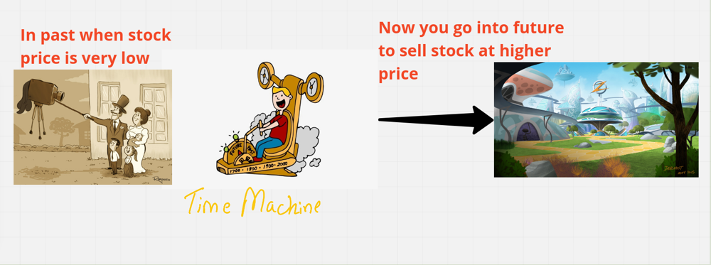
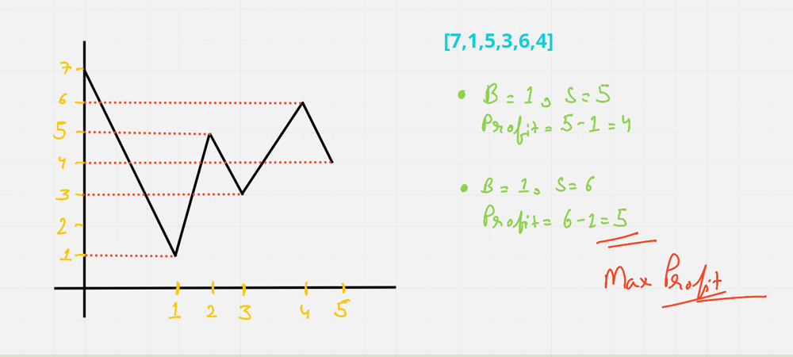

# [Java/C++] best-ever EXPLANATION could possible

**Author:** hi-malik
**Votes:** 1416
**Link:** [https://leetcode.com/problems/best-time-to-buy-and-sell-stock/solutions/1735493/](https://leetcode.com/problems/best-time-to-buy-and-sell-stock/solutions/1735493/)

---

Let's understand this problem by an **imagination**. **Imagine** you have given a **time machine**, you can go to **past** to **buy** the **stock** of your choice when the price is very least. And again using that **time machine** you went into **future** to **sell** the **stock**.



By doing that you have achieve **maximum profit**. From `buying at very least price and selling at very higher price`. **And you have become rich now!**


Now let's just understand it with our given example,
**Input**: prices = [7,1,5,3,6,4]
**Output**: 5



`Remember one rule :- You can only buy one time & sell one time`

* So, if **buy at 7** & **sell at any time in the future**, we'll face loss. Because **buying price** is way **higher** then **selling price** available we have
* Now, I have seen a dip & I **buy at 1** & **sell at 5** my **overall profit** will be **5 - 1 = 4**

* But what if, I had **buy at 1** & **sell at 6** my profit will be **6 - 1 = 5**. Which is **greater then my overall profit**. So, i will **update** my **overall profit** with new value.
* Now we have done as further we don't have any higher point to sell. We will **return our answer.**

**I hope now question, approach is absolute clear.**

*code each line explained :* `Similar for C++, Java`

```
{
        int lsf = Integer.MAX_VALUE; // least so far
        int op = 0; // overall profit
        int pist = 0; // profit if sold today
        
        for(int i = 0; i < prices.length; i++){
            if(prices[i] < lsf){ // if we found new buy value which is more smaller then previous one
                lsf = prices[i]; // update our least so far
            }
            pist = prices[i] - lsf; // calculating profit if sold today by, Buy - sell
            if(op < pist){ // if pist is more then our previous overall profit
                op = pist; // update overall profit
            }
        }
        return op; // return op 
```

**Java**
```
class Solution {
    public int maxProfit(int[] prices) {
        int lsf = Integer.MAX_VALUE;
        int op = 0;
        int pist = 0;
        
        for(int i = 0; i < prices.length; i++){
            if(prices[i] < lsf){
                lsf = prices[i];
            }
            pist = prices[i] - lsf;
            if(op < pist){
                op = pist;
            }
        }
        return op;
    }
}
```
**C++**
```
class Solution {
public:
    int maxProfit(vector<int>& prices) {
        int lsf = INT_MAX;
        int op = 0;
        int pist = 0;
        
        for(int i = 0; i < prices.size(); i++){
            if(prices[i] < lsf){
                lsf = prices[i];
            }
            pist = prices[i] - lsf;
            if(op < pist){
                op = pist;
            }
        }
        return op;
    }
};
```