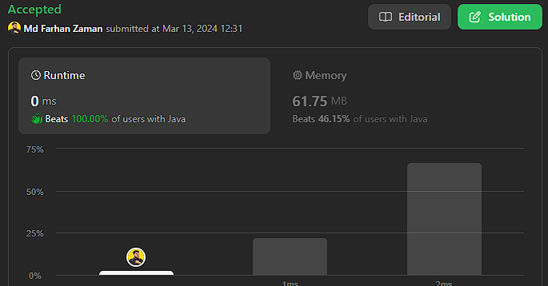

# 🔥Most Optimized ||🌟Kadane's Algorithm || Java || C++ || Python || Rust || JavaScript

**Author:** farhanzamanarnob
**Votes:** 903
**Link:** [https://leetcode.com/problems/best-time-to-buy-and-sell-stock/solutions/4868897/](https://leetcode.com/problems/best-time-to-buy-and-sell-stock/solutions/4868897/)

---

# Intuition
The problem aims to find the maximum profit that can be obtained by buying and selling a stock. The given solution seems to follow a simple approach of iterating through the prices, keeping track of the minimum buying price, and updating the profit whenever a higher selling price is encountered.



# Approach
1. Initialize variables `buy` with the first element of the prices array and `profit` as 0.
2. Iterate through the prices starting from the second element.
3. Update the `buy` variable if the current price is lower than the current buying price.
4. Update the `profit` if the difference between the current price and the buying price is greater than the current profit.
5. Return the final profit.
# Kadane's Algorithm

Kadane's Algorithm is a dynamic programming technique used to find the maximum subarray sum in an array of numbers. The algorithm maintains two variables: `max_current` represents the maximum sum ending at the current position, and `max_global` represents the maximum subarray sum encountered so far. At each iteration, it updates `max_current` to include the current element or start a new subarray if the current element is larger than the accumulated sum. The `max_global` is updated if `max_current` surpasses its value.

# Relating with the Approach

In the provided approach for finding the maximum profit in stock prices, the algorithm can be seen as a variation of Kadane's Algorithm. Instead of finding the maximum subarray sum directly, it focuses on finding the maximum positive difference between consecutive elements (prices) in the array. 

Here's how the approach relates to Kadane's Algorithm:

1. **Initialization:**
   - In Kadane's Algorithm, `max_current` and `max_global` are initialized to the first element of the array.
   - In the stock profit approach, `buy` is initialized with the first element of the prices array, and `profit` is initialized to 0.

2. **Iteration:**
   - Kadane's Algorithm iterates through the array, updating `max_current` based on the current element's value and deciding whether to start a new subarray.
   - The stock profit approach iterates through the prices array, updating `buy` when a lower price is encountered and treating the difference between the current price and `buy` as a potential profit.

3. **Comparison and Update:**
   - Kadane's Algorithm compares and updates `max_current` and `max_global` at each iteration.
   - The stock profit approach compares and updates `profit` whenever a positive difference between the current price and `buy` exceeds the current profit.
# Complexity
- Time complexity: $$O(n)$$, where $$n$$ is the length of the prices array. The algorithm iterates through the array once.
- Space complexity: $$O(1)$$, as only a constant amount of extra space is used.

# Code
```java []
class Solution {
    public int maxProfit(int[] prices) {
        int buy = prices[0];
        int profit = 0;
        for (int i = 1; i < prices.length; i++) {
            if (prices[i] < buy) {
                buy = prices[i];
            } else if (prices[i] - buy > profit) {
                profit = prices[i] - buy;
            }
        }
        return profit;
    }
}
```
```c++ []
class Solution {
public:
    int maxProfit(std::vector<int>& prices) {
        int buy = prices[0];
        int profit = 0;
        for (int i = 1; i < prices.size(); i++) {
            if (prices[i] < buy) {
                buy = prices[i];
            } else if (prices[i] - buy > profit) {
                profit = prices[i] - buy;
            }
        }
        return profit;
    }
};
```
```python []
class Solution:
    def maxProfit(self, prices):
        buy = prices[0]
        profit = 0
        for i in range(1, len(prices)):
            if prices[i] < buy:
                buy = prices[i]
            elif prices[i] - buy > profit:
                profit = prices[i] - buy
        return profit
```
```rust []
impl Solution {
    pub fn max_profit(prices: Vec<i32>) -> i32 {
        let mut buy = prices[0];
        let mut profit = 0;
        for i in 1..prices.len() {
            if prices[i] < buy {
                buy = prices[i];
            } else if prices[i] - buy > profit {
                profit = prices[i] - buy;
            }
        }
        profit
    }
}
```
```javascript []
class Solution {
    maxProfit(prices) {
        let buy = prices[0];
        let profit = 0;
        for (let i = 1; i < prices.length; i++) {
            if (prices[i] < buy) {
                buy = prices[i];
            } else if (prices[i] - buy > profit) {
                profit = prices[i] - buy;
            }
        }
        return profit;
    }
}
```


