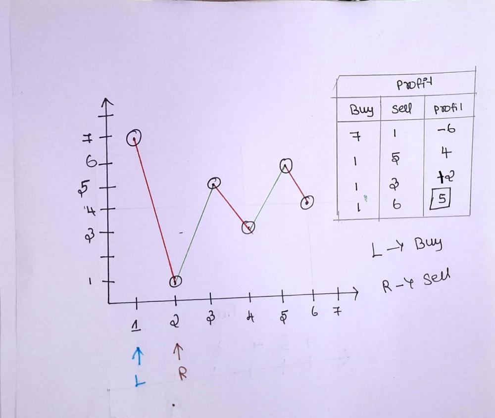

# [Python , Javascript]  Easy solution with very clear Explanation

**Author:** mageshyt
**Votes:** 2457
**Link:** [https://leetcode.com/problems/best-time-to-buy-and-sell-stock/solutions/1735550/](https://leetcode.com/problems/best-time-to-buy-and-sell-stock/solutions/1735550/)

---

**The question is saying us to find the best day to buy and sell stock, so we will get maiximum profit.**

**Some body might think that we can find min and max number from the array so that we can get the max profit. But here is one catch
For Example:
prices=[3,4,1,6]
min=1
max=6
profit=max-min=5 which is correct
in this Example:
```
prices = [7,6,4,3,1]
```
min = 1 price at day 6
max = 7 price at day 1
max_profit = 7-1 = 6 u can think like this but you can't buy the stock at day 6 and sell it at day 1.**

---

**So what is the best way to find the max profit lets see \uD83D\uDE03
<ins>Explanation:</ins>
let use initialize Left and Right pointer to first and second position of array
Here Left is to buy stock and Right is to sell stock**


`   Then we initialize our max_profit as 0.    `

#### Now we will start our while loop and we will run till our 

**Right pointer less then length of array 
<ins>For Example: </ins>
prices=[7,1,5,3,6,4]
Note:
prices[left] --> buy stock
prices[right] --> sell stock
now we will check price at right and left pointer**


**step 1:** <br>
price[left]=7 price[right]=1 profit=-6
here price[left] is greater than price[right] so we will move left pointer to the right position and increment our right pointer by 1. We always want our left point to be minimum

**step 2:** <br>
price[left]=1 price[right]=5 profit=4
here price[left] is less than price[right] which means we will get profit so we will update our max_profit and move our right pointer alone

**step 3:** <br>
price[left]=1 price[right]=3 profit=2
here price[left] is less than price[right] which means we will get profit so we will check our max_profit previously it

was 4 now our current profit is 2 so we will check which is maximum and update our max_profit and move our right pointer alone

**step 4:** <br>
price[left]=1 price[right]=6 profit=5
here price[left] is less than price[right] which means we will get profit so we will check our max_profit previously it was 4 now our current profit is 5 so we will check which is maximum and update our max_profit and move our right pointer alone

**step 5:** <br>
price[left]=1 price[right]=4 profit=3
same logic as above


```
Big O :
n--> length of array
Time Complexity: O(n)
Space Complexity: O(1)
```

**My Hand Writting will not be good ,please adjust it \uD83D\uDE05**




## lets go to the solution:

python:
```python []
class Solution:
    def maxProfit(self,prices):
        left = 0 #Buy
        right = 1 #Sell
        max_profit = 0
        while right < len(prices):
            currentProfit = prices[right] - prices[left] #our current Profit
            if prices[left] < prices[right]:
                max_profit =max(currentProfit,max_profit)
            else:
                left = right
            right += 1
        return max_profit
```

javascript:
```javascript []
const maxProfit = (prices) => {
  let left = 0; // Buy
  let right = 1; // sell
  let max_profit = 0;
  while (right < prices.length) {
    if (prices[left] < prices[right]) {
      let profit = prices[right] - prices[left]; // our current profit

      max_profit = Math.max(max_profit, profit);
    } else {
      left = right;
    }
    right++;
  }
  return max_profit;
};
```
`UPVOTE if you like \uD83D\uDE03 , If you have any question, feel free to ask.`
