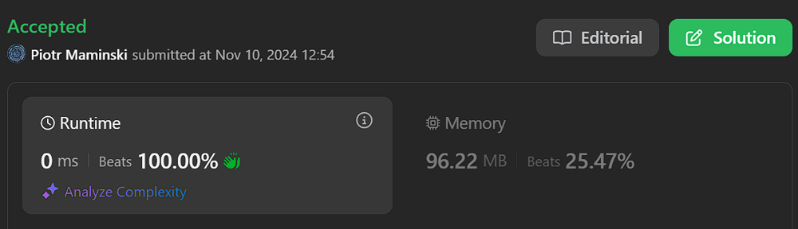

# ✅Beats 100% | Video | Explained Step by Step | List Most Common Array Interview Problems✅

**Author:** Piotr_Maminski
**Votes:** 14
**Link:** [https://leetcode.com/problems/best-time-to-buy-and-sell-stock/solutions/6027720/](https://leetcode.com/problems/best-time-to-buy-and-sell-stock/solutions/6027720/)

---

https://www.youtube.com/watch?v=1pkOgXD63yU


## Aproach 1: Dynamic Programming (All Beats 100%)
```python3 []
class Solution:
    def maxProfit(self, prices: List[int]) -> int:
        min_price = float('inf')
        max_profit = 0
        for current_price in prices:
            min_price = min(current_price, min_price)
            max_profit = max(max_profit, current_price - min_price)   
        return max_profit
```
```cpp []
class Solution {
public:
    int maxProfit(vector<int>& prices) {
        int minPrice = INT_MAX;
        int maxProfit = 0;
        
        for (int currentPrice : prices) {
            minPrice = min(currentPrice, minPrice);
            maxProfit = max(maxProfit, currentPrice - minPrice);
        }
        
        return maxProfit;
    }
};

```
```java []
class Solution {
    public int maxProfit(int[] prices) {
        int minPrice = Integer.MAX_VALUE;
        int maxProfit = 0;
        
        for (int currentPrice : prices) {
            minPrice = Math.min(currentPrice, minPrice);
            maxProfit = Math.max(maxProfit, currentPrice - minPrice);
        }
        
        return maxProfit;
    }
}
```
```csharp []
public class Solution {
    public int MaxProfit(int[] prices) {
        int minPrice = int.MaxValue;
        int maxProfit = 0;
        
        foreach (int currentPrice in prices) {
            minPrice = Math.Min(currentPrice, minPrice);
            maxProfit = Math.Max(maxProfit, currentPrice - minPrice);
        }
        
        return maxProfit;
    }
}
```
```golang []
func maxProfit(prices []int) int {
    minPrice := math.MaxInt32
    maxProfit := 0
    
    for _, currentPrice := range prices {
        minPrice = min(currentPrice, minPrice)
        maxProfit = max(maxProfit, currentPrice - minPrice)
    }
    
    return maxProfit
}
```
```swift []
class Solution {
    func maxProfit(_ prices: [Int]) -> Int {
        var minPrice = Int.max
        var maxProfit = 0
        
        for currentPrice in prices {
            minPrice = min(currentPrice, minPrice)
            maxProfit = max(maxProfit, currentPrice - minPrice)
        }
        
        return maxProfit
    }
}
```
```javascript [JS]
// JavaScript

var maxProfit = function(prices) {
    let minPrice = Number.MAX_VALUE;
    let maxProfit = 0;
    
    for (let currentPrice of prices) {
        minPrice = Math.min(currentPrice, minPrice);
        maxProfit = Math.max(maxProfit, currentPrice - minPrice);
    }
    
    return maxProfit;
};
```
```typescript [TS]
// TypeScript

function maxProfit(prices: number[]): number {
    let minPrice = Number.MAX_VALUE;
    let maxProfit = 0;
    
    for (const currentPrice of prices) {
        minPrice = Math.min(currentPrice, minPrice);
        maxProfit = Math.max(maxProfit, currentPrice - minPrice);
    }
    
    return maxProfit;
}
```
```rust []
impl Solution {
    pub fn max_profit(prices: Vec<i32>) -> i32 {
        let mut min_price = i32::MAX;
        let mut max_profit = 0;
        
        for current_price in prices {
            min_price = min_price.min(current_price);
            max_profit = max_profit.max(current_price - min_price);
        }
        
        return max_profit;
    }
}
```
```ruby []
def max_profit(prices)
    min_price = Float::INFINITY
    max_profit = 0
    
    prices.each do |current_price|
        min_price = [current_price, min_price].min
        max_profit = [max_profit, current_price - min_price].max
    end
    
    max_profit
end
```
- Complexity: O(n) & Space O(1)


---


## Aproach 2: Two Pointers


```python3 []
class Solution:
    def maxProfit(self, prices: List[int]) -> int:

        if not prices or len(prices) < 2:
            return 0
            
        max_profit = 0
        left_buy = 0
        right_sell = 1 #you can't buy later and sell earlier, unless you're doctor who
        
        while right_sell < len(prices):
            current_price = prices[right_sell]
            buy_price = prices[left_buy]
            
            if buy_price < current_price:
                current_profit = current_price - buy_price
                max_profit = max(max_profit, current_profit)
            else:
                left_buy = right_sell
                
            right_sell += 1
            
        return max_profit
```
```cpp []
class Solution {
public:
    int maxProfit(vector<int>& prices) {
        if (prices.empty() || prices.size() < 2) {
            return 0;
        }
        
        int maxProfit = 0;
        int leftBuy = 0;
        int rightSell = 1;
        
        while (rightSell < prices.size()) {
            int currentPrice = prices[rightSell];
            int buyPrice = prices[leftBuy];
            
            if (buyPrice < currentPrice) {
                int currentProfit = currentPrice - buyPrice;
                maxProfit = max(maxProfit, currentProfit);
            } else {
                leftBuy = rightSell;
            }
            
            rightSell++;
        }
        
        return maxProfit;
    }
};
```
```java []
class Solution {
    public int maxProfit(int[] prices) {
        if (prices == null || prices.length < 2) {
            return 0;
        }
        
        int maxProfit = 0;
        int leftBuy = 0;
        int rightSell = 1;
        
        while (rightSell < prices.length) {
            int currentPrice = prices[rightSell];
            int buyPrice = prices[leftBuy];
            
            if (buyPrice < currentPrice) {
                int currentProfit = currentPrice - buyPrice;
                maxProfit = Math.max(maxProfit, currentProfit);
            } else {
                leftBuy = rightSell;
            }
            
            rightSell++;
        }
        
        return maxProfit;
    }
}
```
```csharp []
public class Solution {
    public int MaxProfit(int[] prices) {
        if (prices == null || prices.Length < 2) {
            return 0;
        }
        
        int maxProfit = 0;
        int leftBuy = 0;
        int rightSell = 1;
        
        while (rightSell < prices.Length) {
            int currentPrice = prices[rightSell];
            int buyPrice = prices[leftBuy];
            
            if (buyPrice < currentPrice) {
                int currentProfit = currentPrice - buyPrice;
                maxProfit = Math.Max(maxProfit, currentProfit);
            } else {
                leftBuy = rightSell;
            }
            
            rightSell++;
        }
        
        return maxProfit;
    }
}
```
```golang []
func maxProfit(prices []int) int {
    if len(prices) < 2 {
        return 0
    }
    
    maxProfit := 0
    leftBuy := 0
    rightSell := 1
    
    for rightSell < len(prices) {
        currentPrice := prices[rightSell]
        buyPrice := prices[leftBuy]
        
        if buyPrice < currentPrice {
            currentProfit := currentPrice - buyPrice
            maxProfit = max(maxProfit, currentProfit)
        } else {
            leftBuy = rightSell
        }
        
        rightSell++
    }
    
    return maxProfit
}

func max(a, b int) int {
    if a > b {
        return a
    }
    return b
}
```
```swift []
class Solution {
    func maxProfit(_ prices: [Int]) -> Int {
        guard prices.count >= 2 else {
            return 0
        }
        
        var maxProfit = 0
        var leftBuy = 0
        var rightSell = 1
        
        while rightSell < prices.count {
            let currentPrice = prices[rightSell]
            let buyPrice = prices[leftBuy]
            
            if buyPrice < currentPrice {
                let currentProfit = currentPrice - buyPrice
                maxProfit = max(maxProfit, currentProfit)
            } else {
                leftBuy = rightSell
            }
            
            rightSell += 1
        }
        
        return maxProfit
    }
}
```
```javascript [JS]
// JavaScript

var maxProfit = function(prices) {
    if (!prices || prices.length < 2) {
        return 0;
    }
    
    let maxProfit = 0;
    let leftBuy = 0;
    let rightSell = 1;
    
    while (rightSell < prices.length) {
        const currentPrice = prices[rightSell];
        const buyPrice = prices[leftBuy];
        
        if (buyPrice < currentPrice) {
            const currentProfit = currentPrice - buyPrice;
            maxProfit = Math.max(maxProfit, currentProfit);
        } else {
            leftBuy = rightSell;
        }
        
        rightSell++;
    }
    
    return maxProfit;
};
```
```typescript [TS]
// TypeScript

function maxProfit(prices: number[]): number {
    if (!prices || prices.length < 2) {
        return 0;
    }
    
    let maxProfit = 0;
    let leftBuy = 0;
    let rightSell = 1;
    
    while (rightSell < prices.length) {
        const currentPrice = prices[rightSell];
        const buyPrice = prices[leftBuy];
        
        if (buyPrice < currentPrice) {
            const currentProfit = currentPrice - buyPrice;
            maxProfit = Math.max(maxProfit, currentProfit);
        } else {
            leftBuy = rightSell;
        }
        
        rightSell++;
    }
    
    return maxProfit;
}
```
```rust []
impl Solution {
    pub fn max_profit(prices: Vec<i32>) -> i32 {
        if prices.len() < 2 {
            return 0;
        }
        
        let mut max_profit = 0;
        let mut left_buy = 0;
        let mut right_sell = 1;
        
        while right_sell < prices.len() {
            let current_price = prices[right_sell];
            let buy_price = prices[left_buy];
            
            if buy_price < current_price {
                let current_profit = current_price - buy_price;
                max_profit = max_profit.max(current_profit);
            } else {
                left_buy = right_sell;
            }
            
            right_sell += 1;
        }
        
        max_profit
    }
}
```
```ruby []
def max_profit(prices)
    return 0 if prices.nil? || prices.length < 2
    
    max_profit = 0
    left_buy = 0
    right_sell = 1
    
    while right_sell < prices.length
        current_price = prices[right_sell]
        buy_price = prices[left_buy]
        
        if buy_price < current_price
            current_profit = current_price - buy_price
            max_profit = [max_profit, current_profit].max
        else
            left_buy = right_sell
        end
        
        right_sell += 1
    end
    
    max_profit
end
```


- Complexity: O(n) & Space O(1)


# Explanation


 


---

- The video explains basically everything.
but I can explain the differences in the Dynamic Programming approach and the details of the code. 

## Aproach 1: Dynamic Programming

1. We need two variables:

- `min_price`: Tracks the lowest price seen so far
- `max_profit`: Tracks the maximum profit possible
2. Plan is simple:

- Initialize `min_price` to infinity to ensure the first price will become the minimum
- Initialize `max_profit` to **0** (in case no profit is possible)
3. For each price in the array:

- Update `min_price` if we find a lower price
- Calculate potential profit by subtracting `min_price` from current price
- Update `max_profit` if this potential profit is higher than previous `max_profit` 

## Probably not understand code

## #1 - `min_price = min(current_price, min_price)`

Keeps track of the lowest stock price seen so far by:

1. Comparing two values:

`current_price`: The current stock price being examined
`min_price`: The lowest price we've seen up to this point
2. The `min()` function returns the smaller of these two values

### Example

```
# If current price is $5 and previous min_price was $7
min_price = min(5, 7)  # Returns 5

# If current price is $8 and previous min_price was $5
min_price = min(8, 5)  # Keeps 5
```
## #2 - `max_profit = max(max_profit, current_price - min_price)`

1. Computing potential profit at current position:

- `current_price` - `min_price`: Represents profit if we sell at current price
- Example: If `current_price` is $10 and `min_price` is $4, potential profit is $6
2. Comparing two values using max():

- `max_profit`: Best profit found so far
- `current_price` - `min_price`: New potential profit

### Example

```
# Scenario 1: Current profit calculation is better
current_price = 10
min_price = 4
max_profit = 5
max_profit = max(5, 10 - 4)  # max(5, 6) = 6

# Scenario 2: Previous profit was better
current_price = 8
min_price = 4
max_profit = 6
max_profit = max(6, 8 - 4)  # max(6, 4) = 6
```


## Pseudo Code
```java [Dynamic Programming]
Algorithm MaxProfit(prices)
    // Initialize variables
    min_price = INFINITY
    max_profit = 0

    // Iterate through each price
    for each current_price in prices do
        // Update minimum price seen so far
        min_price = MINIMUM(current_price, min_price)
        
        // Calculate potential profit and update max profit if higher
        current_profit = current_price - min_price
        max_profit = MAXIMUM(max_profit, current_profit)
    end for

    return max_profit
End Algorithm
// Complexy: Time O(n) Space O(1)
```
```java [Two Pointers]
Algorithm MaxProfit(prices)
    if prices is empty OR length of prices < 2 then
        return 0
    end if

    // Initialize variables
    max_profit = 0
    left_buy = 0          // Buy pointer
    right_sell = 1        // Sell pointer

    // Continue while we have prices to compare
    while right_sell < length of prices do
        current_price = prices[right_sell]
        buy_price = prices[left_buy]

        // If profitable trade found
        if buy_price < current_price then
            current_profit = current_price - buy_price
            max_profit = MAXIMUM(max_profit, current_profit)
        else
            // Update buy pointer if we find a lower price
            left_buy = right_sell
        end if

        // Move sell pointer to next day
        right_sell = right_sell + 1
    end while

    return max_profit
End Algorithm
// Complexy: Time O(n) Space O(1)
```
```java [Brute Force]
Algorithm MaxProfit(prices)
    // Initialize maximum profit
    max_profit = 0

    // Outer loop - try each buying position
    for i = 0 to length of prices - 1 do
        buy_price = prices[i]
        
        // Inner loop - try each selling position after buy
        for j = i + 1 to length of prices - 1 do
            sell_price = prices[j]
            
            // Update maximum profit if better profit found
            current_profit = sell_price - buy_price
            max_profit = MAXIMUM(max_profit, current_profit)
        end for
    end for

    return max_profit
End Algorithm
// Complexy: Time O(n^2)I know.. right? Space O(1)
```


Do you like my translation style? I have more solutions, most common problems. List below.

If you want you can give UpVote, then more people will see this solution and help them too. 

The button is in the bottom left corner of the screen, I didn't see it at first either :)


---


# Most common Array Interview Problems
List based on my research (interviews, reddit, github) Probably not 100% accurate but very close to my recruitments. Leetcode Premium is probably more accurate [I don't have]


**Easy:** [[1. Two Sum]](https://leetcode.com/problems/two-sum/solutions/5999466/beats-100-explained-step-by-step-list-most-common-array-inverview) **(common warm-up)** [[121. Best Time to Buy and Sell Stock]](https://leetcode.com/discuss/topic/6027720/solution/) [[88. Merge Sorted Array]](https://leetcode.com/problems/merge-sorted-array/solutions/6031394/beats-100-explained-step-by-step-list-most-common-string-interview-problems) [[27. Remove Element]](https://leetcode.com/problems/remove-element/solutions/6031528/beats-100-explained-step-by-step-list-most-common-array-interview-problems) [[929. Unique Email Addresses]](https://leetcode.com/problems/unique-email-addresses/solutions/6031687/explained-step-by-step-video-list-most-common-array-interview-problems) 


**Medium/Hard:** [[15. 3Sum]](https://leetcode.com/problems/3sum/description/) [[42. Trapping Rain Water]](https://leetcode.com/problems/trapping-rain-water/?envType=problem-list-v2&envId=atbyk0mj) [[56. Merge Intervals]](https://leetcode.com/problems/merge-intervals/description/) [[57. Insert Interval]](https://leetcode.com/problems/insert-interval/description/) [[46. Permutations]](https://leetcode.com/problems/permutations/description/) [[53. Maximum Subarray]](https://leetcode.com/problems/maximum-subarray/description/) [[73. Set Matrix Zeroes]](https://leetcode.com/problems/set-matrix-zeroes/description/) [[284. Peeking Iterator]](https://leetcode.com/problems/peeking-iterator/description/)


####  [Interview Questions and Answers Repository](https://github.com/RooTinfinite/Interview-questions-and-answers)




