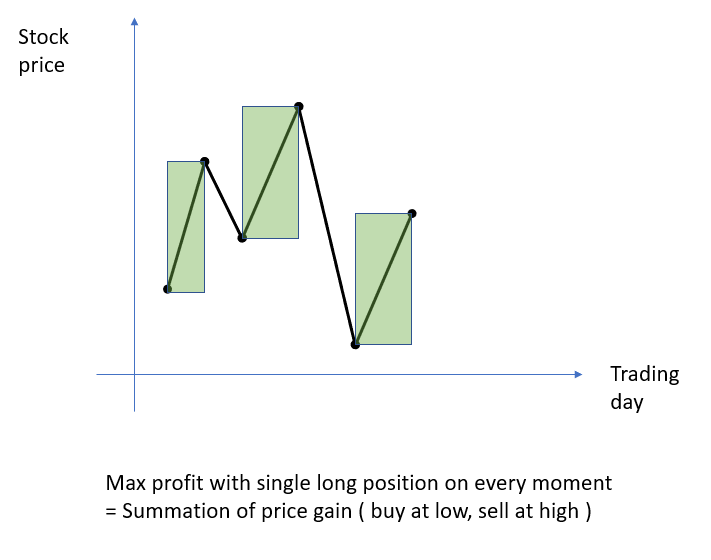

# Python/JS/Java/Go/C++ O(n) by DP // Greedy [+ Visualization & Thinking process] 有中文全系列解析專欄

**Author:** brianchiang_tw
**Votes:** 822
**Link:** [https://leetcode.com/problems/best-time-to-buy-and-sell-stock-ii/solutions/803206/](https://leetcode.com/problems/best-time-to-buy-and-sell-stock-ii/solutions/803206/)

---

[\u4E2D\u6587\u5C08\u6B04:
\u5F9EDP\u548CFSM\u6709\u9650\u72C0\u614B\u6A5F\u7684\u89D2\u5EA6\uFF0C\u53BB\u89E3\u958BLeetcode\u6700\u4F73\u80A1\u7968\u8CB7\u8CE3\u7CFB\u5217\u984C\u3002](https://vocus.cc/article/65fd41d2fd897800015721f3)

[DP\u6F14\u7B97\u6CD5\u6846\u67B6 \u8207 \u63A8\u85A6\u7684\u5B78\u7FD2\u8DEF\u5F91 (\u900F\u904E\u76F8\u4F3C\u984C\u53BB\u5F37\u5316\u5C0DDP\u7D50\u69CB\u7684\u8A8D\u8B58\u8207\u7406\u89E3)
Common DP algorithm framework and recommended learning path](https://vocus.cc/article/66616aeffd89780001cab1da)

Our goal:
Maximize trading profit with at most single long position(\u6BCF\u500B\u6642\u523B\u6700\u591A\u6301\u6709\u4E00\u500B\u591A\u982D\u90E8\u4F4D) on every moment.

Method_#1
O(n) sol by DP + state machine

Define "**Hold**" as the state of **holding stock**. (\u6301\u6709\u80A1\u7968)
Define "**NotHold**" as the state of **keep cash**. (\u6301\u6709\u73FE\u91D1)

General rule aka recursive relationship.

```
DP[Hold] 
= max(keep holding stock, or just buy stock & hold today)
= max( DP[Previous Hold], DP[previous NotHold] - stock price)
```
---

```
DP[NotHold] 
= max(keep cash, or just sell out stock today)
= max( DP[Previous NotHold], DP[previous Hold] + stock price)
```

---

**State machine diagram**:


---

Some reader may argue it is not DP,
but for me it is.
Each state depends on early states, and there are overlapped subproblem.

If you would like to see more traditional DP-style code with multiple dimension, here is the code.

Some reader feels that DP is an over-kill for Best time to buy and sell stock II.
I confess it is, but I just want to show that we can solve all Leetcode's stock trading problem series in DP thinking process with state machine transfer in a general way.


```
class Solution:
    def maxProfit(self, prices: List[int]) -> int:
        
        # Use constant literal to help reader understand source code below.
        HOLD_STOCK, KEEP_CASH = 0, 1

        ## Dictionary (Hash table)
        # key: (day, state) pair
        # value: coreesponding maximal profit
        dp = {}

        # No free lunch, it is impoosible to have stock before first trading day
        dp[-1, HOLD_STOCK] = -math.inf

        # No gain, no loss before first trading day
        dp[-1, KEEP_CASH] = 0

        # For each day with corresponding stock price in stock market
        for day, stock_price in enumerate(prices):

            # If today we have stock, either we already had it yesterday, or we just buy stock and hold it today.
            dp[day, HOLD_STOCK] = max( dp[day-1, HOLD_STOCK], dp[day-1, KEEP_CASH] - stock_price)

            # If today we keep cash, either we already kept cash yesterday, or we just sell out stock today
            dp[day, KEEP_CASH] = max( dp[day-1, KEEP_CASH], dp[day-1, HOLD_STOCK] + stock_price)
        
        #---------------------------------------------------------------
        # To get maximal realized profit, final state must be KEEP_CASH.
        last_day = len(prices)-1
        return dp[last_day, KEEP_CASH]
```

---

**Implementation** by botoom-up DP + iteration:
<iframe src="https://leetcode.com/playground/J7fnkkAb/shared" frameBorder="0" width="1000" height="600"></iframe>

Time Complexity: O(n), for single level for loop
Space Complexity: O(1), for fixed size of temporary variables

---

**Implementation** with Top down DP + recursion 
<iframe src="https://leetcode.com/playground/2zaLvs2H/shared" frameBorder="0" width="1000" height="600"></iframe>

Time Complexity: O(n), for single level for loop
Space Complexity: O(n), for 1D DP recursion call depth

---

Method_#2
O(n) sol by Greedy

Share another O(n) solution by price gain collection with **greedy** value taking concept.

Max profit with [long position](https://en.wikipedia.org/wiki/Long_(finance)) ,'\u505A\u591A' in chinese, is met by **collecting all price gain** in the stock price sequence.

Take care that holding **multiple position at the same time is NOT allowed** by [description](https://leetcode.com/problems/best-time-to-buy-and-sell-stock-ii/).

---

**Visualization**:



---

**Implementation** based on container and summation function:


```python []
class Solution:
    def maxProfit(self, prices: List[int]) -> int:

        price_gain = []
        
        for idx in range( len(prices)-1 ):
            
            if prices[idx] < prices[idx+1]:
                
                price_gain.append( prices[idx+1]- prices[idx])
                
        return sum( price_gain )
```
```Java []
class Solution {
    
    
    public int maxProfit(int[] prices) {

        ArrayList<Integer> priceGain = new ArrayList<Integer>();
        
        for(int idx = 0 ; idx < prices.length-1; idx++){
            
            if( prices[idx] < prices[idx+1] ){
                priceGain.add( prices[idx+1]- prices[idx]);
            }
                
        }
        return priceGain.stream().mapToInt(n->n).sum();
        
    }
}
```
```Javascript []
const accumulate = ( (prev, cur) => (prev + cur) );

var maxProfit = function(prices) {
    
    let profit = new Array();
    
    for( let i = 0 ; i < prices.length-1 ; i++ ){
        
        if( prices[i] < prices[i+1] ){
            profit.push(  prices[i+1] - prices[i] );
        }
    }
    return profit.reduce(accumulate, 0);
}
```
```Go []
func Accumulate(elements ...int) int {  
     sum := 0  
     for _, elem := range elements {  
          sum += elem  
     }  
     return sum  
} 


func maxProfit(prices []int) int {
    
    profit := make([]int, 0)
    
    for i := 0 ; i < len(prices)-1 ; i++{
        
        if( prices[i] < prices[i+1] ){
            profit = append(profit, ( prices[i+1] - prices[i] ))
        }
    }

    return Accumulate(profit...)
}
```
```C++ []
class Solution {
public:
    int maxProfit(vector<int>& prices) {
        
        vector<int> profit;
        
        for( size_t i = 0 ; i < prices.size()-1 ; i++ ){
            
            if( prices[i] < prices[i+1] ){
                profit.push_back( prices[i+1] - prices[i] );
            }
            
        }
        return accumulate( profit.begin(), profit.end(), 0);
    }
};
```

Time Complexity: O(n), for single level for loop
Space Complexity: O(n), for array storage sapce


---

**Implementation** based on generator expression and sum( ... ):

```
class Solution:
    def maxProfit(self, prices: List[int]) -> int:

        return sum( ( prices[idx+1]-prices[idx] ) for idx in range(len(prices)-1) if prices[idx] < prices[idx+1] )
```

---

**Implementation** based on O(1) aux space:

```python []
class Solution:
    def maxProfit(self, prices: List[int]) -> int:
        
        profit_from_price_gain = 0
        for idx in range( len(prices)-1 ):
            
            if prices[idx] < prices[idx+1]:
                profit_from_price_gain += ( prices[idx+1] - prices[idx])
                
        return profit_from_price_gain
```
```Javascript []
var maxProfit = function(prices) {
    
    let profitFromPriceGain = 0;
    
    for( let i = 0 ; i < prices.length-1 ; i++ ){
        
        if( prices[i] < prices[i+1] ){
            profitFromPriceGain += (  prices[i+1] - prices[i] );
        }
    }
    
    return profitFromPriceGain;
}
```
```Java []
class Solution {
    public int maxProfit(int[] prices) {      
        int profitFromPriceGain = 0;
        
        for( int i = 0 ; i < prices.length-1 ; i++ ){
            
            if( prices[i] < prices[i+1] ){
                profitFromPriceGain += ( prices[i+1] - prices[i] );
            }
        }
        
        return profitFromPriceGain;
    }
}
```
```Go []
func maxProfit(prices []int) int {
    
    profitFromPriceGain := 0
    
    for i := 0 ; i < len(prices)-1 ; i++{
        
        if( prices[i] < prices[i+1] ){
            profitFromPriceGain += ( prices[i+1] - prices[i] )
        }
    }

    return profitFromPriceGain
}
```
```C++ []
class Solution {
public:
    int maxProfit(vector<int>& prices) {
        
        int profitFromPriceGain = 0;
        
        for( size_t i = 0 ; i < prices.size()-1 ; i++ ){
            
            if( prices[i] < prices[i+1] ){
                profitFromPriceGain += ( prices[i+1] - prices[i] );
            }
            
        }
        return profitFromPriceGain;
    }
};
```

Time Complexity: O(n), for single level for loop
Space Complexity: O(1), for fixed size of temporary variables


---

Related leetcode challenge:

[Leetcode #121 Best Time to Buy and Sell Stock](https://leetcode.com/problems/best-time-to-buy-and-sell-stock)

[Leetcode #123 Best Time to Buy and Sell Stock III ](https://leetcode.com/problems/best-time-to-buy-and-sell-stock-iii)

[Leetcode #188 Best Time to Buy and Sell Stock IV  ](https://leetcode.com/problems/best-time-to-buy-and-sell-stock-iv)

[Leetcode #309 Best Time to Buy and Sell Stock with Cooldown](https://leetcode.com/problems/best-time-to-buy-and-sell-stock-with-cooldown)

[Leetcode #714 Best Time to Buy and Sell Stock with Transaction Fee  ](https://leetcode.com/problems/best-time-to-buy-and-sell-stock-with-transaction-fee) 

---

Reference:

[1] [Python official docs about generator expression](https://www.python.org/dev/peps/pep-0289/)

[2] [Python official docs about sum( ... )](https://docs.python.org/3/library/functions.html#sum)