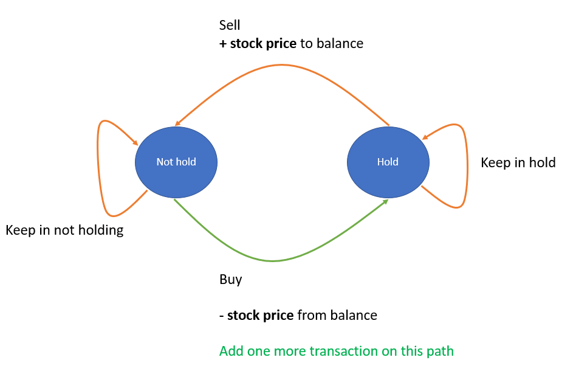

# Python O(n) by DP // Reduction [w/ Visualization] 有中文專欄 解析DP框架

**Author:** brianchiang_tw
**Votes:** 57
**Link:** [https://leetcode.com/problems/best-time-to-buy-and-sell-stock-iii/solutions/802372/](https://leetcode.com/problems/best-time-to-buy-and-sell-stock-iii/solutions/802372/)

---

[\u4E2D\u6587\u5C08\u6B04:
\u5F9EDP\u548CFSM\u6709\u9650\u72C0\u614B\u6A5F\u7684\u89D2\u5EA6\uFF0C\u53BB\u89E3\u958BLeetcode\u6700\u4F73\u80A1\u7968\u8CB7\u8CE3\u7CFB\u5217\u984C\u3002](https://vocus.cc/article/65fd41d2fd897800015721f3)

Python sol by DP and state machine

---

**State machine diagram**



---

**Implementation** by DP:

```
class Solution:
    def maxProfit(self, prices: List[int]) -> int:
        
        HOLD_STOCK, KEEP_CASH = 0, 1
        
        # dictionary
        # key: state, kth-transaction
        # value: corresponding profit
        dp = defaultdict(int)        
        
        # No free lunch, impoosible to have stock before first trading day
        dp[(HOLD_STOCK, 0)] = -math.inf
        dp[(HOLD_STOCK, 1)] = -math.inf
        dp[(HOLD_STOCK, 2)] = -math.inf
        

        for stock_price in prices:

            ## For 1st transaction:
            # Either we kept cash already, or we just sell out stock today
            dp[KEEP_CASH, 1] = max(dp[KEEP_CASH, 1], dp[HOLD_STOCK, 1] + stock_price )
            
            # Either we had stock already, or we just buy in stock today ( add one more transaction)
            dp[HOLD_STOCK, 1] = max(dp[HOLD_STOCK, 1],  dp[KEEP_CASH, 0] - stock_price)
            
            ## For 2nd transaction:
            # Either we kept cash already, or we just sell out stock today
            dp[KEEP_CASH, 2] = max(dp[KEEP_CASH, 2], dp[ HOLD_STOCK, 2] + stock_price)

            # Either we had stock already, or we just buy in stock today ( add one more transaction)
            dp[HOLD_STOCK, 2] = max(dp[HOLD_STOCK, 2], dp[KEEP_CASH, 1] - stock_price)
            
        # Maximal profit must be KEEP_CASH on last day
        # (This means we cash out and sell stocks finally)
        return dp[KEEP_CASH, 2]
```

---

or, we can use **reduction** from ( general template Leetcode #188 ) **Trade at most k times** with k=2  to solve this problem.

Reduction from [Leetcode #188 Best Time to Buy and Sell Stock IV](https://leetcode.com/problems/best-time-to-buy-and-sell-stock-iv/)
<details>
<summary>Click to show source code</summary>

```
class Solution:
	def maxProfit(self, prices: List[int]) -> int:
		
		# Reduction from Leetcode #188 Best Time to Buy and Sell Stock IV
		def trade_at_most_k_times( k: int, prices: List[int]) -> int:

			n = len(prices)

			if n == 0:

				## Base case:
				# Price sequence is empty, we can do nothing : )
				return 0


			## General case:

			# DP[ k ][ d ] = max profit on k, d
			# where k stands for k-th transaction, d stands for d-th trading day.
			dp = [ [ 0 for _ in range(n)] for _ in range(k+1) ]


			# Update by each transction as well as each trading day
			for trans_k in range(1, k+1):

				# Balance before 1st transaction must be zero
				# Buy stock on first day means -prices[0]
				cur_balance_with_buy = 0 - prices[0]

				for day_d in range(1, n):

					# Either we have finished all k transactions before, or just finished k-th transaction today
					dp[trans_k][day_d] = max( dp[trans_k][day_d-1], cur_balance_with_buy + prices[day_d] )

					# Either keep holding the stock we bought before, or just buy in today
					cur_balance_with_buy = max(cur_balance_with_buy, dp[trans_k-1][day_d-1] - prices[day_d] )

			return dp[k][n-1]
		# --------------------------------------------
		return trade_at_most_k_times(k=2, prices=prices)
```
</br>
</details>


---

Related leetcode challenge:

[Leetcode #121 Best Time to Buy and Sell Stock](https://leetcode.com/problems/best-time-to-buy-and-sell-stock)

[Leetcode #122 Best Time to Buy and Sell Stock II](https://leetcode.com/problems/best-time-to-buy-and-sell-stock-ii)

[Leetcode #123 Best Time to Buy and Sell Stock III ](https://leetcode.com/problems/best-time-to-buy-and-sell-stock-iii)

[Leetcode #188 Best Time to Buy and Sell Stock IV  ](https://leetcode.com/problems/best-time-to-buy-and-sell-stock-iv)

[Leetcode #309 Best Time to Buy and Sell Stock with Cooldown](https://leetcode.com/problems/best-time-to-buy-and-sell-stock-with-cooldown)

[Leetcode #714 Best Time to Buy and Sell Stock with Transaction Fee  ](https://leetcode.com/problems/best-time-to-buy-and-sell-stock-with-transaction-fee) 

---