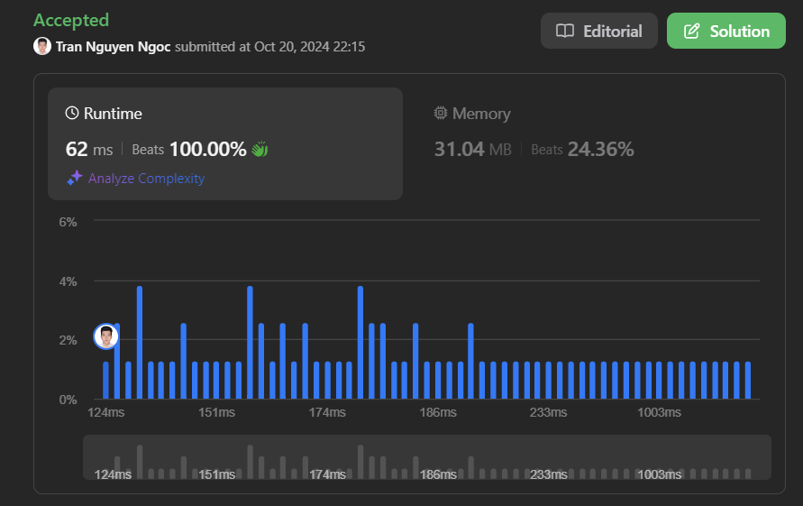

# Beat 100% - PHP!!! Sort first.

**Author:** nguyenngoc02082000
**Votes:** 1
**Link:** [https://leetcode.com/problems/longest-consecutive-sequence/solutions/5943250/](https://leetcode.com/problems/longest-consecutive-sequence/solutions/5943250/)

---



# Approach
<!-- Describe your approach to solving the problem. -->
In this solution, you are tasked with finding the length of the longest consecutive sequence in an unsorted array of integers. The solution first sorts the array, and then iterates through the sorted array to find consecutive sequences.
# Explanation of Logic
- Sorting Approach: The solution relies on sorting the input array, which allows for consecutive elements to be next to each other. This makes it easier to find consecutive sequences by simply iterating through the array once.
- Handling Duplicates: If there are duplicate numbers in the array, they are effectively skipped during the iteration because the condition else if (nums[id + 1] === num) ensures no increments to the sequence counter when encountering duplicates.
# Code Walkthrough
1. Edge Case Checks:

- The function first checks if the array [nums] is empty. If so, it returns 0, as there are no numbers to form a sequence.
- If the array contains only one element, it returns 1, because a single element is trivially a sequence of length 1.
2. Sorting the Array:

- The array [nums] is sorted using PHP\u2019s built-in sort() function.Sorting ensures that consecutive elements in the sequence will be adjacent in the array.
3. Initializing Variables:

- The variable res is used to store the maximum length of any consecutive sequence found so far.
- The variable n is initialized to 1, as each element by itself is a sequence of at least length 1.
4. Iterating through the Sorted Array:

You use a foreach loop to iterate through the sorted array. For each element num:
- The condition if (nums[id + 1] === num + 1) checks if the next element is exactly 1 greater than the current element, meaning they are consecutive. If true, the length of the current sequence (n) is incremented.
- The second condition else if (nums[id + 1] === num) checks if the next element is equal to the current element. In such a case, you do nothing because it\u2019s a duplicate and should not affect the current sequence.
- If neither condition is true, the sequence ends, and the maximum length (res) is updated if the current sequence is longer than the previous one. Then, the sequence length (n) is reset to 1.
5. Return the Result:

After the loop, the function returns res, which holds the length of the longest consecutive sequence found in the array.

# Time complexity:
<!-- Add your time complexity here, e.g. $$O(n)$$ -->
- Sorting the array takes O(n log n), where n is the number of elements in [nums].
- The foreach loop iterates over each element exactly once, which takes O(n).
- Therefore, the overall time complexity is O(n log n) due to the sorting step.
# Space complexity
<!-- Add your space complexity here, e.g. $$O(n)$$ -->
- The space complexity is O(1) if we ignore the input array, as no extra data structures are being used apart from a few variables (res, n).
- If the sorting modifies the input array in place, no extra space is used. If the sorting creates a copy, then the space complexity could be O(n).
# Code
```php []
class Solution {

    /**
     * @param Integer[] $nums
     * @return Integer
     */
    function longestConsecutive($nums) {
        if (count($nums) === 0) return 0;
        if (count($nums) === 1) return 1;
        sort($nums);
        $res = 0;
        $n = 1;
        foreach ($nums as $id => $num) {
            if ($nums[$id + 1] === $num + 1) {
                $n += 1;
            } else if ($nums[$id + 1] === $num) {
            } else {
                $res = $n > $res ? $n : $res;
                $n = 1;
            }
        }
        return $res;
    }
}
```