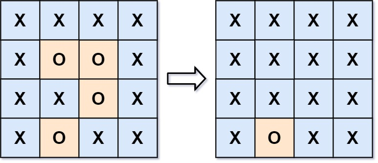

# [130. Surrounded Regions](https://leetcode.com/problems/surrounded-regions/)

| Category | Difficulty | Likes | Dislikes |
| :------: | :--------: | :---: | :------: |
| Algorithms | Medium | 9684 | 2195 |

**Tags:** [`array`](https://leetcode.com/tag/array), [`depth-first-search`](https://leetcode.com/tag/depth-first-search), [`breadth-first-search`](https://leetcode.com/tag/breadth-first-search), [`union-find`](https://leetcode.com/tag/union-find), [`matrix`](https://leetcode.com/tag/matrix)

**Companies:** `google`, `amazon`, `bloomberg`, `facebook`, `oracle`, `nutanix`, `microsoft`, `adobe`, `yahoo`, `apple`, `uber`, `tiktok`

## Description

You are given an `m x n` matrix `board` containing **letters** `'X'` and `'O'`, **capture regions** that are **surrounded**:

	- **Connect**: A cell is connected to adjacent cells horizontally or vertically.

	- **Region**: To form a region **connect every** `'O'` cell.

	- **Surround**: The region is surrounded with `'X'` cells if you can **connect the region **with `'X'` cells and none of the region cells are on the edge of the `board`.

To capture a **surrounded region**, replace all `'O'`s with `'X'`s **in-place** within the original board. You do not need to return anything.

 

**Example 1:**

**Input:** board = [["X","X","X","X"],["X","O","O","X"],["X","X","O","X"],["X","O","X","X"]]

**Output:** [["X","X","X","X"],["X","X","X","X"],["X","X","X","X"],["X","O","X","X"]]

**Explanation:**

In the above diagram, the bottom region is not captured because it is on the edge of the board and cannot be surrounded.

**Example 2:**

**Input:** board = [["X"]]

**Output:** [["X"]]

 

**Constraints:**

	- `m == board.length`

	- `n == board[i].length`

	- `1 <= m, n <= 200`

	- `board[i][j]` is `'X'` or `'O'`.

---

**Links:** [Submissions](https://leetcode.com/problems/surrounded-regions/) | [Solutions](https://leetcode.com/problems/surrounded-regions/)
