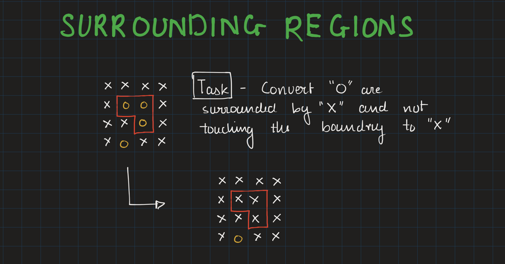
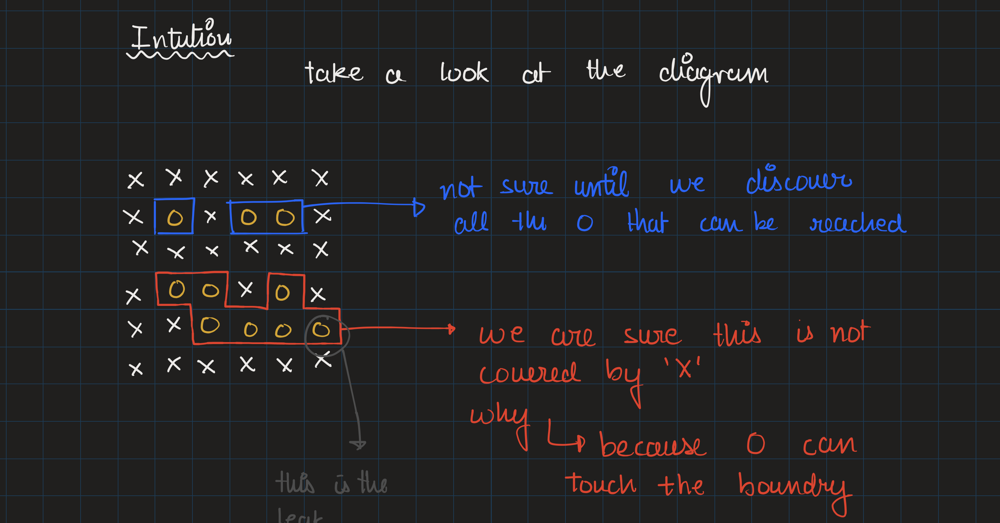
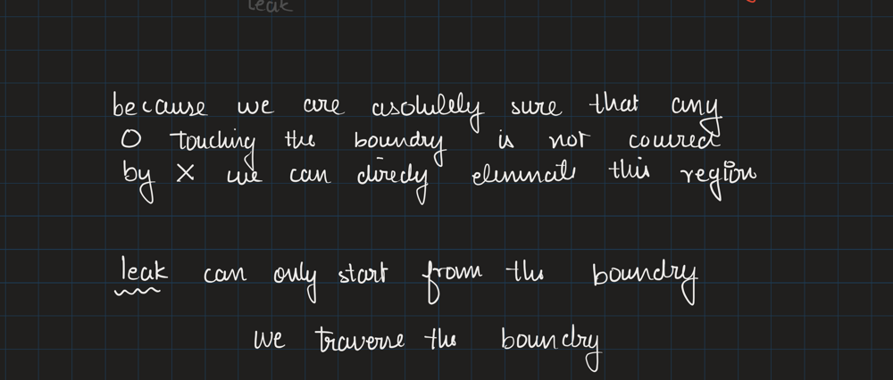
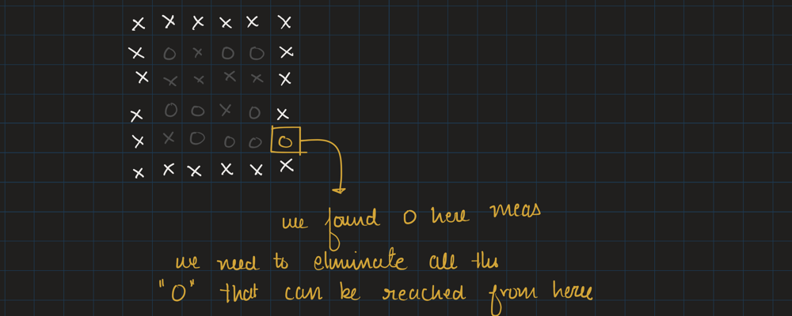
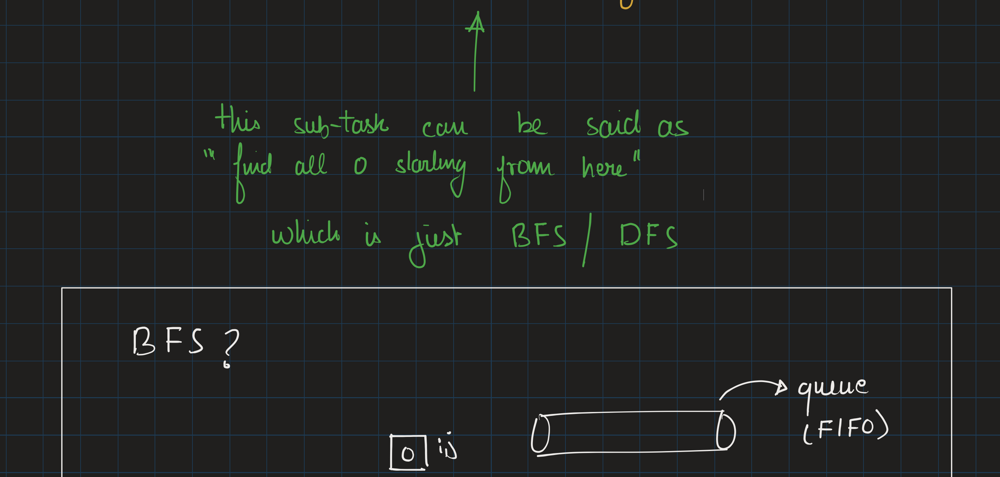
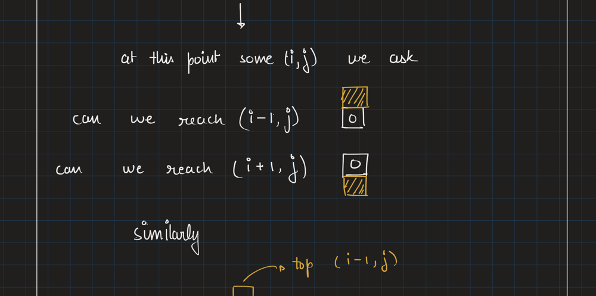
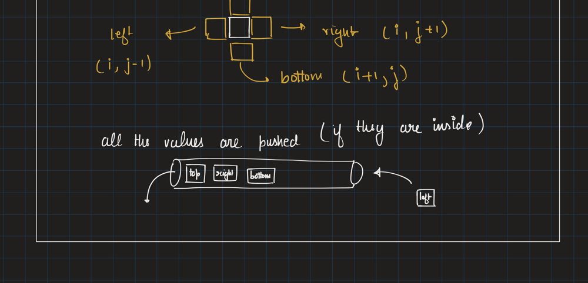
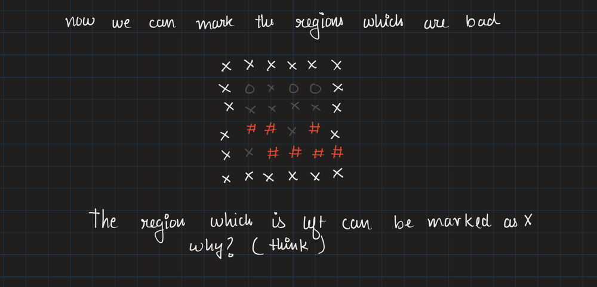
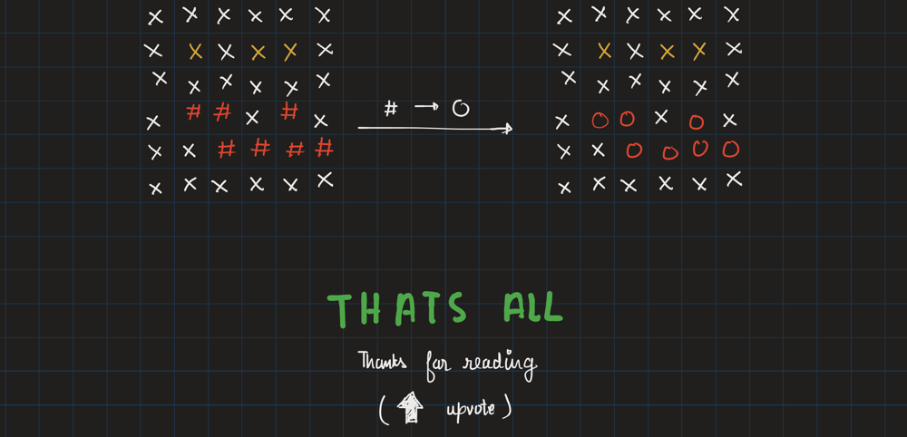

# Easy Explained Solution With 🏞 (Images)

**Author:** yasir991925
**Votes:** 211
**Link:** [https://leetcode.com/problems/surrounded-regions/solutions/1552435/](https://leetcode.com/problems/surrounded-regions/solutions/1552435/)

---










code
```python
from collections import deque

class Solution:
    def solve(self, board: List[List[str]]) -> None:
        """
        Do not return anything, modify board in-place instead.
        """
        
        o = "O"
        
        n = len(board) 
        m = len(board[0])

        Q = deque()
        
        for i in range(n):
            if board[i][0] == o:
                Q.append((i,0))
            if board[i][m-1] == o:
                Q.append((i, m-1))
                
        for j in range(m):
            if board[0][j] == o:
                Q.append((0,j))
            if board[n-1][j] == o:
                Q.append((n-1, j))
                
        def inBounds(i,j):
            return (0 <= i < n) and (0 <= j < m)
                
        while Q:
            i,j = Q.popleft()
            board[i][j] = "#"
            
            for ii, jj in [(i+1, j), (i-1, j), (i, j+1), (i, j-1)]:
                if not inBounds(ii, jj):
                    continue
                if board[ii][jj] != o:
                    continue
                Q.append((ii,jj))
                board[ii][jj] = '#'
            
        for i in range(n):
            for j in range(m):
                if board[i][j] == o:
                    board[i][j] = 'X'
                elif board[i][j] == '#':
                    board[i][j] = o

```
