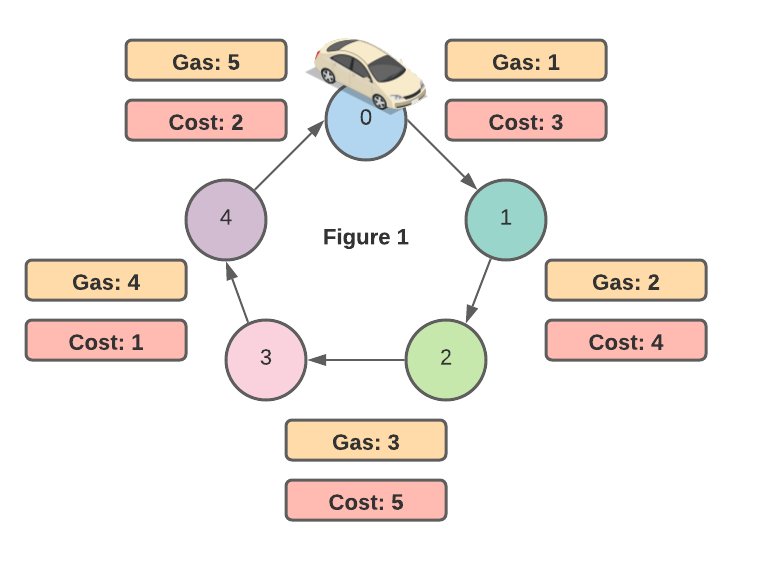
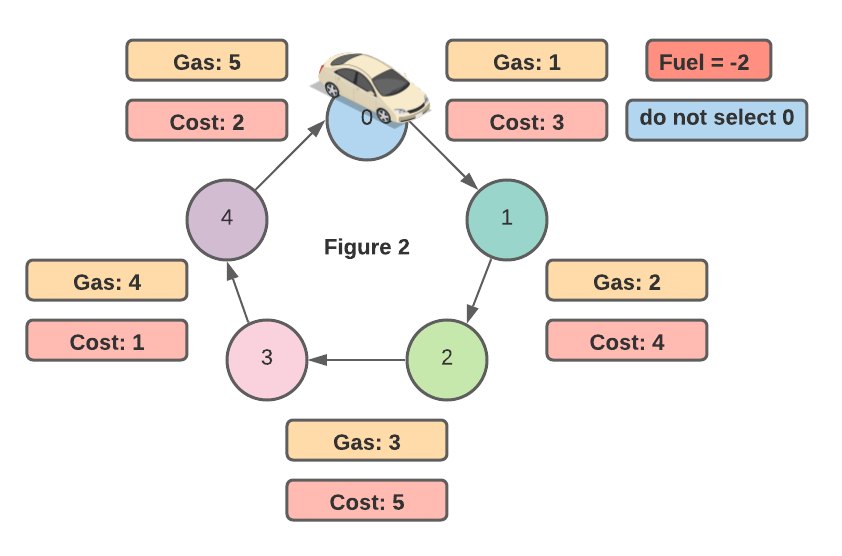
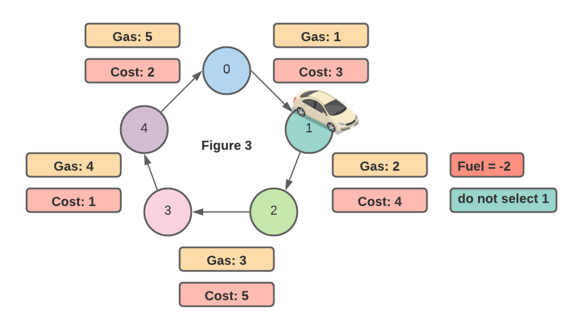
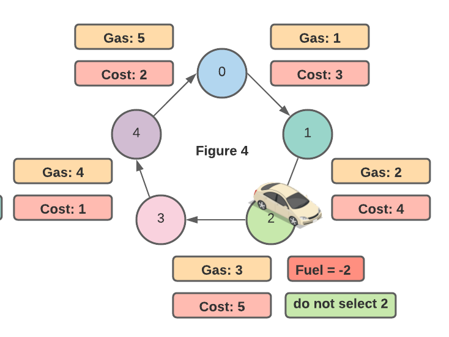
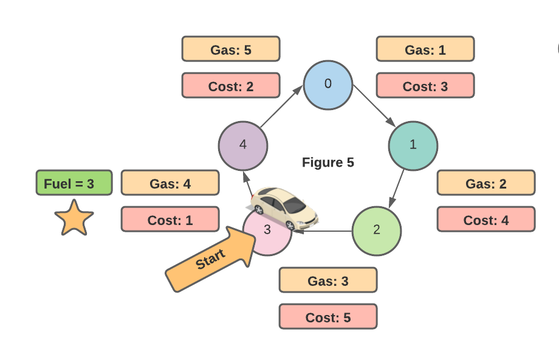
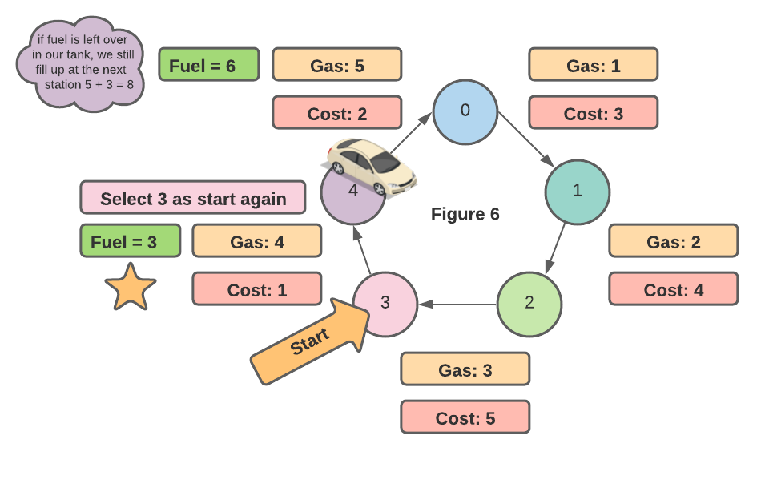
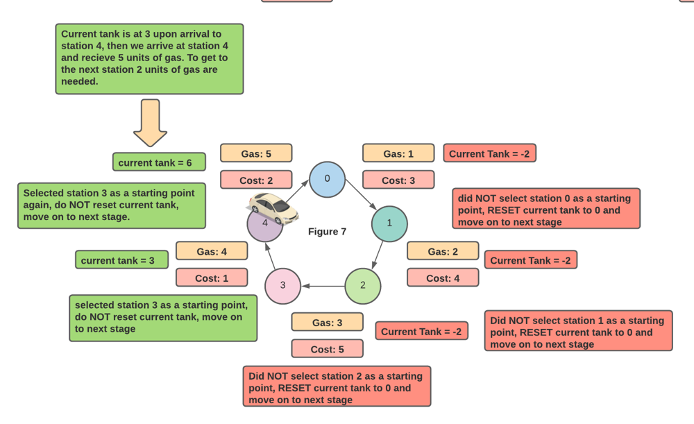
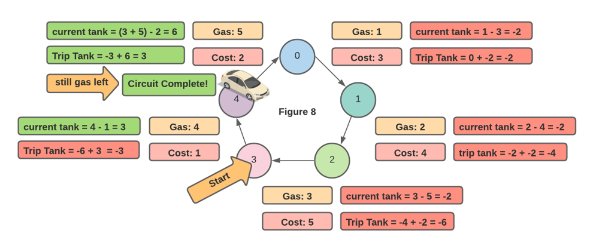

# Greedy Method | Explanation + Visual | [Python]

**Author:** gtshepard
**Votes:** 172
**Link:** [https://leetcode.com/problems/gas-station/solutions/1004074/](https://leetcode.com/problems/gas-station/solutions/1004074/)

---

***TL;DR  (explanation + visual below code snippet)***

At each stage we always select the ***best*** starting point, the ***best*** starting point is the starting point that can ***get the car to the next station***.  if the car can aways get to the next station, then **surely*** the car will complete the circuit if it is possilbe.  

***Note:*** We can get to the next station only if we have enough gas to do so (```gas[i] - cost[i]```). 

```python
def canCompleteCircuit(self, gas: List[int], cost: List[int]) -> int:
	trip_tank, curr_tank, start, n = 0, 0, 0, len(gas)
	for i in range(n):
		trip_tank += gas[i] - cost[i]
		curr_tank += gas[i] - cost[i]
		if curr_tank < 0:
			start = i + 1
			curr_tank = 0 
	return start if trip_tank >= 0 else -1
```
### Overview 
***Problem:*** a circular road connects all  gas stations. with the freedom to start from any station, find the starting station from which the car can complete the circuit (visit all stations in a clockwise). The gas tank has no limit to the amount it can hold.

given the gas availible at each station and the costs to get from one station to the next, find the starting point from which the car can complete the circuit. if a solution exists it is guaranteed to be unique.

* * * 
### Why Greedy?
* * * 

in mathematics and computer science an ***optimization problem*** is defined as a problem where the goal is to find the ***best solution*** from a set of ***feasible solutions***. The ***Greedy Method*** is a strategy for solving ***optimization problems***.

* * * 
What is considered the ***best solution*** is determined by the problem you are trying to solve. There is only one solution that is considered ***best***. 

A ***feasible solution*** is a solution (not necessarily the best) that meets ***all constraints*** for the problem. 

*** 
The ***constraints*** for this problem are as follows 
1. we have a car with an ***unlimited size*** gas tank 
2.  the car must drive from station to station in a ***clockwise*** manner. 
3.  the car can ***only*** go on to the next station if it ***has enough gas***.  
4.  we can start driving from ***any station***.

Thus ***any starting point for a trip conducted under these circumstances is a feasible solution***, because ***all constraints*** of the problem have been met. 

The ***best solution*** is a ***feasible solution*** that finds the starting point that allows the car to complete the circuit. It may be the case there is ***not*** a ***best solution***  (no starting point allows the car to complete the circuit),. 


We are looking for the ***best*** or ***optimal*** solution. 
* * * 
### Applying The Greedy Method 

The ***Greedy*** method says to solve a problem in a series of stages and always select the ***best option*** at each stage. If we always select the ***best option*** at each stage, then ***surely*** we will arrive at the ***best*** or ***optimal*** solution. 

in otherwords always select the ***locally optimal solution*** in hopes to reach a ***globally optimal***solution 

***note:*** we always use the same selection procedure at each stage. 

* * *

We visit gas stations in series of stages ***one station at a time***. At each stage we select the ***best*** station to start our trip from . The ***best*** station to start our trip from is ***the station that can get us to the next gas station***. if there is no best station at given stage, ***we do not make a selection*** and move on to the next stage. 




suppose at ```stage 0``` we have to make the decision of wether or not we select ```station 0``` as the best station thus far. 

We defined the best station as the station that can get our car to the next station. ***The car can only get to the next station if the car has enough gas***

At ```station 0``` there is ```1``` unit of gas in our cars tank and the cost to get to ```station 1``` is ```3```, thus we cannot get to the next station because  ```1 - 3 = - 2``` meaning we run out of gas (```gas[0] - cost[0] < 0```  before getting to ```station 1``` , so we do not select  ```station 0``` as the start station. this is depicted in ***Figure 2***. in the ***Figure 3*** we will decide if ```station 1``` is the best starting point 

***note*** in greedy problems where there are two quanities that influence selection criteria it is common to perform some calculation. in our case we must look at ***gas*** and ***cost***  to decide whether we can get to the next station. it is often helpful to think of how they are related to choose the correct calculation.  we must use ***cost*** units of ***gas*** to get to next station, so subtraction is helpful 





if we proceed in this manner for stations 1, and 2 ***figures 3 & 4*** respecitvely.





The interesting case is when we reach ```station 3```, because we have enough gas to get to ```station 4``` that is (```gas[3] - cost[3] >= 0```).  This means we select ```station 3``` as the ***best*** station. This is depicted in ***Figure 5*** 




in ***Figure 6*** we traveled to ```station 4``` and, can still get to the next station when starting our trip from ```station 3```, thus station 3 is selected as the start station again.
* * * 

* * * 
in ***figure 6***  we select ```station 3``` by assessing the cost to travel from ```station 3``` to ```station 4```. 

* * * 
In our walkthrough thus far we have only shown that if we start at  station 3 can get to ```station 4``` and ```station 0``` our trip. ***This is not  a complete circuit***. we need to show that from ```station 3``` we can travel to ```stations 4, 0, 1, 2, 3``` respectively. 

However as stated our ***greedy approach**** will only needs to ```N``` stages where ```N``` is the number of stations. How is this possible?
* * * 
in our walkthough thus far we kept track of our ***current tank*** (labeled fuel in the diagrams), after we made a trip from one station to another with some desinated start point. This enabled us to decide wether or not we were able to reach the next station.  Here is a recap. the fuel label has been renamed to current tank for clarity. 




* * * 

If we keep a similar running calculation for our ***entire trip*** we get the amount of gas in the tank ***after visiting all stations***. We will call this ***trip tank***.  This is just like ***current tank*** except  this variable is never reset. 




* * * 
it turns out that if ```trip_tank >= 0``` after we complete all stages, then it is possible to complete the circuit because we had gas left in the tank. whatever the last selected starting point was, is the starting point that we can complete the circuit from . in the event there is not enough gas to complete the circuit our ```trip_tank < 0``` thus we ```return -1``` looking at the code below this approach becomes clear.


```python
def canCompleteCircuit(self, gas: List[int], cost: List[int]) -> int:
	trip_tank, curr_tank, start, n = 0, 0, 0, len(gas)
	for i in range(n):
		trip_tank += gas[i] - cost[i]
		curr_tank += gas[i] - cost[i]
		if curr_tank < 0:
			start = i + 1
			curr_tank = 0 
	return start if trip_tank >= 0 else -1


```

code courtesy of leetcode official solution