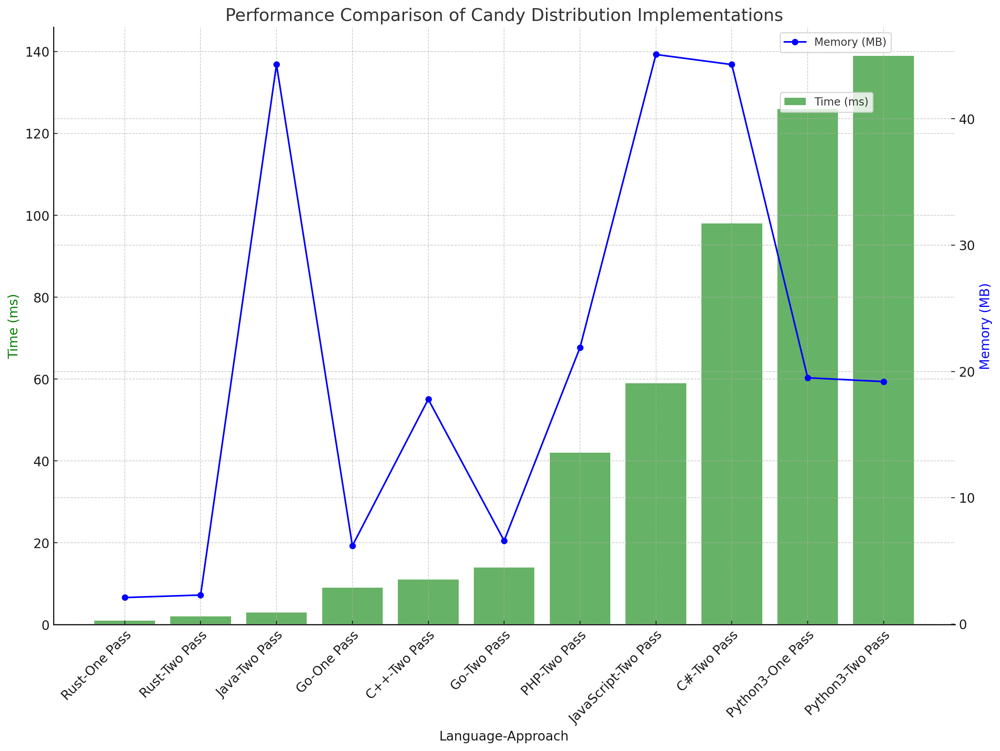

# ✅ 99.20% Greedy Two & One Pass

**Author:** vanAmsen
**Votes:** 451
**Link:** [https://leetcode.com/problems/candy/solutions/4037646/](https://leetcode.com/problems/candy/solutions/4037646/)

---

# Comprehensive Guide to Solving "Candy": Distributing Candies Like a Pro

## Introduction & Problem Statement

Hey there, coding enthusiasts! Welcome back to another exciting coding session. Today's problem is a treat\u2014literally! We're going to solve the "Candy" problem. Imagine you have a bunch of kids lined up, each with a rating assigned to them. Your task is to distribute candies to these kids following two simple rules:

1. Every child must get at least one candy.
2. A child with a higher rating should get more candies than their immediate neighbors.

Sounds like a piece of cake, right? But here's the twist: you need to accomplish this with the fewest candies possible. Let's dig into the mechanics of this problem and how to approach it.

## Key Concepts and Constraints

### Why is This Problem Unique?

1. **Child Ratings**: 
   The ratings of each child are your only guide in how you distribute the candies. Following the rules while using these ratings makes this problem an intriguing puzzle.
  
2. **Minimum Candies**: 
   You're not just distributing candies willy-nilly; the goal is to meet the conditions using the least amount of candy.

3. **Constraints**: 
   - The length of the ratings array, `n` , is between  $$1$$  and $$ 2 \	imes 10^4 $$.
   - Ratings are integers between $$0$$ and $$ 2 \	imes 10^4 $$.

### Strategies to Tackle the Problem

1. **Greedy Algorithm: Two-Pass Method**  
   This method takes two passes through the ratings array to ensure that each child gets the appropriate amount of candy.

2. **One-Pass Greedy Algorithm: Up-Down-Peak Method**  
   This more advanced method uses a single pass and employs three key variables\u2014Up, Down, and Peak\u2014to efficiently determine the minimum number of candies needed.

---

## Live Coding + Explenation of Greedy Two Pass
https://youtu.be/JqrZHuhljps?si=TxkUjNTZ1CxMviij

## Greedy Algorithm: Two-Pass Method Explained

### What is a Greedy Algorithm?

A Greedy Algorithm makes choices that seem optimal at the moment. For this problem, we use a two-pass greedy approach to make sure each child gets the minimum number of candies that still satisfy the conditions.

### The Nuts and Bolts of the Two-Pass Method

1. **Initialize Candies Array**  
   - We start by creating a `candies` array of the same length as the `ratings` array and initialize all its values to 1. This is the base case and ensures that every child will receive at least one candy, satisfying the first condition.
  
2. **Forward Pass: Left to Right**
   - Now, we iterate through the `ratings` array from the beginning to the end. For each child (except the first), we compare their rating with the one to the left. If it's higher, we update the `candies` array for that child to be one more than the child on the left. This takes care of the second condition but only accounts for the child's left neighbor.
   
3. **Backward Pass: Right to Left**  
   - After the forward pass, we loop through the array again but in the reverse direction. This time, we compare each child's rating with the child to their right. If the rating is higher, we need to make sure the child has more candies than the right neighbor. So, we update the `candies` array for that child to be the maximum between its current number of candies and one more than the right neighbor's candies. This ensures that both neighboring conditions are checked and satisfied.
   
4. **Summing it All Up**
   - Finally, we sum up all the values in the `candies` array. This will give us the minimum total number of candies that need to be distributed to satisfy both conditions.
  
### Time and Space Complexity

- **Time Complexity**: $$O(n)$$, because we make two passes through the array.
- **Space Complexity**: $$O(n)$$, for storing the `candies` array.

## Code Greedy
``` Python []
class Solution:
    def candy(self, ratings: List[int]) -> int:
        n = len(ratings)
        candies = [1] * n 

        for i in range(1, n):
            if ratings[i] > ratings[i-1]:
                candies[i] = candies[i-1] + 1

        for i in range(n-2, -1, -1):
            if ratings[i] > ratings[i+1]:
                candies[i] = max(candies[i], candies[i+1] + 1)
        
        return sum(candies)
```
``` Go []
func candy(ratings []int) int {
    n := len(ratings)
    candies := make([]int, n)
    for i := range candies {
        candies[i] = 1
    }

    for i := 1; i < n; i++ {
        if ratings[i] > ratings[i-1] {
            candies[i] = candies[i-1] + 1
        }
    }

    for i := n - 2; i >= 0; i-- {
        if ratings[i] > ratings[i+1] {
            if candies[i] <= candies[i+1] {
                candies[i] = candies[i+1] + 1
            }
        }
    }

    totalCandies := 0
    for _, candy := range candies {
        totalCandies += candy
    }

    return totalCandies
}
```
``` Rust []
impl Solution {
    pub fn candy(ratings: Vec<i32>) -> i32 {
        let n = ratings.len();
        let mut candies = vec![1; n];

        for i in 1..n {
            if ratings[i] > ratings[i - 1] {
                candies[i] = candies[i - 1] + 1;
            }
        }

        for i in (0..n - 1).rev() {
            if ratings[i] > ratings[i + 1] {
                candies[i] = std::cmp::max(candies[i], candies[i + 1] + 1);
            }
        }

        candies.iter().sum()
    }
}
```
``` C++ []
class Solution {
public:
    int candy(std::vector<int>& ratings) {
        int n = ratings.size();
        std::vector<int> candies(n, 1);

        for (int i = 1; i < n; ++i) {
            if (ratings[i] > ratings[i - 1]) {
                candies[i] = candies[i - 1] + 1;
            }
        }

        for (int i = n - 2; i >= 0; --i) {
            if (ratings[i] > ratings[i + 1]) {
                candies[i] = std::max(candies[i], candies[i + 1] + 1);
            }
        }

        int totalCandies = 0;
        for (int candy : candies) {
            totalCandies += candy;
        }

        return totalCandies;
    }
};
```
``` Java []
class Solution {
    public int candy(int[] ratings) {
        int n = ratings.length;
        int[] candies = new int[n];
        Arrays.fill(candies, 1);

        for (int i = 1; i < n; i++) {
            if (ratings[i] > ratings[i - 1]) {
                candies[i] = candies[i - 1] + 1;
            }
        }

        for (int i = n - 2; i >= 0; i--) {
            if (ratings[i] > ratings[i + 1]) {
                candies[i] = Math.max(candies[i], candies[i + 1] + 1);
            }
        }

        int totalCandies = 0;
        for (int candy : candies) {
            totalCandies += candy;
        }

        return totalCandies;
    }
}
```
``` C# []
public class Solution {
    public int Candy(int[] ratings) {
        int n = ratings.Length;
        int[] candies = new int[n];
        Array.Fill(candies, 1);

        for (int i = 1; i < n; i++) {
            if (ratings[i] > ratings[i - 1]) {
                candies[i] = candies[i - 1] + 1;
            }
        }

        for (int i = n - 2; i >= 0; i--) {
            if (ratings[i] > ratings[i + 1]) {
                candies[i] = Math.Max(candies[i], candies[i + 1] + 1);
            }
        }

        int totalCandies = 0;
        foreach (int candy in candies) {
            totalCandies += candy;
        }

        return totalCandies;
    }
}
```
``` JavaScript []
/**
 * @param {number[]} ratings
 * @return {number}
 */
var candy = function(ratings) {
    const n = ratings.length;
    const candies = new Array(n).fill(1);

    for (let i = 1; i < n; i++) {
        if (ratings[i] > ratings[i - 1]) {
            candies[i] = candies[i - 1] + 1;
        }
    }

    for (let i = n - 2; i >= 0; i--) {
        if (ratings[i] > ratings[i + 1]) {
            candies[i] = Math.max(candies[i], candies[i + 1] + 1);
        }
    }

    return candies.reduce((a, b) => a + b, 0);
};
```
``` PHP []
class Solution {

    /**
     * @param Integer[] $ratings
     * @return Integer
     */
    function candy($ratings) {
        $n = count($ratings);
        $candies = array_fill(0, $n, 1);

        for ($i = 1; $i < $n; $i++) {
            if ($ratings[$i] > $ratings[$i - 1]) {
                $candies[$i] = $candies[$i - 1] + 1;
            }
        }

        for ($i = $n - 2; $i >= 0; $i--) {
            if ($ratings[$i] > $ratings[$i + 1]) {
                $candies[$i] = max($candies[$i], $candies[$i + 1] + 1);
            }
        }

        return array_sum($candies);
    }
}
```
## One-Pass Greedy Algorithm: Up-Down-Peak Method

### Why `Up`, `Down`, and `Peak`?

The essence of the one-pass greedy algorithm lies in these three variables: `Up`, `Down`, and `Peak`. They serve as counters for the following:

- **`Up`:** Counts how many children have **increasing ratings** from the last child. This helps us determine how many candies we need for a child with a higher rating than the previous child.
  
- **`Down`:** Counts how many children have **decreasing ratings** from the last child. This helps us determine how many candies we need for a child with a lower rating than the previous child.

- **`Peak`:** Keeps track of the **last highest point** in an increasing sequence. When we have a decreasing sequence after the peak, we can refer back to the `Peak` to adjust the number of candies if needed.

### How Does it Work?

1. **Initialize Your Counters**
   - Start with `ret = 1` because each child must have at least one candy. Initialize `up`, `down`, and `peak` to 0.
   
2. **Loop Through Ratings**
   - For each pair of adjacent children, compare their ratings. Here are the scenarios:
   
     - **If the rating is increasing**: Update `up` and `peak` by incrementing them by 1. Set `down` to 0. Add `up + 1` to `ret` because the current child must have one more candy than the previous child.
     
     - **If the rating is the same**: Reset `up`, `down`, and `peak` to 0, because neither an increasing nor a decreasing trend is maintained. Add 1 to `ret` because the current child must have at least one candy.
     
     - **If the rating is decreasing**: Update `down` by incrementing it by 1. Reset `up` to 0. Add `down` to `ret`. Additionally, if `peak` is greater than or equal to `down`, decrement `ret` by 1. This is because the peak child can share the same number of candies as one of the children in the decreasing sequence, which allows us to reduce the total number of candies.
  
3. **Return the Total Candy Count**
   - At the end of the loop, `ret` will contain the minimum total number of candies needed for all the children, so return `ret`.

By using `up`, `down`, and `peak`, we can efficiently traverse the ratings list just once, updating our total candies count (`ret`) as we go. This method is efficient and helps us solve the problem in a single pass, with a time complexity of $$O(n)$$.
### Time and Space Complexity

- **Time Complexity**: $$O(n)$$, for the single pass through the ratings array.
- **Space Complexity**: $$O(1)$$, as we only use a few extra variables.

## Code One-Pass Greedy
``` Python []
class Solution:
    def candy(self, ratings: List[int]) -> int:
        if not ratings:
            return 0
        
        ret, up, down, peak = 1, 0, 0, 0
        
        for prev, curr in zip(ratings[:-1], ratings[1:]):
            if prev < curr:
                up, down, peak = up + 1, 0, up + 1
                ret += 1 + up
            elif prev == curr:
                up = down = peak = 0
                ret += 1
            else:
                up, down = 0, down + 1
                ret += 1 + down - int(peak >= down)
        
        return ret

```
``` Go []
func candy(ratings []int) int {
    if len(ratings) == 0 {
        return 0
    }

    ret, up, down, peak := 1, 0, 0, 0

    for i := 0; i < len(ratings) - 1; i++ {
        prev, curr := ratings[i], ratings[i+1]

        if prev < curr {
            up++
            down = 0
            peak = up
            ret += 1 + up
        } else if prev == curr {
            up, down, peak = 0, 0, 0
            ret += 1
        } else {
            up = 0
            down++
            ret += 1 + down
            if peak >= down {
                ret--
            }
        }
    }

    return ret
}
```
``` Rust []
impl Solution {
    pub fn candy(ratings: Vec<i32>) -> i32 {
        if ratings.is_empty() {
            return 0;
        }

        let mut ret = 1;
        let mut up = 0;
        let mut down = 0;
        let mut peak = 0;

        for i in 0..ratings.len() - 1 {
            let (prev, curr) = (ratings[i], ratings[i + 1]);

            if prev < curr {
                up += 1;
                down = 0;
                peak = up;
                ret += 1 + up;
            } else if prev == curr {
                up = 0;
                down = 0;
                peak = 0;
                ret += 1;
            } else {
                up = 0;
                down += 1;
                ret += 1 + down;
                if peak >= down {
                    ret -= 1;
                }
            }
        }

        ret
    }
}
```

## Performance Comparison

| Language  | Approach  | Time (ms)  | Memory (MB) |
|-----------|-----------|------------|-------------|
| Rust      | One Pass  | 1          | 2.1         |
| Rust      | Two Pass  | 2          | 2.3         |
| Java      | Two Pass  | 3          | 44.3        |
| Go        | One Pass  | 9          | 6.2         |
| C++       | Two Pass  | 11         | 17.8        |
| Go        | Two Pass  | 14         | 6.6         |
| PHP       | Two Pass  | 42         | 21.9        |
| JavaScript| Two Pass  | 59         | 45.1        |
| C#        | Two Pass  | 98         | 44.3        |
| Python3   | One Pass  | 126        | 19.5        |
| Python3   | Two Pass  | 139        | 19.2        |



## Live Coding & Explenation - One Pass
https://youtu.be/_MVFeqfiDK4?si=t8El9b9mlUQneXDk

## Code Highlights and Best Practices

- The Two-Pass Greedy Algorithm is straightforward and effective, making it a solid approach for this problem.
- The One-Pass Greedy Algorithm is even more efficient in terms of space complexity and is also a bit more challenging to understand.
  
By mastering these approaches, you'll be well-equipped to tackle other optimization problems, which are common in coding interviews and competitive programming. So, are you ready to distribute some candies? Let's get coding!
