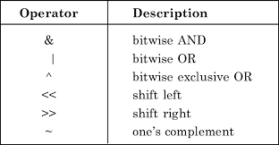
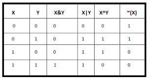

# || ✅✅Mastering Bitwise Operations: A Guide to Boost Your Interview Preparation✅✅ ||

**Author:** devanshupatel
**Votes:** 60
**Link:** [https://leetcode.com/problems/single-number-ii/solutions/3527570/](https://leetcode.com/problems/single-number-ii/solutions/3527570/)

---

# Mastering Bitwise Operations


Bitwise operations are an essential aspect of low-level programming and are frequently encountered in technical interviews. Understanding bitwise operations and their applications can greatly enhance your problem-solving skills and make you stand out as a candidate. In this blog, we will provide a detailed explanation and generalization of the bitwise operation method for single numbers, covering the most commonly used operators and their applications.

1. Bitwise AND (&):
The bitwise AND operation compares the corresponding bits of two numbers and returns a new number where each bit is set to 1 if and only if the corresponding bits of both numbers are 1. Otherwise, the bit is set to 0. This operation is useful for checking the presence of specific bits or extracting specific information from a number.

- Generalization:
Given two integers, perform a binary AND operation on their corresponding bits, resulting in a new integer with bits set to 1 where both input integers have 1s and 0s otherwise.

2. Bitwise OR (|):
The bitwise OR operation compares the corresponding bits of two numbers and returns a new number where each bit is set to 1 if either of the corresponding bits in the input numbers is 1. If both bits are 0, the result bit is set to 0. This operation is often used for setting specific bits or combining different bit patterns.

- Generalization:
Given two integers, perform a binary OR operation on their corresponding bits, resulting in a new integer with bits set to 1 where either input integer has a 1, and 0s otherwise.

3. Bitwise XOR (^):
The bitwise XOR operation compares the corresponding bits of two numbers and returns a new number where each bit is set to 1 if the corresponding bits of the input numbers are different (one is 0 and the other is 1). If the corresponding bits are the same (both 0s or both 1s), the result bit is set to 0. This operation is useful for toggling bits or checking parity.

- Generalization:
Given two integers, perform a binary XOR operation on their corresponding bits, resulting in a new integer with bits set to 1 where the input integers have different bit values, and 0s otherwise.

4. Bitwise NOT (~):
The bitwise NOT operation (also called bitwise complement) negates each bit of a number, flipping 0s to 1s and 1s to 0s. This operation is often used in conjunction with other bitwise operations or for creating bit masks.

- Generalization:
Given an integer, perform a binary NOT operation on each bit of the number, resulting in a new integer with all its bits flipped (0s become 1s and 1s become 0s).



#### Happy coding!

---

# Intuition:
The approach used in the code is based on bitwise operations. It maintains two variables, 'ones' and 'twos', to keep track of the bits that appear once and twice, respectively.

# Approach:
1. Initialize 'ones' and 'twos' as 0.
2. Iterate through each number 'num' in the input vector 'nums'.
3. Update 'ones' and 'twos' using bitwise operations:
   - ones = (ones ^ num) & ~twos: XOR the current number 'num' with 'ones' to toggle the bits that appear once, then perform bitwise AND with the complement of 'twos' to remove the bits that appear twice.
   - twos = (twos ^ num) & ~ones: XOR the current number 'num' with 'twos' to toggle the bits that appear twice, then perform bitwise AND with the complement of 'ones' to remove the bits that appear once.
4. After iterating through all the numbers, the value stored in 'ones' will be the single number that appears only once.
5. Return the value of 'ones' as the result.

# Complexity:
- The time complexity of this approach is O(n), where n is the number of elements in the input vector 'nums', as we iterate through all the numbers once.
- The space complexity is O(1) since we are using a constant amount of extra space to store the variables 'ones' and 'twos'.

---


# C++
```
class Solution {
public:
    int singleNumber(vector<int>& nums) {
        int ones = 0;
        int twos = 0;

        for (int num : nums) {
            ones = (ones ^ num) & ~twos;
            twos = (twos ^ num) & ~ones;
        }

        return ones;
    }
};
```

---
# Java
```
class Solution {
    public int singleNumber(int[] nums) {
        int ones = 0;
        int twos = 0;

        for (int num : nums) {
            ones = (ones ^ num) & ~twos;
            twos = (twos ^ num) & ~ones;
        }

        return ones;
    }
}
```
---
# Python
```
class Solution(object):
    def singleNumber(self, nums):
        ones = 0
        twos = 0

        for num in nums:
            ones = (ones ^ num) & ~twos
            twos = (twos ^ num) & ~ones

        return ones
```
---
# JavaScript
```
var singleNumber = function(nums) {
    let ones = 0;
    let twos = 0;

    for (let num of nums) {
        ones = (ones ^ num) & ~twos;
        twos = (twos ^ num) & ~ones;
    }

    return ones;
};
```