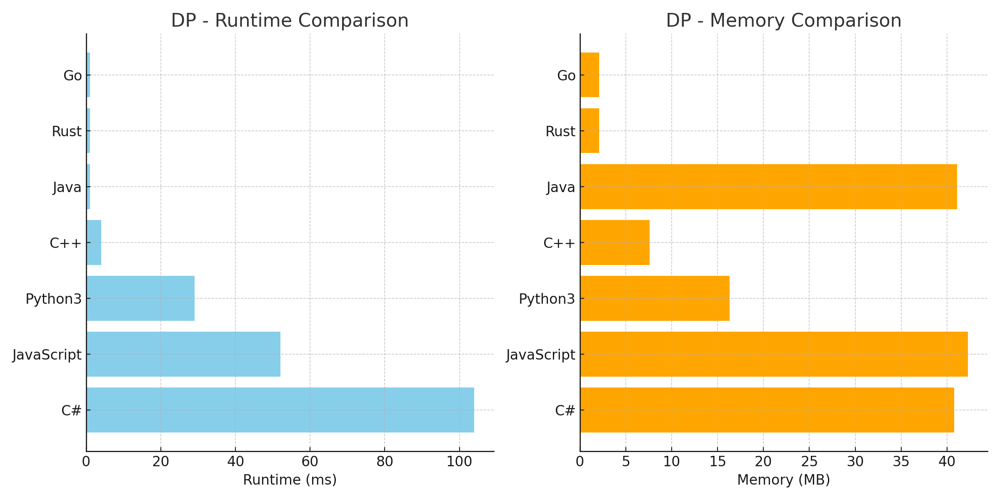
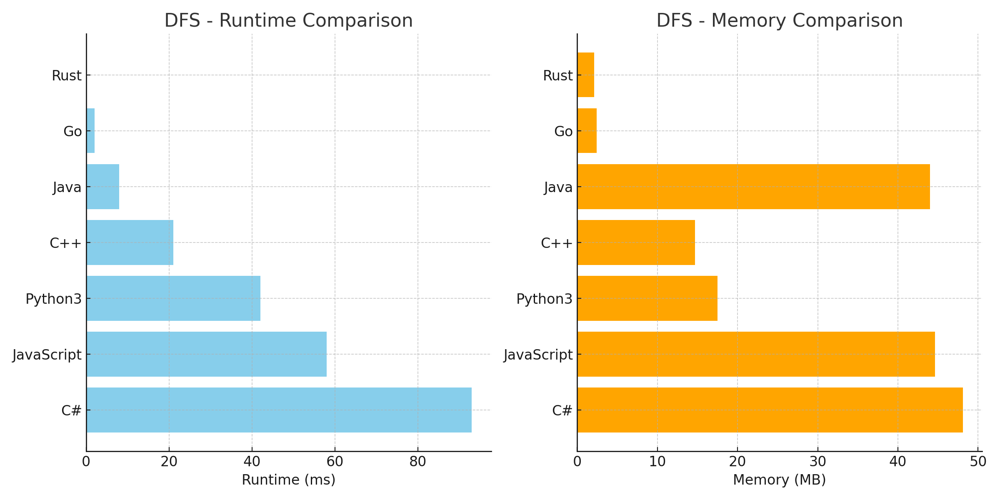

# ✅ 100% DP & DFS [VIDEO] - Segmenting a String

**Author:** vanAmsen
**Votes:** 212
**Link:** [https://leetcode.com/problems/word-break/solutions/3860456/](https://leetcode.com/problems/word-break/solutions/3860456/)

---

# Intuition
When given a string and a dictionary of words, the problem requires us to determine if the string can be segmented into a sequence of dictionary words. A common way to approach this problem is to use either Dynamic Programming or Depth-First Search with memoization, considering the constraints and properties of the problem. The comparison includes implementations in multiple languages: Python, C++, Java, JavaScript, Rust, Go, and C#.

https://youtu.be/9ZIQwa1wCNA

# Approaches - Short Description

## Dynamic Programming
By utilizing a boolean array dp, we can iteratively build a solution that checks if the string can be segmented into dictionary words. This approach leverages the subproblem overlap and builds a bottom-up solution.

## Depth-First Search with Memoization
This approach searches for a valid segmentation by recursively exploring different paths and using a set data structure to efficiently match prefixes. Memoization is used to store results and avoid redundant computations.

## Differences
While Dynamic Programming builds the solution iteratively, Depth-First Search explores recursively. The DP approach has a more straightforward implementation, while DFS with memoization may be more efficient in some cases due to early termination.

# Approach - Dynamic Programming
The Dynamic Programming approach provides an efficient way to solve the word break problem by building up a solution iteratively. Here's a step-by-step description:

1. **Initialization**: We initialize a boolean array `dp` of length \\(n+1\\), where \\(n\\) is the length of the string `s`. The entry `dp[i]` will be `True` if there exists a word in the dictionary that ends at index \\(i-1\\) in the string `s`. We set `dp[0]` to `True` since an empty string can always be segmented.

2. **Determine Maximum Word Length**: We find the maximum length of a word in the dictionary using `max_len = max(map(len, wordDict))`. This helps us in reducing unnecessary iterations.

3. **Iterate Through the String**: We iterate through the string from index 1 to \\(n\\) (inclusive) and for each index `i`, we iterate from index \\(i-1\\) down to \\(i - \	ext{max_len} - 1\\) (or -1, whichever is larger).

4. **Check for Segmentation**: For each `j` in the range, we check if `dp[j]` is `True` and if the substring `s[j:i]` is in `wordDict`. If both conditions are met, we set `dp[i]` to `True` and break out of the inner loop. This means that there exists a valid segmentation ending at index \\(i-1\\).

5. **Result**: Finally, we return `dp[n]`, which will be `True` if the entire string can be segmented into words from the dictionary.

## Example:
Consider the example with `s = "leetcode"` and `wordDict = ["leet","code"]`. Here's how the algorithm proceeds:

- **Initialization**: `dp = [True, False, False, False, False, False, False, False, False]`.
- **Determine Maximum Word Length**: `max_len = 4`.
- **Iterate Through the String**:
  - When `i = 4`, the loop finds that `dp[0]` is `True` and `"leet"` is in the dictionary, so `dp[4]` is set to `True`.
  - When `i = 8`, the loop finds that `dp[4]` is `True` and `"code"` is in the dictionary, so `dp[8]` is set to `True`.
- **Result**: `dp[8]` is `True`, so the function returns `True`.

The use of dynamic programming ensures that we are not recomputing solutions to subproblems, and the consideration of the maximum word length helps in avoiding unnecessary iterations, making this approach both elegant and efficient.

# Complexity
- Time complexity: \\( O(n * m) \\), where \\( n \\) is the length of the string and \\( m \\) is the maximum length of a word in the dictionary.
- Space complexity: \\( O(n) \\)

# Performance - DP

| Language   | Runtime | Beats   | Memory   | Beats   |
|------------|---------|---------|----------|---------|
| Go         | 1 ms    | 69.76%  | 2.1 MB   | 99.78%  |
| Rust       | 1 ms    | 85.43%  | 2.1 MB   | 75.38%  |
| Java       | 1 ms    | 99.85%  | 41.1 MB  | 86.3%   |
| C++        | 4 ms    | 84.76%  | 7.6 MB   | 92.64%  |
| Python3    | 29 ms   | 99.91%  | 16.3 MB  | 97.29%  |
| JavaScript | 52 ms   | 95.93%  | 42.3 MB  | 95.86%  |
| C#         | 104 ms  | 73.58%  | 40.8 MB  | 94.98%  |




# Code - Dynamic Programming
``` Python []
class Solution:
    def wordBreak(self, s: str, wordDict: List[str]) -> bool:
        n = len(s)
        dp = [False] * (n + 1)
        dp[0] = True
        max_len = max(map(len, wordDict))  # The maximum length of a word in the dictionary

        for i in range(1, n + 1):
            for j in range(i - 1, max(i - max_len - 1, -1), -1): # Only consider words that could fit
                if dp[j] and s[j:i] in wordDict:
                    dp[i] = True
                    break

        return dp[n]
```
``` C++ []
class Solution {
public:
    bool wordBreak(std::string s, std::vector<std::string>& wordDict) {
        int n = s.size();
        std::vector<bool> dp(n + 1, false);
        dp[0] = true;
        int max_len = 0;
        for (const auto& word : wordDict) {
            max_len = std::max(max_len, static_cast<int>(word.size()));
        }

        for (int i = 1; i <= n; i++) {
            for (int j = i - 1; j >= std::max(i - max_len - 1, 0); j--) {
                if (dp[j] && std::find(wordDict.begin(), wordDict.end(), s.substr(j, i - j)) != wordDict.end()) {
                    dp[i] = true;
                    break;
                }
            }
        }

        return dp[n];
    }
};
```
``` Java []
class Solution {
    public boolean wordBreak(String s, List<String> wordDict) {
        int n = s.length();
        boolean[] dp = new boolean[n + 1];
        dp[0] = true;
        int max_len = 0;
        for (String word : wordDict) {
            max_len = Math.max(max_len, word.length());
        }

        for (int i = 1; i <= n; i++) {
            for (int j = i - 1; j >= Math.max(i - max_len - 1, 0); j--) {
                if (dp[j] && wordDict.contains(s.substring(j, i))) {
                    dp[i] = true;
                    break;
                }
            }
        }

        return dp[n];
    }
}
```
``` JavaScript []
/**
 * @param {string} s
 * @param {string[]} wordDict
 * @return {boolean}
 */
var wordBreak = function(s, wordDict) {
    let n = s.length;
    let dp = new Array(n + 1).fill(false);
    dp[0] = true;
    let max_len = Math.max(...wordDict.map(word => word.length));

    for (let i = 1; i <= n; i++) {
        for (let j = i - 1; j >= Math.max(i - max_len - 1, 0); j--) {
            if (dp[j] && wordDict.includes(s.substring(j, i))) {
                dp[i] = true;
                break;
            }
        }
    }

    return dp[n];
};
```
``` C# []
public class Solution {
    public bool WordBreak(string s, IList<string> wordDict) {
        int n = s.Length;
        bool[] dp = new bool[n + 1];
        dp[0] = true;
        int max_len = 0;
        foreach (string word in wordDict) {
            max_len = Math.Max(max_len, word.Length);
        }

        for (int i = 1; i <= n; i++) {
            for (int j = i - 1; j >= Math.Max(i - max_len - 1, 0); j--) {
                if (dp[j] && wordDict.Contains(s.Substring(j, i - j))) {
                    dp[i] = true;
                    break;
                }
            }
        }

        return dp[n];
    }
}
```
``` Go []
func wordBreak(s string, wordDict []string) bool {
    n := len(s)
    dp := make([]bool, n+1)
    dp[0] = true
    max_len := 0
    for _, word := range wordDict {
        if len(word) > max_len {
            max_len = len(word)
        }
    }

    for i := 1; i <= n; i++ {
        for j := i - 1; j >= max(i - max_len - 1, 0); j-- {
            if dp[j] && contains(wordDict, s[j:i]) {
                dp[i] = true
                break
            }
        }
    }

    return dp[n]
}

func contains(words []string, target string) bool {
    for _, word := range words {
        if word == target {
            return true
        }
    }
    return false
}

func max(a, b int) int {
    if a > b {
        return a
    }
    return b
}
```
``` Rust []
impl Solution {
    pub fn word_break(s: String, word_dict: Vec<String>) -> bool {
        let n = s.len();
        let mut dp = vec![false; n + 1];
        dp[0] = true;
        let max_len = word_dict.iter().map(|word| word.len()).max().unwrap_or(0);

        let word_dict: std::collections::HashSet<String> = word_dict.into_iter().collect();

        for i in 1..=n {
            for j in (std::cmp::max(i as isize - max_len as isize - 1, 0) as usize..i).rev() {
                if dp[j] && word_dict.contains(&s[j..i].to_string()) {
                    dp[i] = true;
                    break;
                }
            }
        }

        dp[n]
    }
}
```

# Approach - Depth-First Search with Memoization
The Depth-First Search (DFS) approach with memoization offers a recursive way to solve the word break problem. It leverages the Trie data structure to efficiently match prefixes and employs memoization to store intermediate results. Here's a step-by-step description:

1. **Building the Trie**: We initialize an empty Trie and iterate through each word in the dictionary (`wordDict`). For each word, we add it to the Trie, using a nested loop to traverse each character (`ch`) in the word. We use the `'#'` symbol to mark the end of a word in the Trie. We also determine the maximum length (`max_len`) of a word in the dictionary.

2. **Initialization of Memoization**: We initialize an empty dictionary (`memo`) to store the results of subproblems. This helps in avoiding redundant computations.

3. **DFS Function Call**: We call the recursive DFS function with initial parameters, starting from index 0.

4. **Recursive DFS Function**:
    - **Memoization Check**: If the starting index (`start`) is found in `memo`, we return the stored result.
    - **Base Case**: If `start` equals the length of the string, we return `True`, as we have reached the end.
    - **Iterate Through Prefixes**: We initialize `node` to the root of the Trie and iterate through the string from the `start` index to the minimum of `start + max_len` and the length of the string.
    - **Trie Traversal**: For each character (`ch`), we traverse the Trie. If `ch` is not found, we break out of the loop.
    - **Check for Word End and Recursion**: If we find the end of a word marker (`'#'`) in the Trie, we make a recursive call to `dfs` with the next index (`i + 1`).
    - **Update Memoization**: If the recursive call returns `True`, we update `memo[start]` to `True` and return `True`.

5. **Result**: Finally, we update `memo[start]` to `False` if no valid segmentation is found and return `False`.

This approach leverages the Trie structure to efficiently match prefixes and uses memoization to enhance efficiency. It offers a recursive and elegant solution to the word break problem.

# Complexity
- Time complexity: \\( O(n * m + k) \\), where \\( n \\) is the length of the string, \\( m \\) is the maximum length of a word in the dictionary, and \\( k \\) is the total number of characters in all words in the dictionary (for building the Trie).
- Space complexity: \\( O(n + k) \\), where \\( n \\) is the length of the string and \\( k \\) is the total number of characters in all words in the dictionary.

# Performance - DFS

| Language   | Runtime | Beats  | Memory | Beats  |
|------------|---------|--------|--------|--------|
| Rust       | 0 ms    | 100%   | 2.1 MB  | 75.38% |
| Go         | 2 ms    | 66.9%  | 2.4 MB  | 29.16% |
| Java       | 8 ms    | 49.31% | 44 MB   | 14.85% |
| C++        | 21 ms   | 37.63% | 14.7 MB | 21.91% |
| Python3    | 42 ms   | 94.1%  | 17.5 MB | 5.8%   |
| JavaScript | 58 ms   | 86.4%  | 44.6 MB | 16.27% |
| C#         | 93 ms   | 94.32% | 48.1 MB | 17.47% |



# Code - Depth-First Search with Memoization
``` Python []
class Solution:
    def wordBreak(self, s: str, wordDict: List[str]) -> bool:
        memo = {}
        wordSet = set(wordDict)
        return self.dfs(s, wordSet, memo)
    
    def dfs(self, s, wordSet, memo):
        if s in memo:
            return memo[s]
        if s in wordSet:
            return True
        for i in range(1, len(s)):
            prefix = s[:i]
            if prefix in wordSet and self.dfs(s[i:], wordSet, memo):
                memo[s] = True
                return True
        memo[s] = False
        return False
```
``` JavaScript []
var wordBreak = function(s, wordDict) {
    let memo = {};
    let wordSet = new Set(wordDict);
    return dfs(s, wordSet, memo);
};

function dfs(s, wordSet, memo) {
    if (s in memo) return memo[s];
    if (wordSet.has(s)) return true;
    for (let i = 1; i < s.length; i++) {
        let prefix = s.substring(0, i);
        if (wordSet.has(prefix) && dfs(s.substring(i), wordSet, memo)) {
            memo[s] = true;
            return true;
        }
    }
    memo[s] = false;
    return false;
}
```
``` C++ []
class Solution {
public:
    bool wordBreak(std::string s, std::vector<std::string>& wordDict) {
        std::unordered_map<std::string, bool> memo;
        std::unordered_set<std::string> wordSet(wordDict.begin(), wordDict.end());
        return dfs(s, wordSet, memo);
    }
    
private:
    bool dfs(const std::string& s, const std::unordered_set<std::string>& wordSet, std::unordered_map<std::string, bool>& memo) {
        if (memo.find(s) != memo.end()) return memo[s];
        if (wordSet.find(s) != wordSet.end()) return true;
        for (int i = 1; i < s.size(); i++) {
            std::string prefix = s.substr(0, i);
            if (wordSet.find(prefix) != wordSet.end() && dfs(s.substr(i), wordSet, memo)) {
                memo[s] = true;
                return true;
            }
        }
        memo[s] = false;
        return false;
    }
};
```
``` Java []
class Solution {
    public boolean wordBreak(String s, List<String> wordDict) {
        Map<String, Boolean> memo = new HashMap<>();
        Set<String> wordSet = new HashSet<>(wordDict);
        return dfs(s, wordSet, memo);
    }
    
    private boolean dfs(String s, Set<String> wordSet, Map<String, Boolean> memo) {
        if (memo.containsKey(s)) return memo.get(s);
        if (wordSet.contains(s)) return true;
        for (int i = 1; i < s.length(); i++) {
            String prefix = s.substring(0, i);
            if (wordSet.contains(prefix) && dfs(s.substring(i), wordSet, memo)) {
                memo.put(s, true);
                return true;
            }
        }
        memo.put(s, false);
        return false;
    }
}
```
``` C# []
public class Solution {
    public bool WordBreak(string s, IList<string> wordDict) {
        Dictionary<string, bool> memo = new Dictionary<string, bool>();
        HashSet<string> wordSet = new HashSet<string>(wordDict);
        return Dfs(s, wordSet, memo);
    }
    
    private bool Dfs(string s, HashSet<string> wordSet, Dictionary<string, bool> memo) {
        if (memo.ContainsKey(s)) return memo[s];
        if (wordSet.Contains(s)) return true;
        for (int i = 1; i < s.Length; i++) {
            string prefix = s.Substring(0, i);
            if (wordSet.Contains(prefix) && Dfs(s.Substring(i), wordSet, memo)) {
                memo[s] = true;
                return true;
            }
        }
        memo[s] = false;
        return false;
    }
}
```
``` Rust []
use std::collections::HashSet;

impl Solution {
    pub fn word_break(s: String, word_dict: Vec<String>) -> bool {
        let mut memo = std::collections::HashMap::new();
        let word_set: HashSet<String> = word_dict.into_iter().collect();
        Self::dfs(s, &word_set, &mut memo)
    }

    fn dfs(s: String, word_set: &HashSet<String>, memo: &mut std::collections::HashMap<String, bool>) -> bool {
        if let Some(&value) = memo.get(&s) {
            return value;
        }
        if word_set.contains(&s) {
            return true;
        }
        for i in 1..s.len() {
            let prefix = &s[0..i];
            if word_set.contains(prefix) && Self::dfs(s[i..].to_string(), word_set, memo) {
                memo.insert(s, true);
                return true;
            }
        }
        memo.insert(s, false);
        return false;
    }
}
```
``` Go []
func wordBreak(s string, wordDict []string) bool {
	memo := make(map[string]bool)
	wordSet := make(map[string]bool)
	for _, word := range wordDict {
		wordSet[word] = true
	}
	return dfs(s, wordSet, memo)
}

func dfs(s string, wordSet map[string]bool, memo map[string]bool) bool {
	if value, exists := memo[s]; exists {
		return value
	}
	if _, exists := wordSet[s]; exists {
		return true
	}
	for i := 1; i < len(s); i++ {
		prefix := s[:i]
		if _, exists := wordSet[prefix]; exists && dfs(s[i:], wordSet, memo) {
			memo[s] = true
			return true
		}
	}
	memo[s] = false
	return false
}
```