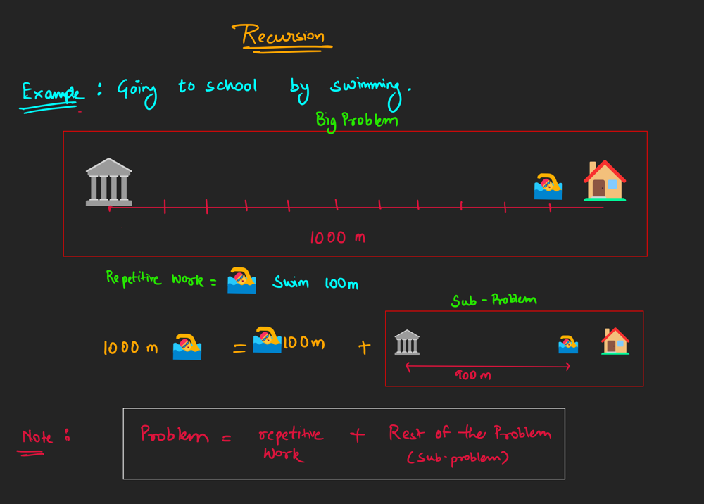
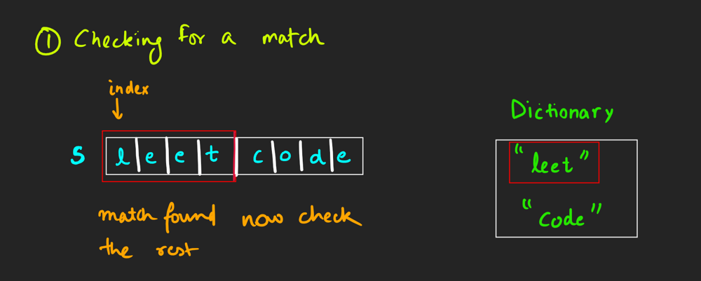
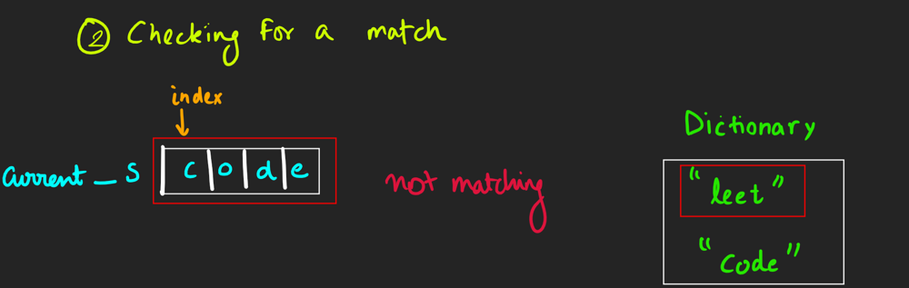
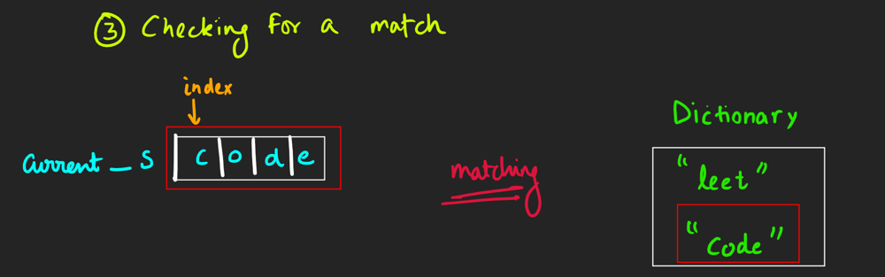
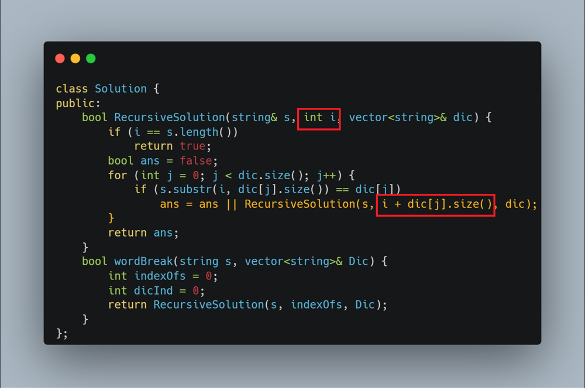
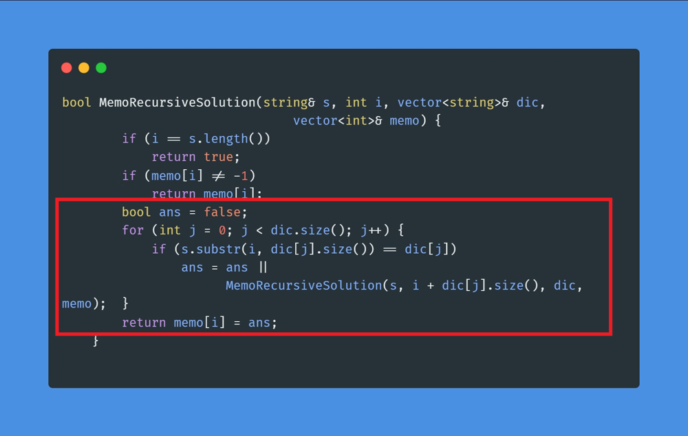

# 🌟Conquering DP : Mastering Word Break with Expert Strategies 💡Beginner Friendly

**Author:** LakshayBrejwal_2_0
**Votes:** 16
**Link:** [https://leetcode.com/problems/word-break/solutions/4453481/](https://leetcode.com/problems/word-break/solutions/4453481/)

---

# Dynamic Programming 
---
### \uD83E\uDD14 How to approach a Dynammic Programming Problem \u2753
- For me particularly , I see every Dp problem as a recursive problem which needs to be optimised.
- That's also the defination of Dynamic programming, to put it simply it can quoted as :- 
> ###  Don't Repeat yourself , ***use what you did for what you want***
1. ##### So, try to think Recursively First
2. ##### Memoisation  [ Top Down Approach or Recursion + Optimization ]
3. ##### Convert the Top Down Approach to Bottom Up Solution
4. ##### Your Solution is already well optimised in terms of Time and Space
5. ##### Sometimes there is still scope for Space Optimisation

---
# Step by Step Solving the Problem : Word Break
## \u2753Problem Statement 
You are given a string and Dictionary (set of strings) , You are required to check whether the string `s` is made from the words of `Dictionary`. if `yes` return  `True` else return `False`.

---

## \uD83D\uDCA1Approach 1: Recursive 

### \u2728How to think Recursively
- We try to find the task we need to perform repetitively to solve the problem



- in this problem we find the words from the dictionary that matches with the sub-part of the string `s`. If it matches with a word from the dictionary , repeat this for the rest of the string `s`
- Dry run will provided more insights 

### \uD83D\uDCDDDry Run
#### For testCase 1




- we parsed the whole string `s` successfully so the output is `True` 

### \uD83D\uDD0DEdge Cases
- Make sure that the you check the words in valid ranges

### \uD83D\uDD78\uFE0FComplexity Analysis
**N** is length of string `s`, **M** is size of Dictionary and **K** is the length of the longest word in Dictionary
- Time Complexity: $$O(N*M*K)$$.
- Space Complexity: $$O(M)+O(N\u22C5K)$$.
### \uD83E\uDDD1\uD83C\uDFFB\u200D\uD83D\uDCBBCode in C++
```C++ []
// TLE 
class Solution {
public:
    bool RecursiveSolution(string& s, int i, vector<string>& dic) {
        if (i == s.length())
            return true;
        bool ans = false;
        for (int j = 0; j < dic.size(); j++) {
            if (s.substr(i, dic[j].size()) == dic[j])
                // if matching now , then check the rest
                // if everything matches then only return true
                ans = ans || RecursiveSolution(s, i + dic[j].size(), dic);
        }
        return ans;
    }
    bool wordBreak(string s, vector<string>& Dic) {
        int indexOfs = 0;
        return RecursiveSolution(s, indexOfs, Dic);
    }
};
```

> ## If you See TLE in recursive Solution Then Its time to show some \uD83D\uDE0E DP Skills


---

# \uD83D\uDCA1Approach 2: Memoisation or Top Down Approach

- So, when we use recursion sometimes we do redundant tasks, meaning we repeat the work we already did, as there is no record of work done in recursion. 
- So to keep the track of work done we store it in a data structure, which can be a map,1 D vector, 2D vectors etc. also refered as `memoisation Table` .

##### You all must be \uD83E\uDD14thinking that Lakshay we understood this but how to keep track of the work done \u2753 Which Data Structure is suitable for it \u2753 
- If You have the same question then you are on the right track.
#### How to select the Data Structure \u2753
- Check your recursive code and check for the variable that is changing in recursive calls.
- Here you can see that the changing variable in the recursive calls is only `i`



- since only one variable is changing in the recursive calls a single dimensional vector would work fine

```cpp
vector<int>memo;
```
- what should be the size of the Data Structure ? 
    - Its the maximum value possible for `i`
    - mostly its already set in base case : `s.length()+1`
    - initialise the vector with a value as flag of modification
```cpp
vector<int>memo;
memo.resize(s.length()+1,-1);
```
#### \u2705Tracking the work already Done
- Check if the work is already done or not
- Just store the answer when you are returning from the recursive call
```cpp
/* 
if memo[i] != -1 , it means that the work is already 
done previously , so just return it.
*/
if(memo[i] != -1) return memeo[i];

// at the ending : modify the return statement 
return memo[i] = ans;
```
### \uD83E\uDDD1\uD83C\uDFFB\u200D\uD83D\uDCBBCodes

```cpp []
class Solution {
public:
    bool MemoRecursiveSolution(string& s, int i, vector<string>& dic,
                               vector<int>& memo) {
        if (i == s.length())
            return true;
        if (memo[i] != -1)
            return memo[i];
        bool ans = false;
        for (int j = 0; j < dic.size(); j++) {
            if (s.substr(i, dic[j].size()) == dic[j])
                ans = ans ||
                      MemoRecursiveSolution(s, i + dic[j].size(), dic, memo);
        }
        return memo[i] = ans;
    }
    bool wordBreak(string s, vector<string>& Dic) {
        vector<int>memo;
        memo.resize(s.length()+1,-1);
        int indexOfs = 0;
        return MemoRecursiveSolution(s, indexOfs, Dic,memo);
    }
};
```

```java []
import java.util.Arrays;
import java.util.List;

public class Solution {

    public boolean memoRecursiveSolution(String s, int i, List<String> dic, int[] memo) {
        if (i == s.length())
            return true;
        if (memo[i] != -1)
            return memo[i] == 1;

        boolean ans = false;
        for (String word : dic) {
            if (s.startsWith(word, i))
                ans = ans || memoRecursiveSolution(s, i + word.length(), dic, memo);
        }
        memo[i] = ans ? 1 : 0;
        return ans;
    }

    public boolean wordBreak(String s, List<String> dic) {
        int[] memo = new int[s.length() + 1];
        Arrays.fill(memo, -1);
        int indexOfs = 0;
        return memoRecursiveSolution(s, indexOfs, dic, memo);
    }
}

```

```python []
class Solution:
    def memo_recursive_solution(self, s, i, dic, memo):
        if i == len(s):
            return True
        if memo[i] != -1:
            return memo[i] == 1

        ans = False
        for word in dic:
            if s.startswith(word, i):
                ans = ans or self.memo_recursive_solution(s, i + len(word), dic, memo)
        memo[i] = 1 if ans else 0
        return ans

    def wordBreak(self, s, dic):
        memo = [-1] * (len(s) + 1)
        index_of_s = 0
        return self.memo_recursive_solution(s, index_of_s, dic, memo)

```


```c []
#include <stdbool.h>
#include <stdio.h>
#include <stdlib.h>
#include <string.h>

struct Solution {
    bool (*memoRecursiveSolution)(char*, int, char**, int*);
    bool (*wordBreak)(char*, char**);
};

bool memoRecursiveSolution(char* s, int i, char** dic, int wordDictSize,
                           int* memo) {
    if (i == strlen(s))
        return true;
    if (memo[i] != -1)
        return memo[i];

    bool ans = false;
    for (int j = 0; j < wordDictSize; j++) {
        if (strncmp(s + i, dic[j], strlen(dic[j])) == 0)
            ans = ans || memoRecursiveSolution(s, i + strlen(dic[j]), dic,
                                               wordDictSize, memo);
    }
    memo[i] = ans;
    return ans;
}

bool wordBreak(char* s, char** dic, int wordDictSize) {
    int* memo = (int*)malloc((strlen(s) + 1) * sizeof(int));
    for (int i = 0; i <= strlen(s); i++) {
        memo[i] = -1;
    }
    int indexOfs = 0;
    bool result = memoRecursiveSolution(s, indexOfs, dic, wordDictSize, memo);
    free(memo);
    return result;
}

```

```javascript []
var wordBreak = function(s, wordDict) {
    let memo = new Array(s.length + 1).fill(-1);

    const memoRecursiveSolution = (i) => {
        if (i === s.length) {
            return true;
        }
        if (memo[i] !== -1) {
            return memo[i] === 1;
        }

        let ans = false;
        for (let word of wordDict) {
            if (s.startsWith(word, i)) {
                ans = ans || memoRecursiveSolution(i + word.length);
            }
        }

        memo[i] = ans ? 1 : 0;
        return ans;
    };

    return memoRecursiveSolution(0);
};

```
```typescript []
function wordBreak(s: string, wordDict: string[]): boolean {
    const memo: number[] = new Array(s.length + 1).fill(-1);

    const memoRecursiveSolution = (i: number): boolean => {
        if (i === s.length) {
            return true;
        }
        if (memo[i] !== -1) {
            return memo[i] === 1;
        }

        let ans = false;
        for (let word of wordDict) {
            if (s.startsWith(word, i)) {
                ans = ans || memoRecursiveSolution(i + word.length);
            }
        }

        memo[i] = ans ? 1 : 0;
        return ans;
    };

    return memoRecursiveSolution(0);
}
```
---
### Memoisation is really good approach and optimised in various aspects but using internal stack memory is not well appreciated in coding , leading us to......
---
## \uD83D\uDCA1Approach 3 : Bottom Up Approach
---
#### \uD83E\uDE9C Step by Step Guide to convert Top Down Approach to BottomUp
1. Initialisation of `memo` with proper size.
2. How to set the intial values in memo ?
      1. Check the base case of memoised Solution , here it is `if (i == s.length()) return true;`
      2. so according to the base-case set the value in memo
      3. in this case it would be `memo[s.length()] = true`

``` cpp []
    vector<int>memo;
    memo.resize(s.length() + 1, 0);
    memo[s.length()] = 1;
```
3. Now as the name bottom up conveys the message **"Reverese of Top Down"**
    - just check the changing variables movement in Memoised solution and then just reverse the ordering in the form of loop
    - In this problem it is as follow
        - In memoised `i` is changing from `0` to `s.length()-1`.
        - So in Bottom Up : `i` will go from `s.length()-1` to `0`.
``` cpp []
    for(int i=s.length()-1 ; i>=0 ; i--){} 
```
4. Now you just need to copy whatever processing you did in memoised solution **Inside this for loop**


```cpp []
    for(int i=s.length()-1 ; i>=0 ; i--){
        bool ans = false;
        for (int j = 0; j < dic.size(); j++) {
            if (s.substr(i, dic[j].size()) == dic[j])
                ans = ans || 
            MemoRecursiveSolution(s, i + dic[j].size(), dic, memo);
        }
        return memo[i] = ans;
    }   
```
5. Now replace the function_name with `memo` with `index` = `value parsed in function`
```cpp []
ans = ans || memo[i + dic[j].size()];
```
6. remove the `return` from the last line
7. Finally you need to return the `memo` for the index you passed in memoisation function call initialy i.e. `0` in this case 
8. So, You code Now looks like this and is completely ready for execution.
```cpp []
class Solution {
public:
    bool wordBreak(string s, vector<string>& dic) {
        vector<int> memo;
        memo.resize(s.length() + 1, 0);
        memo[s.length()] = 1;
        for (int i = s.length() - 1; i >= 0; i--) {
            bool ans = false;
            for (int j = 0; j < dic.size(); j++) {
                if (s.substr(i, dic[j].size()) == dic[j])
                    ans = ans || memo[i + dic[j].size()];
            }
            memo[i] = ans; // removed return from here
        }
        return memo[0]; // returned memo with index from memoisation argument
    }
};
```
9. There are certain problems where the space used can further be optimised , But not in this problem 
10. This is the Final completely optimised solution 
---
# \uD83E\uDDD1\uD83C\uDFFB\u200D\uD83D\uDCBBCodes
```cpp []
class Solution {
public:
    bool wordBreak(string s, vector<string>& dic) {
        vector<int> memo;
        memo.resize(s.length() + 1, 0);
        memo[s.length()] = 1;
        for (int i = s.length() - 1; i >= 0; i--) {
            bool ans = false;
            for (int j = 0; j < dic.size(); j++) {
                if (s.substr(i, dic[j].size()) == dic[j])
                    ans = ans || memo[i + dic[j].size()];
            }
            memo[i] = ans; 
        }
        return memo[0]; 
    }
};
```

```java []
import java.util.List;

public class Solution {
    public boolean wordBreak(String s, List<String> dic) {
        int n = s.length();
        int[] memo = new int[n + 1];
        memo[n] = 1;

        for (int i = n - 1; i >= 0; i--) {
            boolean ans = false;
            for (String word : dic) {
                if (i + word.length() <= n && s.substring(i, i + word.length()).equals(word)) {
                    ans = ans || (memo[i + word.length()] == 1);
                }
            }
            memo[i] = ans ? 1 : 0;
        }

        return memo[0] == 1;
    }
}

```

```python []
from typing import List


class Solution:
    def wordBreak(self, s: str, dic: List[str]) -> bool:
        memo = [0] * (len(s) + 1)
        memo[len(s)] = 1
        for i in range(len(s) - 1, -1, -1):
            ans = False
            for word in dic:
                if s[i : i + len(word)] == word:
                    ans = ans or memo[i + len(word)]
            memo[i] = 1 if ans else 0
        return memo[0] == 1

```


```c []
#include <stdio.h>
#include <stdlib.h>
#include <string.h>

struct Solution {
    int (*wordBreak)(char*, char**, int);
};

int wordBreak(char* s, char** dic, int dicSize) {
    int* memo = (int*)malloc((strlen(s) + 1) * sizeof(int));
    memo[strlen(s)] = 1;
    for (int i = strlen(s) - 1; i >= 0; i--) {
        int ans = 0;
        for (int j = 0; j < dicSize; j++) {
            if (strncmp(s + i, dic[j], strlen(dic[j])) == 0)
                ans = ans || memo[i + strlen(dic[j])] == 1;
        }
        memo[i] = ans ? 1 : 0;
    }
    return memo[0] == 1;
}

```

```javascript []
var wordBreak = function (s, dic) {
    const memo = new Array(s.length + 1).fill(0);
    memo[s.length] = 1;
    for (let i = s.length - 1; i >= 0; i--) {
        let ans = false;
        for (let j = 0; j < dic.length; j++) {
            if (s.substring(i, i + dic[j].length) === dic[j])
                ans = ans || memo[i + dic[j].length] === 1;
        }
        memo[i] = ans ? 1 : 0;
    }
    return memo[0] === 1;
}
```
```Typescript []
function wordBreak(s: string, dic: string[]): boolean {
    const memo: number[] = new Array(s.length + 1).fill(0);
    memo[s.length] = 1;
    for (let i = s.length - 1; i >= 0; i--) {
        let ans = false;
        for (let j = 0; j < dic.length; j++) {
            if (s.substring(i, i + dic[j].length) === dic[j])
                ans = ans || memo[i + dic[j].length] === 1;
        }
        memo[i] = ans ? 1 : 0;
    }
    return memo[0] === 1;
}
```
--- 
# DO UPVOTE\u2B06\uFE0F


# DROP YOUR SUGGESTIONS IN THE COMMENT

## Keep Coding\uD83E\uDDD1\u200D\uD83D\uDCBB

 -- *MR. LB SIGNING OFF*
