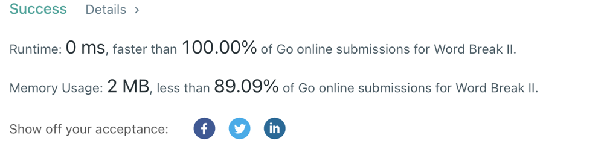

# Golang. Backtracking. 0ms. Easy and clean

**Author:** sobik
**Votes:** 4
**Link:** [https://leetcode.com/problems/word-break-ii/solutions/2380480/](https://leetcode.com/problems/word-break-ii/solutions/2380480/)

---


```
func wordBreak(s string, wordDict []string) []string {

	result := []string{}

	var backtracking func(phrase string, startIndex int)

	backtracking = func(phrase string, startIndex int) {
		str := s[startIndex:]
		for _, w := range wordDict {
			if w == str { 
				finalPhrase := fmt.Sprintf("%s %s", phrase, w) 
				result = append(result, finalPhrase)
			} else if strings.HasPrefix(str, w) {
				newPhrase := fmt.Sprintf("%s %s", phrase, w)
				backtracking(newPhrase, startIndex + len(w))
			}
		}
	}
	
	for _, w := range wordDict {
		if w == s {
			result = append(result, w)
		} else if strings.HasPrefix(s, w) {
			backtracking(w, len(w))
		}	
	}
	return result
}
```
