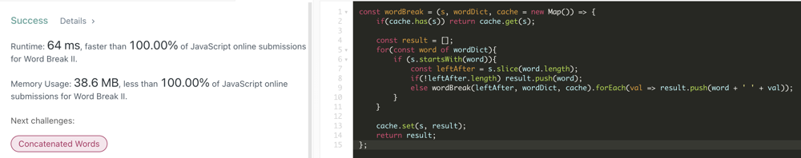

# Clean, simple JavaScript with explanation / walkthrough.  100% | 100%

**Author:** casmith1987
**Votes:** 20
**Link:** [https://leetcode.com/problems/word-break-ii/solutions/1087111/](https://leetcode.com/problems/word-break-ii/solutions/1087111/)

---



EDIT: This problem came up for me again recently and I couldn't remember my exact code when I solved it the first time.  I think the code I wrote the second time around is easier to understand, so I'm including it right below this edit.  I slightly overcomplicated this one on the first go with the .forEach stuff.  Knowing the basic approach let me write a simpler solution this time around.  There's also a one-liner at the very bottom because I was bored. lol

```
const wordBreak = (s, wordDict, cur = [], res = []) => {
  if (!s.length) return res.push(cur.join(' '));
  for (let word of wordDict) {
    if (!s.startsWith(word)) continue;
    cur.push(word);
    wordBreak(s.slice(word.length), wordDict, cur, res);
    cur.pop();
  }
  return res;
}
```

TestCase: s = 'catsanddog', wordDict = ['cat', 'cats', 'and', 'sand', 'dog']

We begin by initializing a new hash map in the arguments.  From there, algorithm checks to see if current string is in hashmap.  First time it runs, it's obviously empty.  In fact, the first time a word is added, it will be the last word.  In this case -> {'dog': ['dog']} will be first entry.  This entry seems pointless, but from here, it will pop back up to last call 'sanddog'.  Sand was the word found on this round of iterations, so {'sanddog': ['sand dog']} is the next entry, and so on back up until the initial call.  In this way, it will take the initial input string and recursively build up the hash map from smallest components until eventually {'catsanddog': ['cat sand dog', 'cats and dog'].

In order to do this recursively, we take the initial string and loop through the dictionary.  We check the first word in the dictionary - cat and check if 'catsanddog' starts with that word.  It does, so we initialize a new variable to equal what is left of the string - 'sanddog'.  We then check if this new leftAfter string's length is === 0 (Or !leftAfter.length.  This is the same as leftAfter.length === 0 since 0 is a false-y value).  If it is, we know we have matched the entire string.  If not, we call the function again on the new string.  This time the 'leftAfter' string = 'sanddog'.  Loop matches 'sand', leftAfter is dog.  Function runs again with 'dog' as the argument.  'Dog' matches in loop, leftAfter.length === 0.  {'dog':['dog']} is set.  On the 'sanddog' level of the recursion call (back on this one since dog found the end of the string and fully finished its execution) 'sand' is the current word. else wordBreak('dog', wordDict, cache) runs and returns ['dog']. For each loop runs on this array and pushes 'sand' + ' ' + 'dog' to result.  cache is set with 'sanddog': ['sand dog'].  In this way, we recurse down to the smallest word and build the combinations up until the full string has been constructed in this manner.  
```
const wordBreak = (s, wordDict, cache = new Map()) => {
    if(cache.has(s)) return cache.get(s);
	    
    const result = [];
    for(const word of wordDict){
        if (s.startsWith(word)){
            const leftAfter = s.slice(word.length);
            if(!leftAfter.length) result.push(word);
            else wordBreak(leftAfter, wordDict, cache).forEach(val => result.push(word + ' ' + val));
        }
    }
    
    cache.set(s, result);
    return result;
};
```

First function call:  'catsanddog'  loop through dictionary finds two matches. 'cat' and 'cats'.
	Leftovers = 'sanddog' and 'anddog'.

Function runs on both of these in first level of recursive calls.  
	'sanddog' matches 'sand'.  leftAfter = 'dog' 
	'anddog' matches 'and'.  leftAfter = 'dog'
	
Function runs on 'dog' twice in next level of recursive calls.
	'dog' matches 'dog'.  results = [dog]. leftAfter = ''.  dog is added to memo and the second time this recursive call is ran, it is found.
	['dog'] returned to call above.
	
Above 'sanddog' call with 'sand' as current word and ['dog'] returned as potential matches for leftAfter.  ForEach loop runs on ['dog'].
'sand dog' is pushed to results.

In same fashion, 'anddog' pushes ['and dog'] to results.  Both of these are added to memo and returned to calls above.

Back on first call - words matched were 'cat' and 'cats'. 
	['sand dog'] is returned from recursive (sanddog) call.  forEach runs and adds 'cat sand dog' to results.
	['and dog'] is returned from recursive (anddog) call.  forEach runs and adds 'cats and dog' to results.
	
Results are returned.


One-liner:
```
const wordBreak=(s,w,c,a=[])=>s?!(w.forEach(n=>s.startsWith(n)&&wordBreak(s.slice(n.length),w,c?`${c} ${n}`:n,a)))&&a:a.push(c)
```

Cool trie solution just because I've been practicing trie problems lately:
```
const wordBreak = (s, words) => {
  const trie = words.reduce((trie, word) => {
    let runner = trie
    for (let char of word) {
      runner = runner[char] = runner[char] || {}
    }
    runner.end = word
    return trie
  }, {})
  
  const ans = new Array(s.length + 1).fill(false)
  ans[0] = ['']
  for (let i = 0; i < s.length + 1; i++) {
    if (!ans[i]) continue
    let runner = trie, runIdx = i + 1
    while (runner) {
      const char = s[runIdx - 1]
      runner = runner[char]
      if (runner && runner.end) {
        ans[runIdx] = ans[runIdx] || []
        ans[i].forEach(arr => ans[runIdx].push([...arr, runner.end]))
      }
      runIdx++
    }
  }
  return ans[s.length] ? ans[s.length].map(words => words.join(' ')) : []
}
```