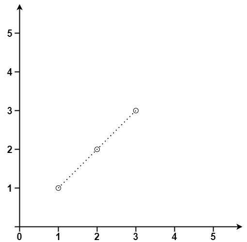

# [149. Max Points on a Line](https://leetcode.com/problems/max-points-on-a-line/)

| Category | Difficulty | Likes | Dislikes |
| :------: | :--------: | :---: | :------: |
| Algorithms | Hard | 4457 | 574 |

**Tags:** [`array`](https://leetcode.com/tag/array), [`hash-table`](https://leetcode.com/tag/hash-table), [`math`](https://leetcode.com/tag/math), [`geometry`](https://leetcode.com/tag/geometry)

**Companies:** `sprinklr`, `facebook`, `microsoft`, `linkedin`, `amazon`, `google`, `bloomberg`, `cisco`, `zoox`, `nvidia`, `apple`, `twitter`

## Description

Given an array of `points` where `points[i] = [x_i, y_i]` represents a point on the **X-Y** plane, return *the maximum number of points that lie on the same straight line*.

 

**Example 1:**


```

Input: points = [[1,1],[2,2],[3,3]]
Output: 3

```

**Example 2:**


```

Input: points = [[1,1],[3,2],[5,3],[4,1],[2,3],[1,4]]
Output: 4

```

 

**Constraints:**

	- `1 <= points.length <= 300`

	- `points[i].length == 2`

	- `-10^4 <= x_i, y_i <= 10^4`

	- All the `points` are **unique**.

---

**Links:** [Submissions](https://leetcode.com/problems/max-points-on-a-line/) | [Solutions](https://leetcode.com/problems/max-points-on-a-line/)
