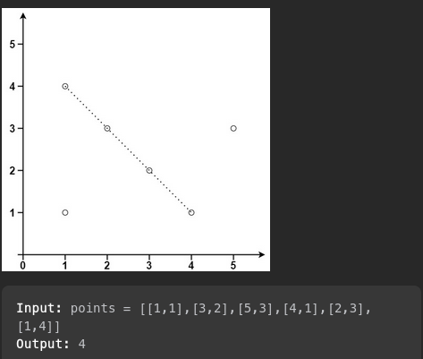
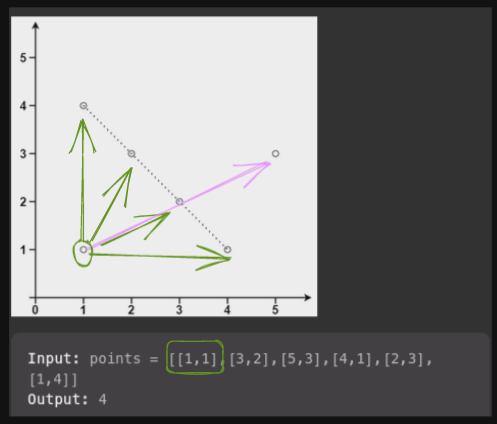
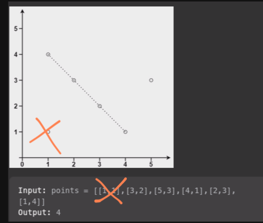
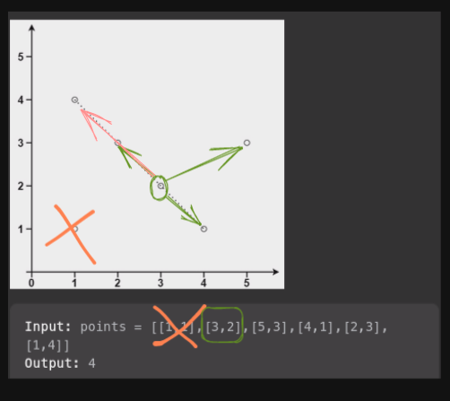
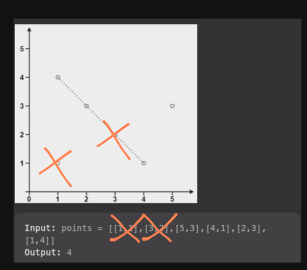

# Ruby solution (T: 104 ms - 100%, M: 213.7 MB - 100%)

**Author:** ozovalihasan
**Votes:** 2
**Link:** [https://leetcode.com/problems/max-points-on-a-line/solutions/3019118/](https://leetcode.com/problems/max-points-on-a-line/solutions/3019118/)

---

# Approach
Select one point. Then, find the slope between this point and other points. Then, count the same slopes and take the maximum count by adding 1. 

Repeat the same procedure for each points.

Lastly, the result is the maximum of the values found.

---

The previous steps are enough to solve this challenge, but let me add a few optimizations.

Let's continue with an example given in the description.

 


Let's start the procedure by selecting one of them.



Now, we have `slope = 2` for two times. And we are adding 1 to these value; `2 + 1 => 1`. Lastly, it is possible to remove the selected point from `points` array because we found the max value if this point is on the line having maximum points. This is the first optimization.



Let's continue with the next loop.



Now, we have `slope = -1` for three times. So, the result for this loop is `3 + 1 => 4`.



Now, we don't need to continue because we have 4 points to check. But, let's say all of them are on the same line, the result for the next loop will be 4  at most. Currently, we have found 4 as result of one of previous loops. This is the second optimization.

# Code
```
# @param {Integer[][]} points
# @return {Integer}
def max_points(points)
  return points.size if points.size <= 2

  points_found = 0
  until points[points_found].nil?
    point1 = points.pop

    slopes = Hash.new(0)
    points.each { |point2| slopes[ slope(point1, point2) ] += 1 }
    
    points_found = [points_found, slopes.values.max + 1].max
  end    

  points_found 
end

def slope(point1, point2)
  return Float::INFINITY if point1.first == point2.first

  (point1.last - point2.last) / (point1.first - point2.first).to_f
end
```