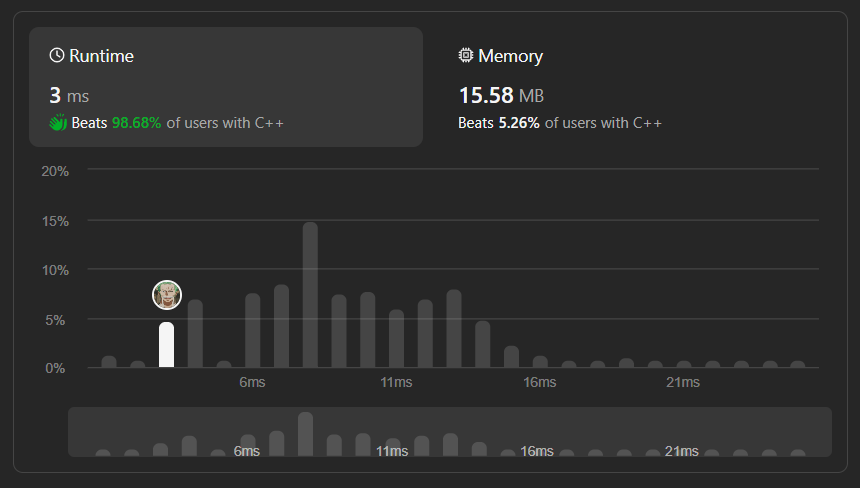

# ✅☑Beats 98.68% Users || [C++/Java/Python/JavaScript] || EXPLAINED🔥

**Author:** MarkSPhilip31
**Votes:** 100
**Link:** [https://leetcode.com/problems/evaluate-reverse-polish-notation/solutions/4646163/](https://leetcode.com/problems/evaluate-reverse-polish-notation/solutions/4646163/)

---

# PLEASE UPVOTE IF IT HELPED

---



---

# Approaches
(Also explained in the code)

1. **Stack for Operand Storage:** Use a stack to store operands while iterating through the given list of tokens. When encountering an operand, push it onto the stack.

1. **Operator Handling:** When encountering an operator, pop the top two operands from the stack, apply the operator, and push the result back onto the stack.

1. **Numeric Token Detection:** Check whether the token is a numeric value or an operator. If it is a numeric value, convert it to a long and push it onto the stack.

1. **Resolving Operations:** Define a helper function (`resolves`) to handle the arithmetic operations based on the encountered operator. Perform the operation on the top two operands and push the result back onto the stack.

1. **Final Result:** After processing all tokens, the final result will be the only remaining element on the stack. Return this value as the result of the evaluation.


# Complexity
- Time complexity:
   $$O(n)$$
    

- Space complexity:
   $$O(n)$$
    


# Code
```C++ []

class Solution {

    long resolves(int a, int b, char Operator){
        if(Operator == '+') return a + b;
        else if(Operator == '-') return a - b;
        else if(Operator == '*') return (long)a*b;
        return a/b;
    }
public:
    int evalRPN(vector<string>& tokens) {
        stack<long> Stack;
        int n = tokens.size();
        for(int i = 0; i < n; i++){

            if(tokens[i].size() == 1 and tokens[i][0] < 48){
                long integer2 = Stack.top();
                Stack.pop();
                long integer1 = Stack.top();
                Stack.pop();
                
                string Operator = tokens[i];
                long resolvedAns = resolves(integer1, integer2 , Operator[0]);
                Stack.push(resolvedAns);
            }else 
                Stack.push(stol(tokens[i]));
        }
        return Stack.top();
    }
};


```
```Java []

class Solution {
    long resolves(long a, long b, char Operator) {
        if (Operator == '+') return a + b;
        else if (Operator == '-') return a - b;
        else if (Operator == '*') return a * b;
        return a / b;
    }

    public int evalRPN(String[] tokens) {
        Stack<Long> stack = new Stack<>();
        int n = tokens.length;
        for (int i = 0; i < n; i++) {
            if (tokens[i].length() == 1 && tokens[i].charAt(0) < 48) {
                long integer2 = stack.pop();
                long integer1 = stack.pop();
                char operator = tokens[i].charAt(0);
                long resolvedAns = resolves(integer1, integer2, operator);
                stack.push(resolvedAns);
            } else {
                stack.push(Long.parseLong(tokens[i]));
            }
        }
        return stack.pop().intValue();
    }
}

```
```python3 []
class Solution:
    def resolves(self, a, b, Operator):
        if Operator == '+':
            return a + b
        elif Operator == '-':
            return a - b
        elif Operator == '*':
            return a * b
        return int(a / b)

    def evalRPN(self, tokens):
        stack = []
        for token in tokens:
            if len(token) == 1 and ord(token) < 48:
                integer2 = stack.pop()
                integer1 = stack.pop()
                operator = token
                resolved_ans = self.resolves(integer1, integer2, operator)
                stack.append(resolved_ans)
            else:
                stack.append(int(token))
        return stack.pop()


```
```javascript []
class Solution {
    resolves(a, b, Operator) {
        if (Operator === '+') return a + b;
        else if (Operator === '-') return a - b;
        else if (Operator === '*') return a * b;
        return Math.trunc(a / b);
    }

    evalRPN(tokens) {
        const stack = [];
        for (const token of tokens) {
            if (token.length === 1 && token.charCodeAt(0) < 48) {
                const integer2 = stack.pop();
                const integer1 = stack.pop();
                const operator = token;
                const resolvedAns = this.resolves(integer1, integer2, operator);
                stack.push(resolvedAns);
            } else {
                stack.push(parseInt(token, 10));
            }
        }
        return stack.pop();
    }
}


```
---


# PLEASE UPVOTE IF IT HELPED

---
---


---