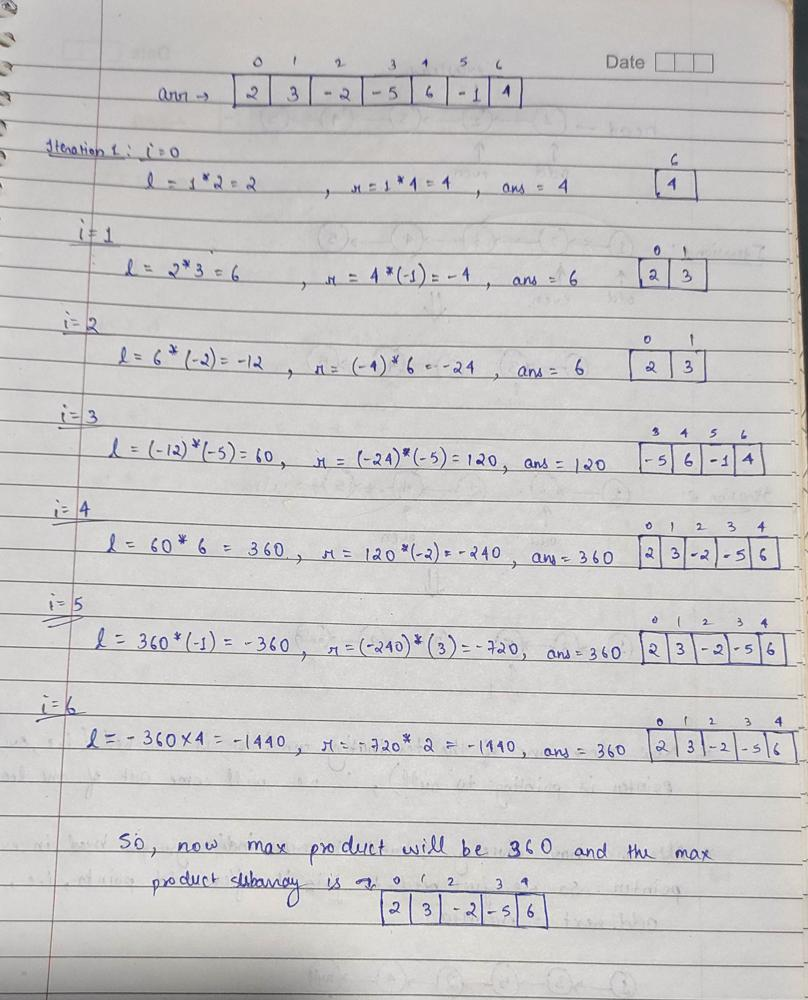

# JAVA | 3 Solutions | Detailed Explanation Using Image

**Author:** Chaitanya1706
**Votes:** 742
**Link:** [https://leetcode.com/problems/maximum-product-subarray/solutions/1608862/](https://leetcode.com/problems/maximum-product-subarray/solutions/1608862/)

---

**Intution:** Since we have to find the contiguous subarray having maximum product then your approach should be combination of following three cases :
* **Case1 :- All the elements are positive :** Then your answer will be product of all the elements in the array.
* **Case2 :- Array have positive and negative elements both :**
	1. 	If the number of negative elements is even then again your answer will be complete array because on multiplying all the negative numbers it will become positive.
	2. 	If the number of negative elements is odd then you have to remove just one negative element and for that u need to check your subarrays to get the max product.
* **Case3 :- Array also contains 0 :** Then there will be not much difference...its just that your array will be divided into subarray around that 0. What u have to so is just as soon as your product becomes 0 make it 1 for the next iteration, now u will be searching new subarray and previous max will already be updated.
*(These cases are much clear in approach 3)


** As it is said "Talk is Cheap, Show me the Code", so based on above discussion we can frame our code in many different ways, out of which I have mentioned 3 intutive approaches.

**Approach 1:** For each index i keep updating the max and min. We are also keeping min because on multiplying with any negative number your min will become max and max will become min. So for every index i  we will take max of (i-th element, prevMax * i-th element, prevMin * i-th element).

```
class Solution {
    public int maxProduct(int[] nums) {
        
        int max = nums[0], min = nums[0], ans = nums[0];
        
        for (int i = 1; i < nums.length; i++) {
            
            int temp = max;  // store the max because before updating min your max will already be updated
            
            max = Math.max(Math.max(max * nums[i], min * nums[i]), nums[i]);
            min = Math.min(Math.min(temp * nums[i], min * nums[i]), nums[i]);
            
            if (max > ans) {
                ans = max;
            }
        }
        
        return ans;

    }
}
```

**Approach 2:** Just the slight modification of previous approach. As we know that on multiplying with negative number max will become min and min will become max, so why not as soon as we encounter negative element, we swap the max and min already.

```
class Solution {
    public int maxProduct(int[] nums) {
        
        int max = nums[0], min = nums[0], ans = nums[0];
        int n = nums.length;
        
        for (int i = 1; i < n; i++) {
        
			// Swapping min and max
            if (nums[i] < 0){
                int temp = max;
                max = min;
                min = temp;
            }
                


            max = Math.max(nums[i], max * nums[i]);
            min = Math.min(nums[i], min * nums[i]);


            ans = Math.max(ans, max);
        }
        
        return ans;

    }
}
```

**Approach 3:** Two pointer Approach
Explanation : 
1.) Through intution explanation we know that if all the elements are positive or the negative elements are even then ur answer will be product of complete array which u will get in variable l and r at the last iteration.
2.) But if negative elements are odd then u have to remove one negative element and it is sure that it will be either right of max prefix product or left of max suffix product. So u need not to modify anything in your code as u are getting prefix product in l and suffix prduxt in r.
3.) If array also contains 0 then your l and r will become 0 at that point...then just update it to 1(or else u will keep multiplying with 0)  to get the product ahead making another subarray.



```
class Solution {
    public int maxProduct(int[] nums) {
        
        int n = nums.length;
        int l=1,r=1;
        int ans=nums[0];
        
        for(int i=0;i<n;i++){
            
			//if any of l or r become 0 then update it to 1
            l = l==0 ? 1 : l;
            r = r==0 ? 1 : r;
            
            l *= nums[i];   //prefix product
            r *= nums[n-1-i];    //suffix product
            
            ans = Math.max(ans,Math.max(l,r));
            
        }
        
        return ans;

    }
}
```

Thanks for giving it a read...I hope it helped u!!