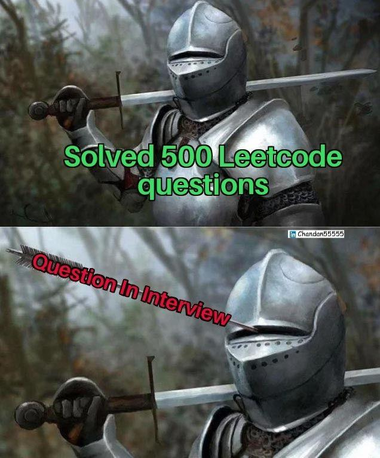

# ✅100% 0ms |🔥8 LINER CODE🔥| with proof | Easy MAHIYA se SHAVA| JAVA | C++ | JS | PHP | All in ONE ✅

**Author:** _Torpedo_
**Votes:** 19
**Link:** [https://leetcode.com/problems/find-minimum-in-rotated-sorted-array-ii/solutions/4881165/](https://leetcode.com/problems/find-minimum-in-rotated-sorted-array-ii/solutions/4881165/)

---


# Intuition
Use modified Binary Search.
i.e. after finding middle element check if only right side is sorted completely or if only left side is sorted.
i.e. if middle element is smaller than last element, then right is sorted , else left is sorted.
The smallest element will lie in the unsorted side because the sorted elements have rotated in that region only. 
REPEAT.

# Approach
`  Note : [element_index] = means the element at index [element_index]`

First find the middle element. 
Now, we need to check which side of [m] is sorted completely i.e. if left is sorted, then the smallest element is on right side and vice versa. So, if [m] <= [e] i.e. middle element <= end element i.e. right is completely sorted so we need to find in left of [m] therefore e = m . 
Else, s = m + 1 i.e. the smallest element is in right side.
REPEAT till s < e and return [s]

`EDGE-CASE : since array may contain dupicates ->`

Now if [m] = [s] = [e] i.e. first, last and middle element are same, we can't tell whether left/ right side of [m] is completely sorted so we decreement e by 1 and increement s by 1 so to reduce the array to be searched. Only this edge case leads to the worst case of O(n/2) = O(n).



# Complexity
- Time complexity: Average: $$\u03B8(log N) $$ in worst case : $$O(N/2)$$
- Space complexity: $$O(1)$$

# Code
```JAVA []
class Solution {
    public int findMin(int[] nums) {
        int s = 0 , e = nums.length - 1, m ;
        while ( s < e ){
            m = s + (e - s ) / 2 ;
            if ( nums[m] == nums[s] && nums[m] == nums[e]){
                s++;    e--;
            }
            else if (nums[m] <= nums[e])   e = m ;
            else     s = m + 1 ;
        }
        return nums [s] ;
    }
}
```
```C++ []
class Solution {
public:
    int findMin(vector<int>& nums) {
        int s = 0 , e = nums.size() - 1, m ;
        while ( s < e ){
            m = s + (e - s ) / 2 ;
            if ( nums[m] == nums[s] && nums[m] == nums[e]){
                s++;        e--;
            }
            else if (nums[m] <= nums[e])   e = m ;
            else        s = m + 1 ;
        }
        return nums [s] ;
    }
};
```
```JavaScript []
//Note: U need to add Math.floor function while calculating [mid] since JS doesn't implicitly typecast floating no. which may result in unexpected output
var findMin = function(nums) {
    let s = 0 , e = nums.length - 1, m ;
        while ( s < e ){
            m = Math.floor(s + (e - s ) / 2) ;
            if ( nums[m] == nums[s] && nums[m] == nums[e]){
                s++;        e--;
            }
            else if (nums[m] <= nums[e])   e = m ;
            else        s = m + 1 ;
        }
        return nums [s] ;
};
```
```PHP []
class Solution {

    /**
     * @param Integer[] $nums
     * @return Integer
     */
    function findMin($nums) {
        $s = 0 ; $e = count($nums) - 1; $m ;
        while ( $s < $e ){
            $m = floor($s + ($e - $s ) / 2) ;
            if ( $nums[$m] == $nums[$s] && $nums[$m] == $nums[$e]){
                $s++;
                $e--;
            }
            else if ($nums[$m] <= $nums[$e])   $e = $m ;
            else        $s = $m + 1 ;
        }
        return $nums [$s] ;
    }
}
```

P.S. If you found any mistake, error or faced any problem in understanding or running, please let me know and I will be glad to help.
Till time keep coding. Unsudrablez Out !!
