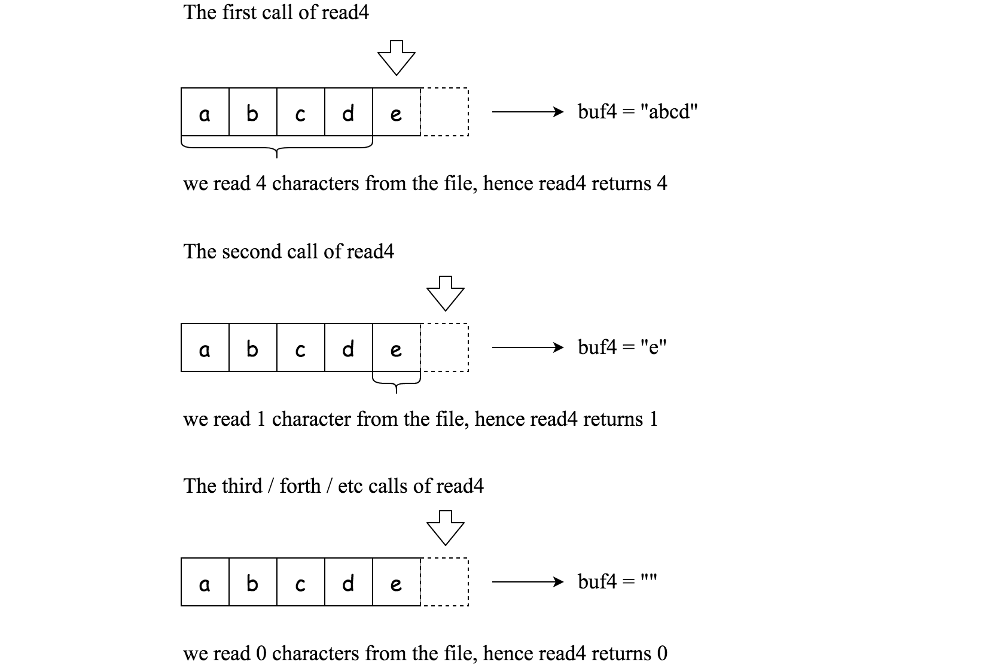

# [157. Read N Characters Given Read4](https://leetcode.com/problems/read-n-characters-given-read4/)

| Category | Difficulty | Likes | Dislikes |
| :------: | :--------: | :---: | :------: |
| Algorithms | Easy | 601 | 3598 |

**Tags:** [`array`](https://leetcode.com/tag/array), [`simulation`](https://leetcode.com/tag/simulation), [`interactive`](https://leetcode.com/tag/interactive)

**Companies:** `apple`, `google`, `amazon`, `facebook`

## Description

Given a `file` and assume that you can only read the file using a given method `read4`, implement a method to read `n` characters.

**Method read4: **

The API `read4` reads **four consecutive characters** from `file`, then writes those characters into the buffer array `buf4`.

The return value is the number of actual characters read.

Note that `read4()` has its own file pointer, much like `FILE *fp` in C.

**Definition of read4:**

```

    Parameter:  char[] buf4
    Returns:    int

buf4[] is a destination, not a source. The results from read4 will be copied to buf4[].

```

Below is a high-level example of how `read4` works:


```

File file(&quot;abcde&quot;); // File is &quot;abcde&quot;, initially file pointer (fp) points to &#39;a&#39;
char[] buf4 = new char[4]; // Create buffer with enough space to store characters
read4(buf4); // read4 returns 4. Now buf4 = &quot;abcd&quot;, fp points to &#39;e&#39;
read4(buf4); // read4 returns 1. Now buf4 = &quot;e&quot;, fp points to end of file
read4(buf4); // read4 returns 0. Now buf4 = &quot;&quot;, fp points to end of file

```

 

**Method read:**

By using the `read4` method, implement the method read that reads `n` characters from `file` and store it in the buffer array `buf`. Consider that you cannot manipulate `file` directly.

The return value is the number of actual characters read.

**Definition of read: **

```

    Parameters:	char[] buf, int n
    Returns:	int

buf[] is a destination, not a source. You will need to write the results to buf[].

```

**Note:**

	- Consider that you cannot manipulate the file directly. The file is only accessible for `read4` but not for `read`.

	- The `read` function will only be called once for each test case.

	- You may assume the destination buffer array, `buf`, is guaranteed to have enough space for storing `n` characters.

 

**Example 1:**

```

Input: file = &quot;abc&quot;, n = 4
Output: 3
Explanation: After calling your read method, buf should contain &quot;abc&quot;. We read a total of 3 characters from the file, so return 3.
Note that &quot;abc&quot; is the file&#39;s content, not buf. buf is the destination buffer that you will have to write the results to.

```

**Example 2:**

```

Input: file = &quot;abcde&quot;, n = 5
Output: 5
Explanation: After calling your read method, buf should contain &quot;abcde&quot;. We read a total of 5 characters from the file, so return 5.

```

**Example 3:**

```

Input: file = &quot;abcdABCD1234&quot;, n = 12
Output: 12
Explanation: After calling your read method, buf should contain &quot;abcdABCD1234&quot;. We read a total of 12 characters from the file, so return 12.

```

 

**Constraints:**

	- `1 <= file.length <= 500`

	- `file` consist of English letters and digits.

	- `1 <= n <= 1000`

---

**Links:** [Submissions](https://leetcode.com/problems/read-n-characters-given-read4/) | [Solutions](https://leetcode.com/problems/read-n-characters-given-read4/)
