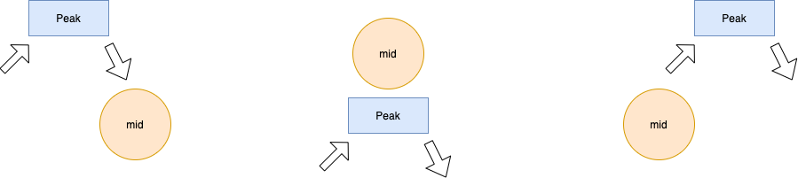

# Intuition behind conditions | Complete Explanation | Diagram | Binary Search

**Author:** Nam_22
**Votes:** 879
**Link:** [https://leetcode.com/problems/find-peak-element/solutions/1290642/](https://leetcode.com/problems/find-peak-element/solutions/1290642/)

---

Given an array, we need to find the peak element. 
As, the subportions of the array are increasing/decreasing ( only then we would be able to find peak ), there are subportions of array which are sorted, so we could use binary search to get this problem done. But exactly how ? 

This is an interesting part.

For a mid element, there could be three possible cases : 



Case 1 : mid lies on the right of our result peak ( Observation : Our peak element search space is leftside )
Case 2 : mid is equal to the peak element ( Observation : mid element is greater than its neighbors )
Case 3 : mid lies on the left. ( Observation : Our peak element search space is rightside )

so, the code becomes 

```
int start = 0;
int end = n-1;

while(start <= end) {
	int mid = start + (end - start)/2;
	if(nums[mid] > nums[mid-1] && nums[mid] > nums[mid+1]) return mid;   // if mid == peak ( case 2 )
	else if(nums[mid] < nums[mid-1]) end = mid - 1; // downward slope and search space left side ( case 1)
	else if(nums[mid] < nums[mid+1]) start = mid + 1; // upward slope and search space right side ( case 3 )
}
```

Some base cases : 

The array could be strictly increasing or strictly decreasing and as we have to return any of the possible peaks, so we could add a condition to check whether the 1st element/last element could be the peak ). This point is also supported by the fact that, we are looking for mid-1/ mid+1 ( and these indices are compremised for 0th index / n-1 th index respectively.

So, our complete code becomes 

```

		if(nums.length == 1) return 0; // single element
        
        int n = nums.length;
        
		// check if 0th/n-1th index is the peak element
        if(nums[0] > nums[1]) return 0;
        if(nums[n-1] > nums[n-2]) return n-1;
		
		// search in the remaining array
        int start = 1;
        int end = n-2;
        
        while(start <= end) {
            int mid = start + (end - start)/2;
            if(nums[mid] > nums[mid-1] && nums[mid] > nums[mid+1]) return mid;
            else if(nums[mid] < nums[mid-1]) end = mid - 1;
            else if(nums[mid] < nums[mid+1]) start = mid + 1;
        }
        return -1; // dummy return statement
```