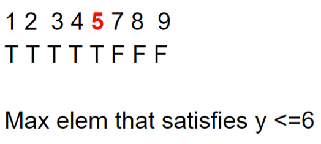
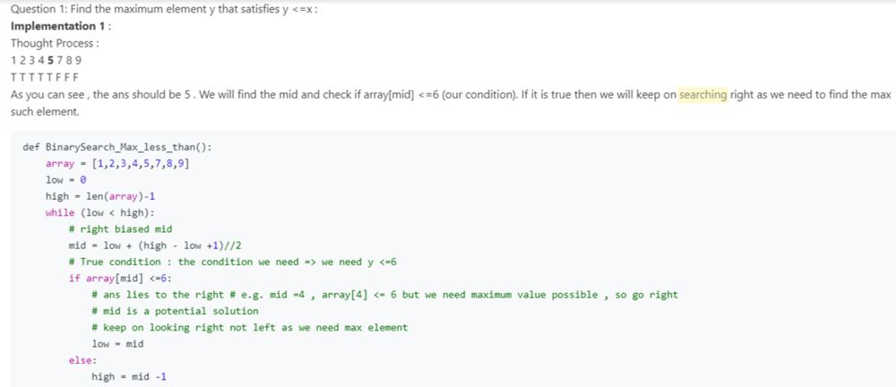
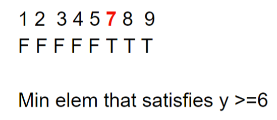
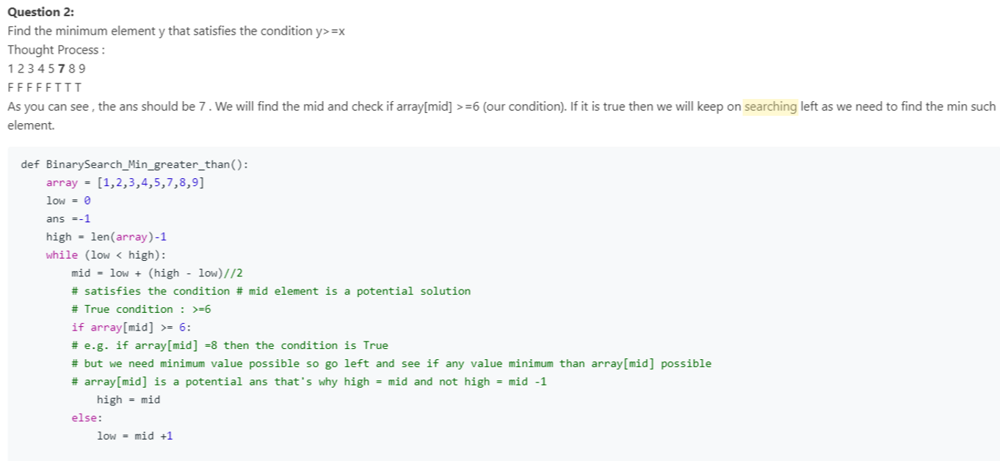
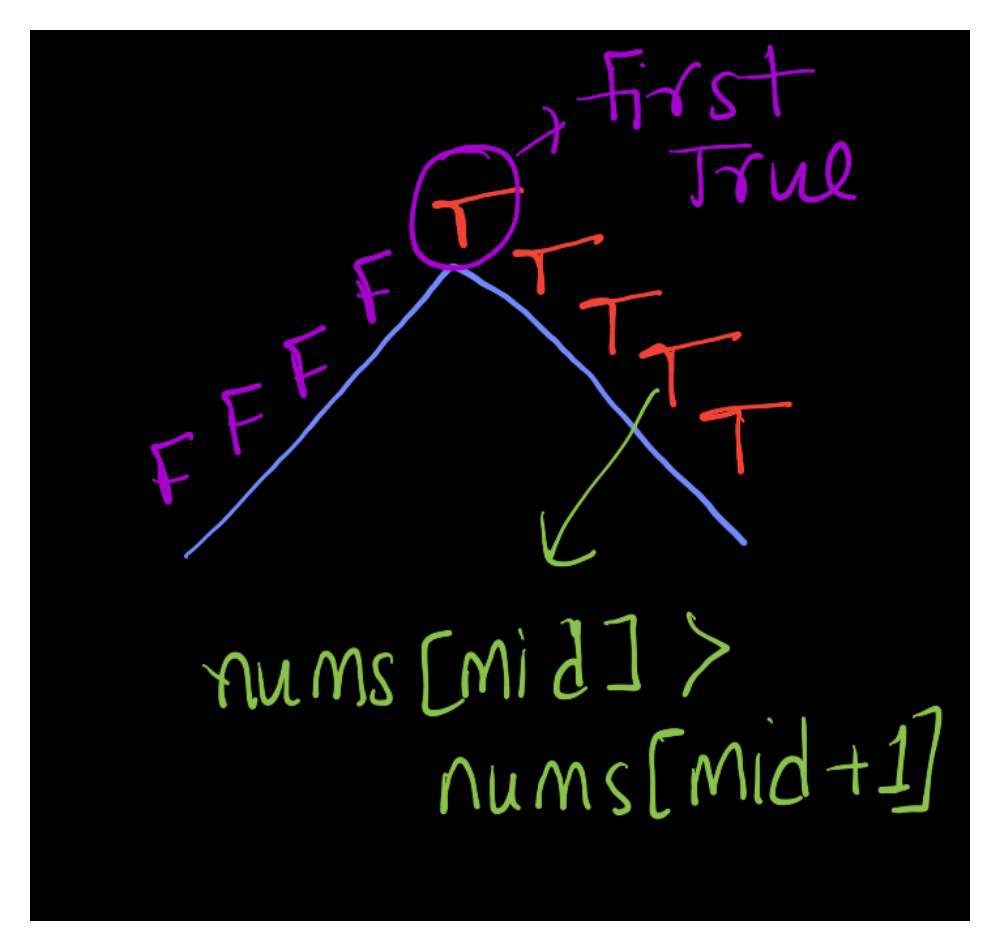
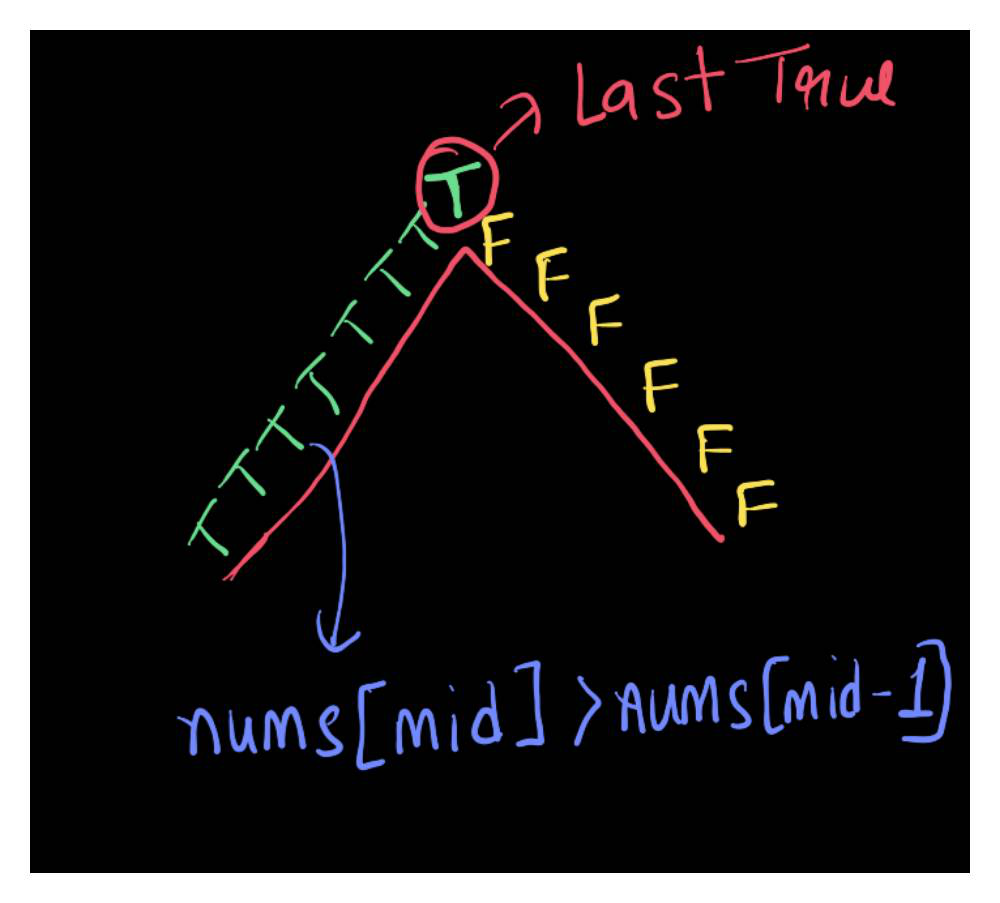
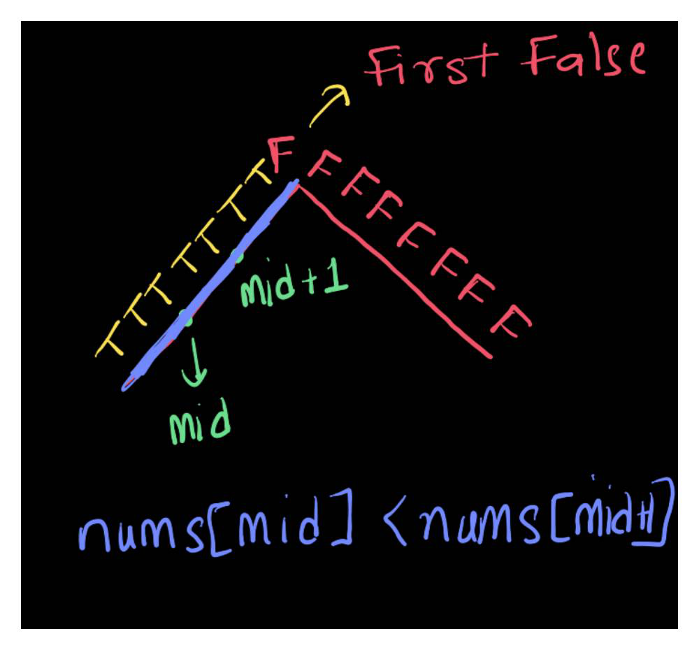
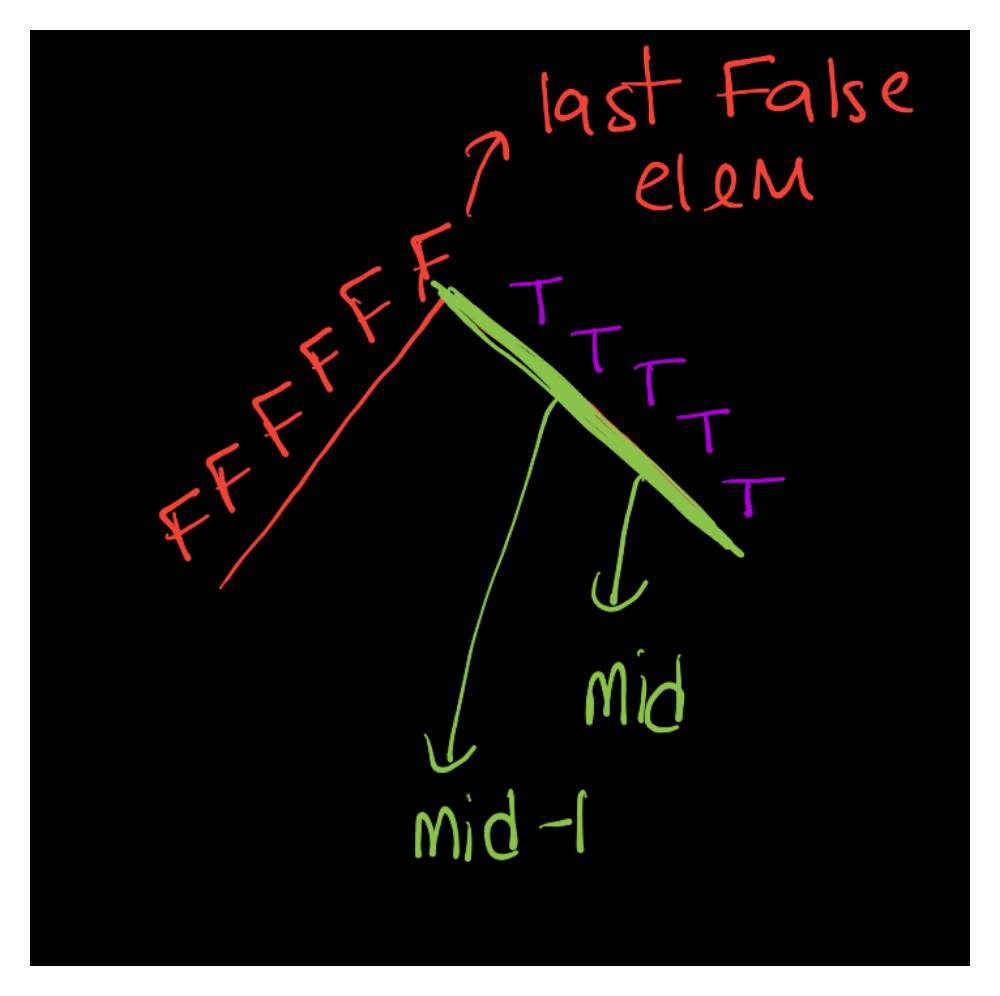

# General Binary Search Thought Process : 4 Templates

**Author:** user8301z
**Votes:** 125
**Link:** [https://leetcode.com/problems/find-peak-element/solutions/788474/](https://leetcode.com/problems/find-peak-element/solutions/788474/)

---

***Scroll down to the end to check the solution to this question using all 4 templates***
Binary Search can be applied to a problem where we can find a function(if condition of the code) that map elements in left half to True and the other half to False or vice versa . **Don't think it is just for the sorted array**  (Refer here :https://www.youtube.com/watch?time_continue=67&v=GU7DpgHINWQ&feature=emb_logo)

Pattern : T T T T T F F F 



**Note: y<=6 is a condition**







Now a Binary Search can be solved using 4 Templates: You can try solving all Binary Search questions using just one template. 
1. **Find the *First True***:

	**T** T T T T F F F or F F F F **T** T T T
	We always try to go the left when finding the First True and the template will be like :
	
	```
	while left < right :
		if condition is true:
			right = mid 
		else:
			left = mid +1
	```
	
      **Thought Process for this template :**  For FFFFTTTT, if mid is second last True , then it is a possible ans but we need to keep searching left because we want First True or minimal True for it . We move to left part by doing right = mid where mid is a potential solution and throw away the right part

2. **Find the *Last True***:

	T T T T **T** F F F or  F F F F T T T T **T**
	
	We always try to go the right when finding the Last True and the template will be like :
	
	```
	while left < right :
		if condition is true:
			left = mid 
		else:
			right = mid - 1
	```
	
    **Thought Process for this template :**  For T T T T T F F F, if mid is First True , then it is a possible ans but we need to keep searching right because we want Last True or Maximal True for it . We move to right half  by doing left = mid where mid is a potential solution and throw away the left part
	
3. **Find the *First False***:
T T T T T **F** F F or  **F** F F F T T T T 
	```
	while left < right:
		if condition is False: 
			left = mid +1
		else:
			right = mid
	```
    **Thought Process this template :**  For T T T T T F F F, if mid is at Last False , then it is a possible ans but we need to keep searching left because we want First False or Minimal False for it . 

4.  **Find the *Last False*:**
T T T T T F F **F**  or F F F F **F** T T T
	```
	while left < right:
		if condition is False: 
			right  = mid -1
		else:
			left = mid
	```
     **Reason for this template :**  For  F F F F F T T T , if mid is second False , then it is a possible ans but we need to keep searching right because we want Last False or Maximal False for it .

You have to change the condition in the "if statement" such that the problem is converted to one of the problem above. You can stick to one template if you want like always finding the First true . Now this "condition" in "if statement" can be the one which question is asking or it can be the opposite of it .

----------------------------------------------------------------------------------------------------------------------------
## **Current Problem** : Find Peak Element : 

**Condition for this question** : We know a elem at index i is a peak elem , if its left and right neighbours are smaller than it i.e. **nums[i] > nums[i-1] and nums[i] > nums[i+1]**

**Now Lets solve this question using all the 4 templates above:**
1. **Find First True** :
In order to convert this problem to F F F F T T T T   where the ans(finding peak in this question) will be the First True , we need to come up with condition like ***nums[i] >nums[i+1]***



```
class Solution:
    def findPeakElement(self, nums: List[int]) -> int:
        left =0
        right = len(nums)-1
        while left < right:
            mid = left + (right - left ) //2
            if nums[mid] > nums[mid+1]: # True Condition # Dec function # go left # Find First True i.e first elem where this condition will be True
                right = mid # include mid # mid is potential solution 
            else:
                left = mid +1
        return left
```
2. **Find Last True:** . In order to convert this problem to T T T T T F F F where the ans will be the Last True , we need to come up with condition like ***nums[i] > nums[i-1]***


```
class Solution:
    def findPeakElement(self, nums: List[int]) -> int:
        left =0
        right = len(nums)-1
        while left < right:
            mid = left + (right - left + 1) //2 # Right biased mid as left = mid in else condition # prevent infinite loop
            if nums[mid] > nums[mid-1]: # True condition # go right # inc function # Last True 
                left = mid # mid is a potential elem
            else:
                right = mid -1
        return left
```

3. **Find First False :** You have to use a condition in if statement which is opposite of what question is asking . 
**Opposite Conditions :**   nums[i] < nums[i+1] or nums[i] < nums[i-1].
For first False , we will use nums[i] < nums[i+1]
When nums[i] < nums[i+1], it means it is the increasing slope and all elems n this inc slope will pass this condition i.e. They will be True. Our Ans will be the first false.(In else condition , we are storing the potential ans in "right"var and when loop ends , we can return that)


```
class Solution:
    def findPeakElement(self, nums: List[int]) -> int:
        left =0
        right = len(nums)-1
        while(left < right):
            mid = left +(right-left)//2
            if nums[mid] <  nums[mid+1]: # False Condition # inc function # go right # Find First False
			# i.e. find First elem when this if will be false
                left = mid+1 # exclude mid 
            else: 
                right = mid
        return left
```
*  **Find Last False**  : nums[i] < nums[i-1]


```

class Solution:
    def findPeakElement(self, nums: List[int]) -> int:
        left =0
        right = len(nums)-1
        while(left < right):
            mid = left +(right-left+1)//2 # Right biased mid as left = mid in else condition # prevent infinite loop
            if nums[mid] < nums[mid-1]: # False condition # Dec function # go left # Find Last False i.e the Last elem for which this condition will be False 
                right = mid - 1
            else: # decreasing so peak will be before mid or it can be mid
                left = mid
        return left
```

