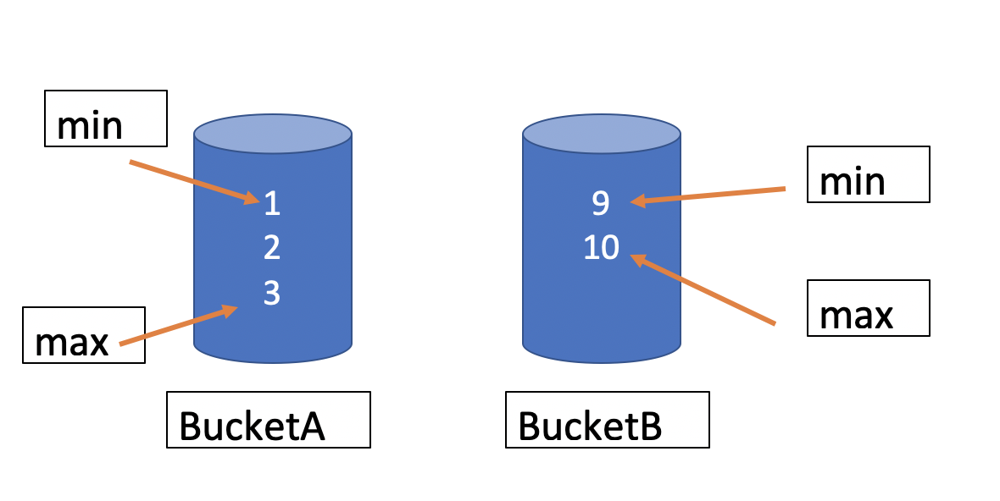
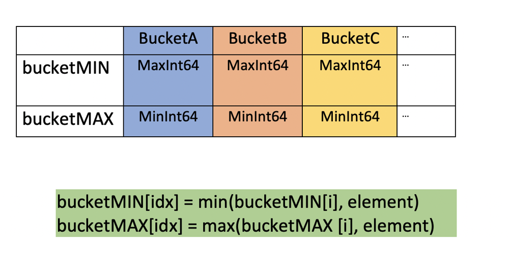
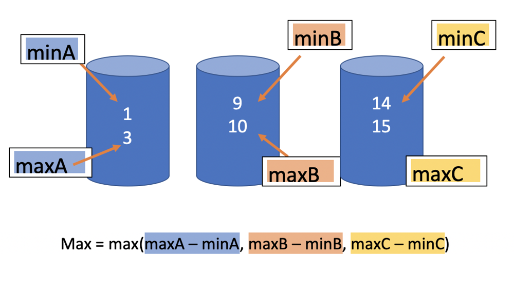

# Bucket sort solution in Golang with explanation

**Author:** Konnichiwa
**Votes:** 14
**Link:** [https://leetcode.com/problems/maximum-gap/solutions/1038791/](https://leetcode.com/problems/maximum-gap/solutions/1038791/)

---

Sort the whole array is unnecessary, we just need for loop the whole array and group  a set of elements in a way that elements in the same group are more similar (close value) to each other than to those in other groups, yeah, a bit like clustering, bucket sort can solve kind of this problem. 

After clustering, we will have many groups(called buckets), we store two elements in each bucket(the max one and the min one) because all elements in same bucket have close value, so the max gap is ```minValue(current bucket) - maxValue(previous bucket)```

Let me explain more with some examples

**NOTICE**: *In order to explain more clearly(IMHO), I made some fake data and screenshots to demonstrate how I think about this problem, that means data and screenshot may not compatible and appeared in real.*

For example, we have a array like this ```array = [1,2,9,3,10]```,  assume we have two bucket: ```bucketA``` and ```bucketB```, we retrieve each elements of array and put them into bucktes, because ```1,2,3``` are close value, so put they three into ```bucketA```, put ```9,10``` into ```bucketB```:




	
It is obviously: ```maxGap =  bucketB.min - bucketA.max```, and also,  you may see that ```2``` in ```bucketA``` is unnecessary, so we dont store it in code, each bucket has only ```2``` elements: the min one and the max one

Well, now, the question is how to clustering these elements ?

The ```average gap``` between two element should be ```(array.Max - array.Min) / (array.Size - 1)``` , the max gap here must bigger than that.

Let's calculate the ```average gap``` in ```array ([1,2,9,3,10])``` above:
 ```gap = ((2-1) + (9-2) + (3-9) + (10-3)) / (array.Size - 1)```
  ```gap = (1+7-6+7) / 4```
  ```gap = 9 / 4 = 2.25```
 well, it is equal to```(10 - 1) / 4 = 2.25``` , so if the gap between two element is bigger than ```2.25```,  it makes itself possible to be the final, maxGap.


Here are buckets we initialized, by default they have default values respecitively:



  
```idx``` is the index of buckets we should put elements into. ```idx := (array.element - min) / gap```

How many buckets I used ?  
```numOfBuckets = array.Size - 1```

Assume, our buckets are looks like this:



```Max``` is the result.

Ok, my english is not good, let see the final solution in Golang is as follows
```

func maximumGap(nums []int) int {

	size := len(nums)

	if 2 == size {
		return int(math.Abs(float64(nums[0] - nums[1])))
	}

	if size < 2 {
		return 0
	}

	// retrieve min and max of array
	min, max := nums[0], nums[0]

	for i := 1; i < size; i++ {
		if nums[i] > max {
			max = nums[i]
		} else if nums[i] < min {
			min = nums[i]
		}
	}

	// equal elements
	if min == max {
		return 0
	}

	gap := int(float64((max - min) / (size - 1))) + 1
	capacity := size - 1

	bucketMIN := make([]int, capacity)
	bucketMAX := make([]int, capacity)

	for i := 0; i < capacity; i++ {
		bucketMIN[i] = math.MaxInt64
		bucketMAX[i] = math.MinInt64
	}

	// buckets become
	// bucketMIN = { MaxInt64, MaxInt64, MaxInt64, ...}
	// bucketMAX = { MinInt64, MinInt64, MinInt64, ...}

	// put nums into buckets respectively
	for i := 0; i < size; i++ {

		num := nums[i]

		if num == max || num == min {
			continue
		}

		// index of buckets
		idx := (num - min) / gap

		bucketMIN[idx] = int(math.Min(float64(num), float64(bucketMIN[idx])))
		bucketMAX[idx] = int(math.Max(float64(num), float64(bucketMAX[idx])))
	}

	maxGap := math.MinInt64
	prev := min

	for i := 0; i < capacity; i++ {

		if bucketMIN[i] == math.MaxInt64 &&
			bucketMAX[i] == math.MinInt64 {

			// empty bucket
			continue
		}

		maxGap = int(math.Max(float64(maxGap), float64(bucketMIN[i] - prev)))
		prev = bucketMAX[i]
	}

	maxGap = int(math.Max(float64(maxGap), float64(max - prev)))
	return maxGap
}

```

Leetcode says:
```
Runtime: 4 ms, faster than 95.83% of Go online submissions for Maximum Gap.
Memory Usage: 3.7 MB, less than 25.00% of Go online submissions for Maximum Gap.
```

Thanks for reading.


